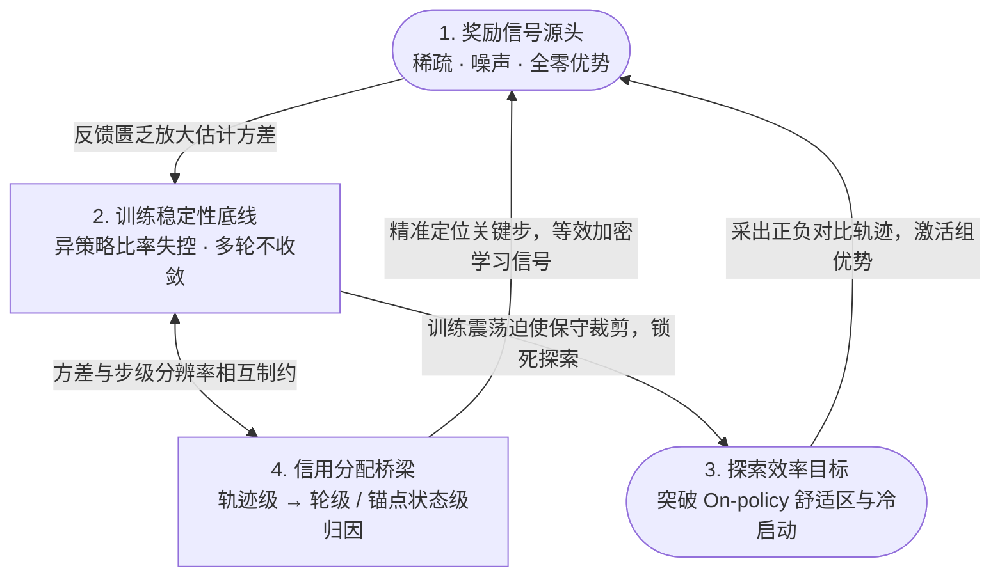

# 1.1 从推理 RL 到 Agentic RL

!!! abstract "本节摘要"
    RLVR 在数学与竞赛编程等**单轮闭卷可验证任务**上已高度成熟，但其底层依赖的“单步完整生成”与“即时确定性核验”两大假设在多轮环境交互、工具调用与长程规划场景下同时失效。基于 47 篇前沿论文的统计归纳，Agentic RL 的核心攻坚集中在**奖励信号质量、训练稳定性、探索效率与跨步信用分配**四大维度。

!!! info "背景衔接"
    本报告聚焦多轮交互智能体的强化学习机制（重点剖析各代表作的**问题诊断、核心建模与适用边界**）。关于单轮基础策略优化算法（PPO / GRPO / DAPO / VAPO / CISPO / GSPO / SAPO）的完整公式推导，请参见 **[Post-Training 技术报告第 1 章](../../post-training/ch1/1.1-training-landscape.md)**。

---

## 单轮 RLVR 的成功边界：哪两个隐含假设被打破了？

2025 年以 DeepSeek-R1、Qwen3、DAPO、VAPO 为代表的推理强化学习取得了突破性成功。但审视其任务结构可以发现，经典 RLVR 建立在两个非常干净的简化假设之上：

1. **闭卷单轮生成（Single-Turn Closed-Loop）**：外部环境是静止的——模型读入题目 $q$，一口气自回归吐完从 `<think>` 到 `<answer>` 的整串词元，中间没有任何外部系统状态转移或随机环境返回；
2. **终局确定可验证（Clean Binary Outcome）**：回答末尾有一个格式明确的数字或独立函数，规则脚本毫秒级即可给出无歧义的对错反馈。

一旦任务升级为**真实智能体工作流**——例如在陌生的网页间多跳检索核实信息、在十万行代码库里反复改文件跑测试排障、或在电商与办公系统中连续调用数十次 API 完成复合委托——上述两个假设瞬间瓦解：

- 模型发出的每一次工具调用都会改变外部世界状态，并收到**不可完全预测的环境观测（Observation）**（本质上变成了**部分可观测马尔可夫决策过程 POMDP**）；
- 任务往往跨越数十轮交互、累计上万词元才在终点得出成败，甚至对于开放式调研报告根本不存在唯一标准答案。

---

## Agentic RL 的核心结构性矛盾

!!! warning "核心矛盾总结"
    真实 Agent 任务的**长程多轮性、环境随机性与目标开放性** $\;\longleftrightarrow\;$ 现有大模型策略梯度算法对**短回合、整句统一优势与同策略采样**的依赖。

| Agent 任务真实特征 | 传统单轮 RL 默认假设 | 由此诱发的算法与工程困境 |
|-------------------|---------------------|-------------------------|
| **数十轮长程交互（数万 tokens）** | 单轮一次生成完毕 | 终局奖励极度延迟，逐词元/跨轮方差累积爆炸 |
| **开放或复合多维任务目标** | 单一可验证标准答案 | 奖励信号稀疏甚至带噪，全错组频发导致零梯度（Advantage Collapse） |
| **动态外部环境反馈介入** | 纯模型内部自回归概率链 | 中间弯路与关键一步混在同一轨迹，整句共享同一优势造成严重**错误归因** |
| **语言 + 多参数工具组合空间** | 封闭解题空间 | 纯靠当前策略随机采样（On-policy）极难撞出复杂工具链，且每次环境调用耗时昂贵 |

---

## 四大核心挑战及其耦合闭环

对 2024–2026 Q1 共 47 篇 Agentic RL 专项论文的统计显示，研究火力高度集中在以下四个相互咬合的问题上：

| 核心挑战 | 论文涉及占比 | 核心技术追问 |
|----------|-------------|-------------|
| **1. 奖励信号质量（Reward Signal）** | **68%** | 当终局反馈极度稀疏或任务缺乏唯一真值时，如何构造密集、抗钻空子的过程/轮级信号？ |
| **2. 训练稳定性（Training Stability）** | **53%** | 多轮异步采样下重要性比率极端化、单轮算法在多轮下理论不收敛，如何守住稳定更新边界？ |
| **3. 探索效率（Exploration Efficiency）** | **44%** | 当模型初始成功率接近 0%、且环境交互昂贵时，如何跨回合积累经验或借力外部轨迹破局？ |
| **4. 信用分配（Credit Assignment）** | **44%** | 一条 20 轮轨迹最终成功（或失败），如何精准识别是第几轮的哪个工具调用真正起了决定作用？ |

这四个维度并非孤立存在，而是构成了紧耦合的因果环路：**奖励稀疏或带噪是源头**（直接推高梯度方差并引发组优势坍塌），**细粒度信用分配是桥梁**（把终局信号拆解到关键步骤等价于加密有效反馈），**训练稳定性是底线保障**，而**高效探索出新策略则是最终目的**：

