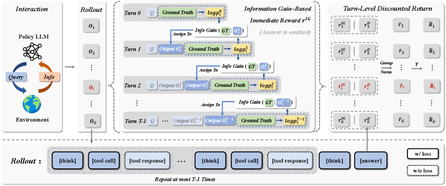
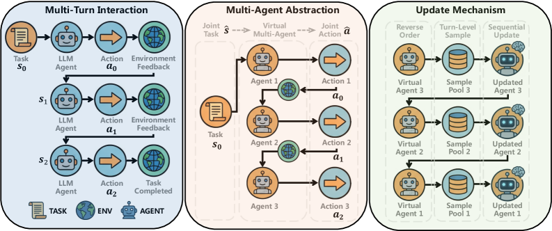
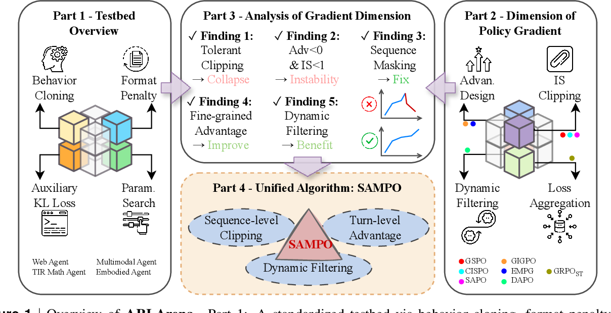

# 1.2 奖励信号与训练稳定性

!!! abstract "本节摘要"
    在多轮交互场景下，奖励端面临**终局稀疏、评判噪声与全组同分导致优势归零（Advantage Collapse）**三重困境；优化端则面临**长程重要性比率极端化、负优势宽裁剪累积崩溃以及单轮算法在多轮下缺乏收敛保证**等隐患。本节深入解析奖励侧的 **IGPO**（信息增益内在奖励）与 **CM2**（多维核查清单奖励），以及稳定侧的 **SeeUPO**（逆向归纳多轮收敛保证）、**ARLArena / SAMPO**（四维正交稳定性拆解）与 **VCPO**（有效样本量动态步长）。

---

## 一、奖励信号设计：从终局稀疏走向内在密集与结构化

### 问题剖析

在 47 篇调研文献中，高达 **68%** 的工作首先向奖励稀疏与失真开刀，核心痛点有三：

1. **长程终局稀疏**：Agent 连续执行十几轮网页检索或命令调用，直到最后一轮提交答案才拿到一个 `0` 或 `1`，中间哪一次查询推进了认知、哪一次纯属原地打转毫无区分；
2. **开放式评判噪声**：对于“撰写行业竞品调研报告”这类开放任务，外部神经网络 RM 容易被篇幅和排版迷惑；
3. **组优势坍塌（Advantage Collapse）**：面对复杂多步任务，当前策略采样的 $G$ 条轨迹在训练初期极易**全军覆没（得分全为 0）**，组内标准差与分子双双归零，模型一步也学不动。

---

### IGPO — 用“对真值答案的信息增益”构造零标注轮级内在奖励

!!! abstract "论文：IGPO"
    *Information Gain-based Policy Optimization: A Simple and Effective Approach for Multi-Turn LLM Agents* ([arXiv:2510.14967](https://arxiv.org/abs/2510.14967)) | **机构**: 阿里巴巴

<figure markdown="span">
  { width="98%" }
  <figcaption markdown="span">IGPO 核心流程：在与环境交互的每一轮 $t$ 结束后，探查当前上下文让策略生成真实答案的对数概率边际提升（Information Gain），将其作为密集 Turn-level 内在奖励并与终局奖励结合计算折扣回报（图源：arXiv:2510.14967 Figure 2）</figcaption>
</figure>

- **设计动机**：在多轮搜索问答中，即便两条轨迹最终都没凑齐最后一块拼图（终局奖励同为 `0`），其中一条在前两轮搜到了关键线索，另一条全程搜错方向——能否**不训练任何外部过程奖励模型（PRM）**，直接利用策略模型自身的“信念更新（Belief Update）”把有效搜索识别出来？
- **核心机制**：在训练阶段已知标准答案 $y^*$ 的前提下，每当第 $t$ 轮动作 $a_t$ 拿到环境返回的新观测 $o_t$ 后，计算模型在追加该观测前后生成标准答案 $y^*$ 的条件概率变化（即**边际信息增益**）：
    - 若本轮工具返回的信息让模型产出正确答案的概率显著上升 $\implies$ 赋予**正的轮级内在奖励**；
    - 若本轮调用毫无帮助甚至引入噪声拉低了正确概率 $\implies$ 赋予**负的轮级奖励**。
- **核心优势与适用边界**：
    - **一举两得**：既把稀疏终局信号变成了每轮即时的密集反馈，又因为不同轨迹各轮的信息增益连续各异，天然打破了全零组导致的 Advantage Collapse；
    - **局限性**：训练时仍要求任务具备**已知参考答案 $y^*$** 才能探查条件概率，无法直接用于无固定答案的开放式创作；同时每轮探查答案概率需额外前向计算，且依赖模型自身概率校准度。

---

### CM2 — 面向多轮工具使用的细粒度 Checklist 结构化奖励

!!! abstract "论文：CM2"
    *Checklist Rewards for Multi-turn Tool-use* ([arXiv:2602.12268](https://arxiv.org/abs/2602.12268)) | **机构**: 字节跳动（已开源）

- **设计动机**：多轮工具交互中经常出现“工具选对了、必填字段也齐了，但日期格式写错导致调用报错”的半成功状态。单一的 `0/1` 标量奖励把“差一点就对”和“完全胡言乱语”一棍子打死，丢失了宝贵的局部梯度。
- **核心机制**：摒弃笼统的整体打分，将多轮工具调用拆解为涵盖**工具选择恰当性、参数结构合规性、环境反馈利用度、指令约束满足度与任务推进度**等 **7 个细粒度可核查条目（Checklist）**，逐项独立判定后再聚合为密集反馈信号（与 Kimi K2 的结构化 Rubric 思路高度呼应）。
- **适用边界**：结构化核查表大幅降低了主观评判方差，但核查维度的拆解与权重配比带有任务域特征，跨全新场景迁移时需配套生成对应的核查清单。

### 奖励与采样侧其他代表性工作速览

| 算法 | arXiv 编号 | 核心切入点与机制 | 针对痛点 |
|------|-----------|-----------------|----------|
| **EDGE-GRPO** | [2507.21848](https://arxiv.org/abs/2507.21848) | 引入策略熵与错误多样性引导调整优势，打破全组同分时的零梯度僵局 | Advantage Collapse |
| **PF-PPO** | [2409.06957](https://arxiv.org/abs/2409.06957) | 利用奖励模型的不确定性过滤低置信度伪高分/伪低分样本，仅在可靠区间更新 | 开放任务 RM 噪声 |
| **ZeroSearch** | [2505.04588](https://arxiv.org/abs/2505.04588) | 训练轻量 LLM 模拟搜索引擎返回可控有用/干扰文档，省去高昂商业搜索 API 费用并控噪 | 外部检索 API 昂贵与噪声 |
| **DARS** | [2508.13755](https://arxiv.org/abs/2508.13755) | 分阶段动态重分配采样预算，为低通过率难题倾斜更多 Rollout 配额以确保采出正例 | 难题正样本饥饿 |

---

## 二、训练稳定性：从局部经验修补走向多轮收敛保证

### 问题剖析

把单轮 GRPO 直接搬到 20～50 轮的异步 Agent 训练中，最常见的现象就是“前几百步奖励稳步爬升，随后突然断崖式归零且无法救回”。背后的深层原因在于：

1. **多轮序贯依赖下的单轮算法失配**：第 1 轮动作改变了外部环境状态，进而改变了第 2 轮面临的输入分布；传统无 Critic 算法把整条多轮轨迹捆绑更新，缺乏多轮单调改进的理论保证；
2. **异策略负样本的破坏性累积**：长多轮交互往往采用异步架构，过时轨迹上的极端重要性采样比率一旦与负优势叠加，极易一步推垮词表分布。

---

### SeeUPO — 基于多智能体逆向归纳的首个多轮 RL 全局收敛保证

!!! abstract "论文：SeeUPO"
    *Sequence-Level Sequential Update Policy Optimization* ([arXiv:2602.06554](https://arxiv.org/abs/2602.06554)) | **机构**: 阿里巴巴 | **ICLR 2026**

<figure markdown="span">
  { width="98%" }
  <figcaption markdown="span">SeeUPO 建模原理：将 $T$ 轮 Agent 交互等价建模为 $T$ 个顺序协作的虚拟子智能体，按从最后一轮倒推回第一轮的逆向归纳（Backward Induction）顺序逐轮更新策略，严格保证单调提升与全局最优收敛（图源：arXiv:2602.06554）</figcaption>
</figure>

??? info "📖 初学者补充：什么是逆向归纳（Backward Induction），为什么同时更新所有轮次会出问题？"
    想象你在下两步棋（第 1 轮搜资料，第 2 轮写结论）：第 1 轮某个搜索动作到底是好是坏，**完全取决于第 2 轮拿到资料后会不会用**！如果第 1 轮和第 2 轮同时混在一起改参数，第 1 轮评估自己动作价值时看到的还是“旧的第 2 轮策略”，两边互相追逐移动靶，在理论上就可能震荡不收敛。

    博弈论与动态规划中的**逆向归纳法（Backward Induction）**则是反过来：**先固定前面所有轮次，把最后一轮（第 $T$ 轮）的决策策略更到最优；既然第 $T$ 轮的行为已经确定更优了，再往回退一步更新第 $T-1$ 轮……以此类推一路倒推回第 1 轮**。这样每一轮更新时，它所面对的后续策略都已经率先稳定下来了。

- **核心理论洞察**：SeeUPO 从理论上证明了直接将单轮无 Critic 组相对算法套用到多轮交互场景时，由于各轮状态转移耦合且缺乏价值基线解耦，无法同时兼顾“无 Critic”与“多轮全局收敛保证”。
- **核心算法设计**：将单模型跨越 $T$ 轮的交互视作一个 $T$ 智能体顺序博弈，结合序列级信任域比率（类似 GSPO），在每次迭代中**严格按照从第 $T$ 轮向第 $1$ 轮回溯的顺序逐轮执行策略更新**。在满足充分采样假设下，首次给出了多轮 LLM 强化学习的**单调策略改进与全局最优收敛证明**，并在 AppWorld（`+43.3%`）与 BFCL（`+24.1%`）多轮工具基准上取得大幅领先。
- **工程权衡与局限**：逐轮逆向顺序更新意味着计算开销随交互轮数 $T$ 增长，在轮数适中（如 3～10 轮对话与工具调用）的场景效果显著，但在动辄上百轮的超长终端排障任务上仍面临串行更新延迟挑战。

---

### ARLArena / SAMPO — 四维正交消融定位多轮崩溃元凶

!!! abstract "论文：ARLArena / SAMPO"
    *ARLArena: A Unified Framework for Stable Agentic Reinforcement Learning* ([arXiv:2602.21534](https://arxiv.org/abs/2602.21534)) | **机构**: UCLA

<figure markdown="span">
  { width="98%" }
  <figcaption>ARLArena 系统框架：构建标准化多轮测试床，将策略梯度拆解为四个正交设计维度（IS Clipping / Dynamic Filtering / Advantage Design / Loss Aggregation），提炼出五大崩溃机理并组装成稳定算法 SAMPO（图源：arXiv:2602.21534 Figure 1）</figcaption>
</figure>

面对五花八门的稳定化技巧，ARLArena 做了一件极有价值的“控制变量全因子体检”——把多轮策略梯度拆成四个正交旋钮：**① 重要性采样裁剪粒度与边界**、**② 异常/低质轨迹动态过滤**、**③ 优势分配层级**、**④ 损失长度聚合方式**。

- **最核心的实验发现**：诱发多轮 Agent 训练突然崩溃的头号杀手，是**“带有负优势（$\hat{A}<0$）且重要性比率未受严格约束的异策略轨迹累积”**！正如我们在 [1.10 SAPO](../../post-training/ch1/1.10-sapo.md) 中分析的，负梯度会把概率质量盲目推向十万词表中的无关词元；在多轮长序列中一旦放任大比率负样本更新，几步就会击穿语言流形（这也与 DeepSeek-V3.2 专门设计 `Off-Policy Sequence Masking` 屏蔽高偏离负优势序列高度吻合）。
- **SAMPO 稳定配方**：在四维空间中组合序列/轮级受限裁剪、异常负样本过滤与均衡损失聚合，为新环境提供了一套开箱即用的高稳健默认基线。

---

### VCPO — 基于有效样本量（ESS）的异步异策略动态步长

!!! abstract "论文：VCPO"
    *Variance-Controlled Off-Policy Reinforcement Learning* ([arXiv:2602.17616](https://arxiv.org/abs/2602.17616)) | **机构**: MIT | **ICLR 2026（已开源）**

??? info "📖 初学者补充：什么是有效样本量（Effective Sample Size, ESS）？"
    假设一个训练 batch 里有 $N=64$ 条异策略轨迹，它们的重要性采样权重分别为 $w_1, \ldots, w_{64}$。

    - 如果数据几乎是刚刚用最新模型采的（On-policy），所有权重都接近 $1$，这时 **有效样本量 $\mathrm{ESS} = \frac{(\sum_{i=1}^N w_i)^2}{\sum_{i=1}^N w_i^2} \approx 64$**，梯度估计非常可靠，可以放心迈大步更新；
    - 如果这批数据已经很老了（重度 Off-policy），其中 1 条轨迹的权重暴涨到 $100$，其余 63 条权重接近 $0.01$，虽然名义上有 64 条数据，但算出来的 $\mathrm{ESS} \approx 1$——整个 batch 实际上被那 1 条孤立样本绑架了，方差极大！

- **核心机制**：VCPO 没有只盯着事后裁剪单个权重，而是实时计算当前异策略 batch 的 **有效样本量（ESS）**，据此**动态缩放当前步的有效学习率**（当异策略滞后严重、ESS 骤降时自动缩小步长防震荡，当贴近同策略、ESS 充足时恢复全速步长），并配套推导出闭式最小方差最优基线（OPOB），非常适合工业界大规模异步 Actor-Learner 集群。

### 训练稳定性方向其他代表工作

| 算法 | arXiv 编号 | 核心稳定化机制 |
|------|-----------|---------------|
| **ProRL** | [2505.24864](https://arxiv.org/abs/2505.24864) | 在超长周期（数千步）RL 训练中加 KL 约束并**周期性将参考模型 $\pi_{\text{ref}}$ 重置为当前策略快照**，防止比率漂移锁死后期探索 |
| **GMPO** | [2507.20673](https://arxiv.org/abs/2507.20673) | 在对数空间对带符号的重要性加权替代项做**几何聚合**（配合词元级裁剪），大幅削弱个别极端离群 token 对整句更新的绑架 |
| **OTB** | [2602.07078](https://arxiv.org/abs/2602.07078) | 利用前向传播统计量低开销近似梯度范数，构造最小化策略梯度方差的逐词元最优基线 |
| **Dr. MAS** | [2602.08847](https://arxiv.org/abs/2602.08847) | 针对多智能体协作训练提出 **Agent-wise（按角色独立）** 优势归一化，消除不同职责智能体间的奖励尺度干扰 |
