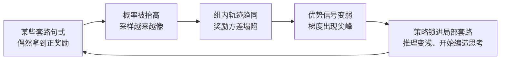

# 1.2 为什么单轮 GRPO 直接搬过来会翻车？三大病灶与「回声陷阱」

!!! abstract "本节摘要"
    把 1.1 的多轮循环和单轮 GRPO 直接拼起来，能跑，但会在三个地方系统性翻车：全组同分时没有梯度、整条轨迹共用一个优势会奖错罚好、多轮特有的重复套路会让训练自己把自己锁死。第三个现象由 RAGEN 系统记录下来，叫回声陷阱。看清这三件事，后面四节的解法就都有了出处。

还是退货核查。对同一个请求采样 \(G=4\) 条轨迹，用单轮 GRPO 的组内相对优势：整条轨迹一个奖励，减组均值（这里先不除标准差），每个词元共用这个数。

## 病灶一：全组同分，梯度为零

任务难一点，4 条轨迹全都没查对政策，奖励全是 \(-0.2\)（只有调用成本）。组均值也是 \(-0.2\)，于是

$$
\hat A_i = R_i-\bar R = -0.2-(-0.2)=0\qquad(i=1,\dots,4)
$$

采样花了 4 次工具调用的钱，梯度是零。反过来，任务太简单时 4 条全对，优势同样是零。

用概率算这件事有多常见。设单条轨迹成功率 \(p=0.1\)，组大小 \(G=4\)，独立采样：

$$
P(\text{全错})=(1-p)^G=0.9^4\approx 65.6\%,\qquad
P(\text{有对有错})=1-0.9^4-0.1^4\approx 34.4\%
$$

也就是说三分之二的组白采。\(G\) 加大能缓解：\(0.9^K\le 0.05\) 需要 \(K\ge 29\)。但多轮里一条轨迹要调好几次工具，29 条的成本比单轮贵得多，而且成功率还会随训练变化。靠堆 \(G\) 不是长久办法，这正是 1.3 要加密奖励、1.5 要想办法先采出一条正例的原因。

!!! warning "加个小常数救不了"
    给标准差分母加 \(\epsilon\) 只能避免除零时报 NaN。分子本来就是零，优势还是零，造不出方向。筛选、动态采样、过程奖励，处理的都是这个分子为零的问题。

## 病灶二：整轨一个优势，奖错罚好

看两条轨迹：

| 轨迹 | 第 1 步 | 第 2 步 | 第 3 步 | 终局 |
| --- | --- | --- | --- | --- |
| 甲 | 查错订单号 | 跟着错信息判断 | 发现对不上，重新查对 | 答对，\(R=+0.8\) |
| 乙 | 查对订单 | 查对政策 | 结论写反了 | 答错，\(R=-0.2\) |

假设同组另外两条一对一错，组均值 \(\bar R=0.3\)。单轮 GRPO 给甲的优势是 \(0.8-0.3=+0.5\)，**甲的每一个词元都乘 +0.5**，包括第一步查错订单。给乙的是 \(-0.5\)，乙前两步完全正确的查询也被压低。

这就是多轮里最核心的错位：终局信号是轨迹级的，功劳却需要落到步级。甲真正该奖的是第三步的纠错，该罚的是第一步；乙该罚的只有最后一步。整轨平摊把这四件事全做反了。1.4 的四种方法——分支重采、同状态对比、语义近邻、二分定位——都是为了把这一个数拆开。

还有一个隐蔽版本：两条轨迹前两步一模一样，只在第三步分叉。这种「共享前缀」在单轮视角下被当成两条独立样本重复计算，既浪费算力，又没有利用「同一起点、不同走法」这个天然的对照实验。TreePO 和 GiGPO 分别从采样和归因两端利用它，见 1.4、1.5。

## 病灶三：回声陷阱——模型学会重复自己

RAGEN（StarPO，[arXiv:2504.20073](https://arxiv.org/abs/2504.20073)）在多个受控多轮环境里系统记录了第三种崩溃，作者称之为 **Echo Trap（回声陷阱）**。它的演化链条大致是：

和单轮的熵坍塌相比，多轮回声陷阱多了一层：模型重复的不只是词，而是**整套行动套路**——每次都先说同一句开场白、调同一个工具、走同一条路。组内轨迹越像，组相对优势越没信号；信号一弱，更新越被少数偶然样本主导；几步尖峰之后，策略就锁死在这套动作里。RAGEN 还观察到，没有细粒度奖励时，多轮训练出的「思考」容易变成形式上的自言自语，和行动脱节。

StarPO-S 的稳定化组合针对的正是这条链：过滤轨迹（把方差异常、明显退化的轨迹先筛掉）、引入价值基线（不完全依赖组内相对量）、做梯度稳定。它给出的另一条经验是关于采样本身的：初始状态要多样、交互粒度别太粗、采样要够频——这三件事决定了模型能不能在锁死之前见到足够不同的走法。

??? info "📖 初学者补充：为什么多轮比单轮更容易锁死？"
    单轮数学题里，一条轨迹锁进套路，其他题还能提供不同信号。多轮里同一个任务的状态是自己走出来的：策略一变窄，它访问到的状态也跟着变窄，训练数据和策略互相喂养。环境本该带来多样性，但如果每条轨迹都在第二步就走进同一个页面，多样性就消失了。这也是为什么 1.5 要专门谈探索，1.6 要谈多轮更新的稳定性。

## 三个病灶，正好对应后面四节

| 病灶 | 症状 | 解法在哪 |
| --- | --- | --- |
| 全组同分 | 采样花了钱，梯度是零 | 1.3 加密奖励；1.5 先采出正例 |
| 整轨平摊 | 奖错罚好，共享前缀被浪费 | 1.4 步级信用分配 |
| 回声陷阱与异步漂移 | 轨迹趋同、梯度尖峰、更新崩盘 | 1.5 探索与记忆；1.6 稳定性 |

顺序也是有讲究的：没有信号（病灶一），谈归因是空的；归因粗糙（病灶二），探索采到的好轨迹也会被错误强化；前两件都有了，训练能不能持续跑下去，取决于病灶三。
