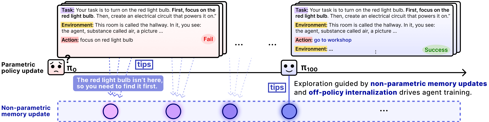
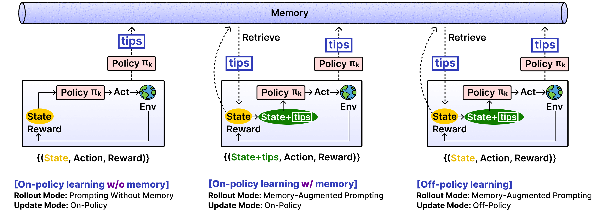
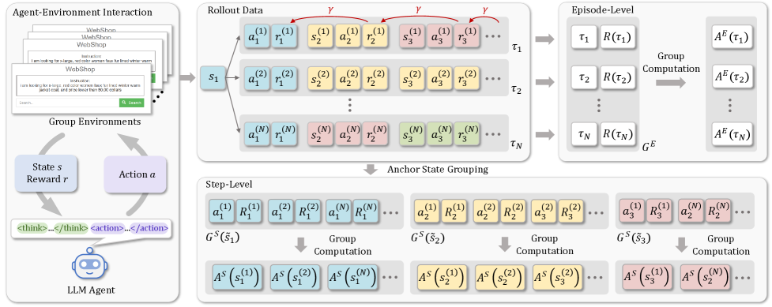
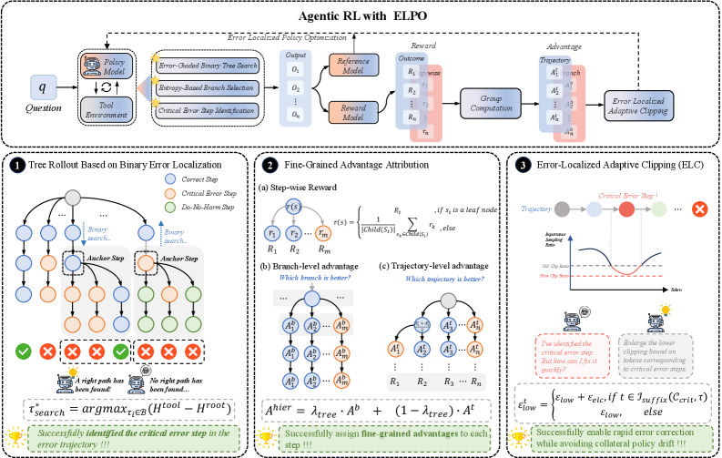
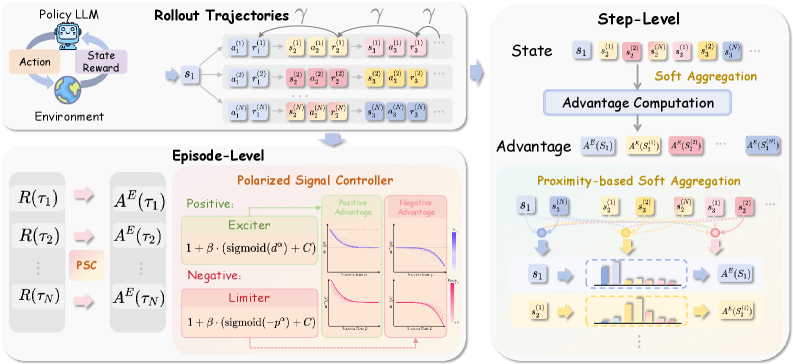

# 1.3 探索效率与信用分配

!!! abstract "本节摘要"
    在**探索效率**维度，标准同策略 RL 每次回合结束后即遗忘试错教训且受限于基座初始分布，**EMPO²** 通过自生成非参数化记忆提示与异策略参数内化实现跨回合经验积累，**LUFFY** 则引入外部专家轨迹打破零奖励冷启动。在最具挑战的**跨步信用分配**维度，**GiGPO** 利用多轨迹重合的“锚点状态”做步级分组对比，**ELPO** 用二分树搜索精确定位“首个不可挽回错误步”，**ProxMO** 则用连续语义相似度软聚合突破离散匹配限制。

---

## 一、探索效率：打破“同策略原地打转”与“回合间失忆”

### 问题剖析

多轮智能体的探索比单轮数学题难得多：每次环境交互都要真实调接口或跑容器（采样慢且贵）；而在陌生工具环境中，初始策略随机试错十几步全错是常态——如果每次采样都是无记忆地重头盲撞（Episode-level 独立采样），或者完全局限于模型自己当前高概率的旧习惯，训练很难破局。

---

### EMPO² — 外部探索记忆生成与参数化内化的双闭环

!!! abstract "论文：EMPO²"
    *Exploratory Memory-Augmented LLM Agent via Hybrid On- and Off-Policy Optimization* ([arXiv:2602.23008](https://arxiv.org/abs/2602.23008)) | **机构**: Microsoft | **ICLR 2026**

<figure markdown="span">
  { width="98%" }
  <figcaption>EMPO² 核心动机：人类试错后会记住“上次哪条路走不通”；EMPO² 让 Agent 从过往轨迹自总结经验 Tips 存入外部 Memory（下层非参数更新），辅助探索出高回报轨迹后再内化回模型权重（上层参数更新）（图源：arXiv:2602.23008 Figure 4）</figcaption>
</figure>

- **设计动机**：标准 RL 在第 100 个 episode 踩过的坑（例如“某网页需要先点展开按钮才能抓取表格”），到了第 101 个 episode 如果权重还没彻底学会，模型依然会一模一样再踩一遍。能否给 RL 循环装上一块可读写的**“跨回合经验笔记本”**？
- **核心机制（三种混合训练模式协同）**：

<figure markdown="span">
  { width="98%" }
  <figcaption>EMPO² 混合优化三模式：(1) 无提示标准同策略探索；(2) 检索历史 Tips 注入上下文做记忆增强同策略探索；(3) 抹去输入中的 Tips，将成功轨迹作为异策略目标喂给无提示策略，迫使模型将外部记忆真正内化进神经网络权重（图源：arXiv:2602.23008 Figure 5）</figcaption>
</figure>

1. **自总结非参数记忆**：Agent 在交互后对失败教训或成功窍门提炼简短的自然语言 Tips 存入记忆库，并结合新状态发现内在奖励鼓励探索未知分支；
2. **带记忆提示探索（On-policy with Tips）**：检索相关 Tips 放入提示词，大幅提高采出成功轨迹的概率；
3. **隐去提示异策略内化（Off-policy Context Distillation）**：最关键的一步——把靠 Tips 才做对的优质轨迹拿出来，**删掉提示词里的 Tips**，用带重要性采样截断的异策略损失训练模型在“不看小抄”的情况下也能直接生成这套正确动作！

- **实测效果与边界**：在 ScienceWorld 取得 `+128.6%` 相对提升、分布外（OOD）测试任务平均提升 `+136%`。局限在于早期自总结 Tips 的质量受基座反思能力制约，且大规模任务下记忆库的去重检索淘汰需配套工程管理。

---

### LUFFY — 引入外部强示范轨迹引导探索的混合策略 GRPO

!!! abstract "论文：LUFFY"
    *LUFFY: Learning to Reason under Off-Policy Guidance* ([arXiv:2504.14945](https://arxiv.org/abs/2504.14945)) | **机构**: 字节跳动 & 香港大学

- **设计动机**：当一道难题当前模型采样 $G$ 次全错（`0/G`）时，无论怎么调裁剪阈值，纯 On-policy 算法都拿不到半点正向信号；而如果直接拿强模型轨迹做离线 SFT，又容易死记硬背丢失自身探索能力。
- **核心机制**：提出 **Mixed-Policy GRPO**——在同题的一组 $(G-1)$ 条自采样 On-policy 轨迹中，**混入 $1$ 条来自外部强模型（如 R1）的正确 Off-policy 示范轨迹**共同计算组相对优势；同时针对异策略示范轨迹设计了平滑策略塑形函数 $\frac{\pi_\theta}{\pi_\theta + \gamma}$（而非直接硬裁剪极小分母比率），让模型在保持自探索活力的同时温和吸收原本够不着的高阶解题范式，在多类分布外基准上稳定提升 `+6.2` 分。

### 探索效率方向其他代表工作

| 算法 | arXiv 编号 | 核心提效思路 | 代表收益 |
|------|-----------|-------------|----------|
| **TreePO** | [2508.17445](https://arxiv.org/abs/2508.17445) | 将独立重复的链式采样改为**共享公共前缀的分段树状采样（Tree Rollout）**并及时剪枝死胡同分支 | 节省 **22%–43%** Rollout GPU 耗时 |
| **LADDER** | [2503.00735](https://arxiv.org/abs/2503.00735) | 面对 0% 通过率的超难积分/竞赛题，让模型自己递归构造由易到难的同构简化子题阶梯自举学习 | 竞赛积分冷启动准确率 **1% → 82%** |
| **SGE** | [2603.02045](https://arxiv.org/abs/2603.02045) | 在高层自然语言“解题元策略空间”而非底层词元空间做多样化采样探索（Google DeepMind） | 显著提升搜索广度与样本多样性 |
| **SSRL** | [2508.10874](https://arxiv.org/abs/2508.10874) | 利用模型内部自模拟交互替代高频外部真实检索训练，大幅压缩训练期 API 调用开销 | 显著降低外部接口交互成本 |

---

## 二、跨步信用分配（Credit Assignment）：揪出多轮成败的真正关键步

### 问题剖析：为什么“整条轨迹共用一个优势”在多轮 Agent 中问题很大？

设想一个 4 轮客服/搜索智能体交互过程：

- **Turn 1**：发出了一个拼写错误的糟糕搜索词（**坏动作**，拿到无关页面）；
- **Turn 2**：没有细看就基于无关页面下了一个错误判断（**坏动作**）；
- **Turn 3**：意识到前后矛盾，主动换用精准关键词重新检索（**极其关键的纠错好动作**）；
- **Turn 4**：根据新检索结果给出正确最终答复 $\implies$ **终局判定成功（$R = +1$）！**

如果直接用标准 GRPO / GSPO 把 $+1$ 衍生出的正优势平均扣在全部 4 轮头上，**Turn 1 和 Turn 2 的错误操作也会被当作功臣正向强化**！反过来，如果前 3 轮操作堪比教科书，仅仅第 4 轮输出JSON漏了一个括号得 $0$ 分，前 3 轮的精彩规划也会跟着遭殃。如何在**不训练昂贵 Critic 网络**的前提下实现步级（Step/Turn-level）精准归因，催生了三条递进代表方案：

---

### GiGPO — 双层分组与“锚点状态（Anchor State）”步级对比

!!! abstract "论文：GiGPO"
    *Group-in-Group Policy Optimization for LLM Agent Training* ([arXiv:2505.10978](https://arxiv.org/abs/2505.10978)) | **机构**: 南洋理工大学 & Skywork AI | **NeurIPS 2025**

<figure markdown="span">
  { width="98%" }
  <figcaption markdown="span">GiGPO 两级优势融合框架：宏观层（Episode-Level）在完整轨迹间计算组相对优势 $A^E$；微观层（Step-Level）将同一任务不同轨迹中自然途经相同环境状态（Anchor State）的分支动作聚成子组，对比各自后续折扣回报得出步级优势 $A^S$（图源：arXiv:2505.10978 Figure 2）</figcaption>
</figure>

- **核心洞察**：虽然语言推理自由度很大，但在操作网页、购物车或文件系统时，同一道题采样出的 $G$ 条轨迹经常会**自然经过完全相同的中间环境状态 $s$**（例如大家都打开了同一个商品详情页，或者都定位到了同一个报错函数）。
- **双层组中组（Group-in-Group）机制**：
    1. **宏观轨迹优势 $A^E$**：与 GRPO 相同，比较整条轨迹总分，保留全局成败方向；
    2. **微观锚点步优势 $A^S$**：无需任何额外树采样，直接在已采出的 $G$ 条轨迹历史里建立哈希表，把到达同一个观测状态 $s$ 却采取了不同动作 $a^{(1)}, a^{(2)}, \dots$ 的步骤归入一个**状态内子组（Step Group）**，比较各自从该步往后的未来折扣回报均值——在状态 $s$ 下导向后续高回报的动作获正 $A^S$，导向死胡同的动作获负 $A^S$；
    3. **加权合成总优势**：$\hat{A}_{i,t} = A^E_i + \omega \cdot A^S_{i,t}$，零额外环境交互开销即可同时兼顾全局目标与局部步级优劣。
- **适用边界**：依赖不同轨迹间存在真实可比的状态重合；在状态文本高度发散（如每次时间戳、随机 ID 或自由长文本不同）的开放环境中，精确字面匹配命中率会下降（且需注意环境若含隐藏未观测历史变量，表面相同的观测未必完全等价）。

---

### ELPO — 二分树搜索精确定位“首个不可挽回错误步”

!!! abstract "论文：ELPO"
    *Error-Localized Policy Optimization* ([arXiv:2602.09598](https://arxiv.org/abs/2602.09598)) | **机构**: 阿里巴巴 | **ICLR 2026**

<figure markdown="span">
  { width="98%" }
  <figcaption>ELPO 三步机制：(1) 对失败轨迹执行二分分支续写探测（Binary Search Tree Rollout），精准锁定导致满盘皆输的“首个不可挽回错误步（Critical Error Step）”；(2) 分层精细赋优势；(3) 对该关键错误步自适应放宽下侧裁剪边界以加大纠偏力度（图源：arXiv:2602.09598 Figure 2）</figcaption>
</figure>

- **核心洞察**：在一条长达 20 步最终失败的轨迹里，往往前 11 步全都走对了，直到**第 12 步改错了关键公式或删错了文件**，才导致后面第 13～20 步无论怎么补救都回天乏术。第 12 步就是整条失败链条的**“首个不可挽回错误步（First Irrecoverable Step）”**。
- **二分搜索定位法**：受经典的 `git bisect`（二分查找引入 Bug 的提交）启发，对失败轨迹取中点第 $T/2$ 步让策略重新往后分支采样若干条：若从 $T/2$ 出发还能高概率做对，说明致命错误发生在后半段 $[T/2+1, T]$；若从 $T/2$ 出发已经全军覆没，说明致命错误早在前半段 $[1, T/2]$ 就已铸成！仅需 $O(\log T)$ 次探测即可精准揪出罪魁祸首步，并对其施加专项负向优势与更宽的负侧裁剪上限（允许彻底压低该错误动作概率）。
- **适用边界**：归因因果性极强，但每次二分探测需要额外的在线分支 Rollout 预算，更适合高价值的推理与编程排障场景。

---

### ProxMO — 用连续语义邻近性软聚合升级离散锚点匹配

!!! abstract "论文：ProxMO"
    *Proximity-Based Multi-Turn Optimization* ([arXiv:2602.19225](https://arxiv.org/abs/2602.19225)) | **机构**: 腾讯 & 香港理工大学 | **ICLR 2026**

<figure markdown="span">
  { width="98%" }
  <figcaption>ProxMO 双层设计：Episode-Level 根据题目通过难度动态调节激励/抑制幅度；Step-Level 用连续语义相似度核函数对相近历史状态做软加权聚合构造步级基线，消除 GiGPO 对字面严格一致的依赖（图源：arXiv:2602.19225 Figure 2）</figcaption>
</figure>

- **核心机制**：针对 GiGPO 在开放文本环境中“两个中间状态意思完全一样、只因多了一个空格或换了一种措辞就无法归入同一锚点组”的短板，ProxMO 将离散相等判定升级为**基于表征余弦相似度的连续软核加权（Soft Aggregation）**——语义越相近的跨轨迹中间状态，在计算当前步对比基线时权重越大，即插即用地把锚点归因推广到了自由文本交互场景。

### 信用分配方向其他代表工作对照

| 算法 | arXiv 编号 | 归因粒度 | 核心机制简述 |
|------|-----------|---------|-------------|
| **VinePPO** | [2410.01679](https://arxiv.org/abs/2410.01679) | Step / Token 级 | 移除神经网络 Critic，直接在推理关键节点挂载轻量蒙特卡洛分支采样估计真实动作价值 $Q(s_t, a_t)$ |
| **Step-GRPO** | [2503.12937](https://arxiv.org/abs/2503.12937) | Step 级 | 为中间推理步显式构造步骤准确性与逻辑有效性双奖励信号 |
| **ARPO** | [2507.19849](https://arxiv.org/abs/2507.19849) | Turn / Step 级 | 监测工具调用后的策略熵跃升点（高不确定性分岔口），按需触发局部自适应分支采样与步级归因 |
