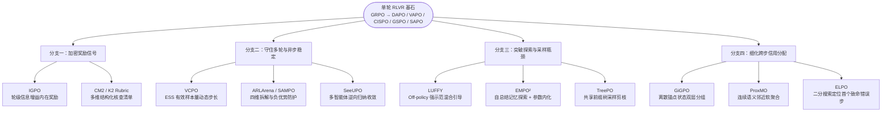

# 1.5 算法速查与路线图

## 核心代表算法一表速查

| 算法名称 | arXiv 编号 | 主攻核心挑战 | 核心技术机制一句话总结 | 依赖外部神经网络 RM？ | 代码开源 |
|----------|-----------|-------------|-----------------------|----------------------|----------|
| **SeeUPO** | [2602.06554](https://arxiv.org/abs/2602.06554) | 稳定性 + 多轮归因 | 将 $T$ 轮交互建模为多智能体顺序博弈，按**逆向归纳**从末轮倒推逐轮更新，给出全局收敛保证 | 否 | — |
| **EMPO²** | [2602.23008](https://arxiv.org/abs/2602.23008) | 跨回合探索效率 | 自总结失败/成功 Tips 外部记忆引导同策略探索 + 隐去提示做异策略内化进权重 | 否 | — |
| **GiGPO** | [2505.10978](https://arxiv.org/abs/2505.10978) | 步级信用分配 | **Episode + Anchor State（锚点状态）** 双层组对比，零额外采样拆分中间动作优劣 | 否 | ✅ |
| **ARLArena / SAMPO** | [2602.21534](https://arxiv.org/abs/2602.21534) | 多轮训练稳定性 | 四维正交拆解策略梯度，定位“异策略负优势累积”崩溃根因并给出高稳组合配置 | — | ✅ |
| **ELPO** | [2602.09598](https://arxiv.org/abs/2602.09598) | 因果错误定位归因 | 对失败轨迹做 **二分树搜索续写**，精准锁定首个不可挽回错误步并放宽负侧纠偏裁剪 | 否 | 即将 |
| **ProxMO** | [2602.19225](https://arxiv.org/abs/2602.19225) | 连续步级信用分配 | 用**连续语义表征相似度软加权**替代离散字面匹配，构造跨轨迹中间状态对比基线 | 否 | — |
| **VCPO** | [2602.17616](https://arxiv.org/abs/2602.17616) | 异步异策略稳定性 | 依据重要性权重的 **有效样本量（ESS）** 自适应缩放步长，配合闭式最小方差基线 | — | ✅ |
| **IGPO** | [2510.14967](https://arxiv.org/abs/2510.14967) | 稀疏奖励 + 轮级归因 | 用每轮环境观测带来的**标准答案对数概率边际提升（信息增益）**充当密集内在奖励 | 否（需真值答案） | — |
| **LUFFY** | [2504.14945](https://arxiv.org/abs/2504.14945) | 零样本冷启动探索 | 在同策略采样组中混入外部强示范轨迹，配合正则化策略塑形吸收高阶模式 | 否（需外部示范） | ✅ |
| **CM2** | [2602.12268](https://arxiv.org/abs/2602.12268) | 多维过程奖励构建 | 面向工具选择、参数合规与推进度设计 **7 维细粒度 Checklist** 结构化密集反馈 | 自建核查器 | ✅ |
| **GMPO** | [2507.20673](https://arxiv.org/abs/2507.20673) | 长序列离群词稳定 | 在对数空间对带符号的重要性加权替代项做**几何平均聚合**，抑制单点极端比率噪声 | — | ✅ |
| **ProRL** | [2505.24864](https://arxiv.org/abs/2505.24864) | 超长程训练扩展 | 带 KL 惩罚并**周期性重置参考策略 $\pi_{\text{ref}}$**，突破基座固有推理分布边界 | — | — |

---

## 代表工作四级影响力坐标

综合学术首创性、理论严密性、开源复现度与大规模工业产品验证四个维度：

| 层级 | 代表系统 / 算法 | 入选核心依据 |
|------|----------------|-------------|
| **Tier 1：工业旗舰标杆** | **GLM-5、Kimi K2 / K2.5、MiniMax Forge、DeepSeek-V3.2** | 在数百亿至万亿参数旗舰模型上完成千卡级生产验证，建立异步流式与环境合成工程标准 |
| **Tier 2：理论与范式突破** | **SeeUPO、EMPO²** | 分别从“多轮逆向归纳收敛理论”与“非参数记忆 + 参数内化双系统探索”开辟全新建模维度 |
| **Tier 3：通用核心方法创新** | **GiGPO、ELPO、ProxMO、VCPO、ARLArena** | 直击步级信用分配与异步方差控制痛点，模块化程度高、易于集成进主流框架 |
| **Tier 4：高价值专项利器** | **IGPO、LUFFY、CM2、TreePO、GMPO、ProRL** | 在搜索信息增益、示范混合引导、树状省流采样等细分瓶颈上给出精巧解法 |

---

## 从单轮 RLVR 走向多轮 Agentic RL 的技术分化树

