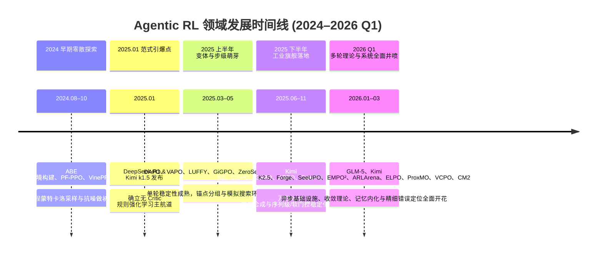

# 2.1 领域全景与技术路线

!!! abstract "本节摘要"
    基于对 2024–2026 Q1 共 47 篇代表性工作的全景统计，本节梳理 Agentic RL 从零散探索到集中井喷的演进脉络，对比**“自底向上修补基础算法”、“自顶向下重建模多轮决策”与“横向增强环境与记忆基础设施”**三条主干技术路线的优劣，并审视从学术论文到工业级 Coding / Research Agent 产品的快速转化生态。

---

## 演进时间线：从单轮推理外溢到多轮智能体井喷

### 研究热度与机构分布特征

- **重心明显迁移**：2025 年上半年的高引工作主要在解决“如何把单轮长思维链数学题训稳训高”；到 2026 年第一季度，单季涌现的近 20 篇核心工作几乎全部聚焦于**多轮异策略稳定、跨轮信用分配与十万级环境合成**——标志着单轮 RLVR 基础配方已趋收敛，研究前沿正式整体移师多轮交互智能体。
- **全球研发格局**：
    - **中国团队（占比约 60%+）**：阿里巴巴（Qwen / 通义：GSPO、SAPO、IGPO、SeeUPO、ELPO、ZeroSearch）、字节跳动（Seed：DAPO、VAPO、LUFFY、CM2、ABE）、DeepSeek、月之暗面（Kimi）、智谱（GLM-5）、MiniMax、腾讯等在**超大规模 MoE 工业落地、异步训练基础设施与全栈工程排障**上处于领跑身位；
    - **北美与国际高校/机构（占比约 30%+）**：MIT（VCPO）、UCLA（ARLArena）、Microsoft（EMPO²）、Google DeepMind（SGE）、普林斯顿（SWE-smith）、南洋理工（GiGPO）等在**理论收敛性刻画、方差控制界与高复用开源环境基准**上贡献突出。

---

## 三条主干技术路线深度对比

当前所有 Agentic RL 创新都可以清晰地归入以下三条互补的技术路线：

=== "路线 A：自底向上修补单轮基础算法 (Bottom-Up)"

    **核心逻辑**：保留 GRPO / PPO 将整条多轮交互压平为词元序列的基本框架，针对长序列与异步采样暴露出的梯度消失、MoE 路由抖动和负样本崩溃逐一打补丁。

    - **代表工作**：`DAPO → CISPO → GSPO → SAPO`（基础层），`ARLArena / SAMPO`、`VCPO`、`IcePop`（多轮异步适配层）
    - **核心优势**：与现有分布式训练框架（veRL、Megatron、TRL）完全兼容，代码改动极小，工业界大规模上线风险最低；
    - **天花板局限**：没有触碰“多轮状态转移耦合”与“整条轨迹共享单一结果优势”的结构限制，在几十轮复杂试错任务中信用分配依然粗糙。

=== "路线 B：自顶向下重建模多轮序贯问题 (Top-Down)"

    **核心逻辑**：承认多轮 Agent 交互不是单轮续写，显式拆解轮次（Turn）与中间状态（State）结构，重构优势估计或更新次序。

    - **代表工作**：`SeeUPO`（多智能体逆向归纳逐轮更新）、`GiGPO` / `ProxMO`（跨轨迹同状态/近邻状态分组对比）、`ELPO`（二分树搜索定位首个不可挽回错误步）、`IGPO`（轮级信息增益内在奖励）
    - **核心优势**：数学建模直击多轮因果本质，能够精准奖惩中间某一次关键工具调用；
    - **工程挑战**：往往伴随额外的计算或采样代价（如逐轮回溯更新、二分分支重采样或中间概率探查），在百轮级超长容器任务上的吞吐扩展性仍需工程打磨。

=== "路线 C：横向增强环境、记忆与编排基础设施 (Infrastructure & Memory)"

    **核心逻辑**：不纠结于单个策略梯度公式，而是升级智能体所处的**外部学习闭环**——给它造出十万个逼真沙箱、装上跨回合经验记忆库、或拆解为主从并行蜂群。

    - **代表工作**：`EMPO²`（外部记忆探索 + 异策略参数内化）、`Kimi K2.5 PARL`（可训编排器 + 冻结子代理）、`SWE-smith` / `Agent World Model` / `ASTRA`（规模化可验证环境合成）、`Slime` / `Forge`（异步流式前缀树系统）
    - **核心优势**：**与路线 A、B 完全正交可叠加**，且直接拓宽了数据来源与能力形态边界；
    - **现实壁垒**：系统工程复杂度极高，环境逼真度与防作弊严密性直接决定最终泛化上限。

---

## 产业落地与开源生态观察

1. **论文到旗舰产品的转化周期压缩至 3–6 个月**：Coding Agent（如 Claude Code、Cursor、GLM-5、MiniMax-M2.5、Kimi K2）与 Deep Research 多跳调研助手已成为大模型商业化最核心的落地形态，背后全部由多轮可验证/半可验证 Agentic RL 驱动；
2. **开源生态呈现“算法易得、框架渐熟、高质量沙箱最稀缺”的倒金字塔**：
    - **算法层**：任何新裁剪或门控公式发表后数天内即被社区复现合入 `veRL`、`OpenRLHF` 或 `TRL`；
    - **异步框架层**：支持千级并发容器环境、TITO 分词一致性与前缀树合并的第二代 Agent-Native RL 训练框架正在加速开源标准化；
    - **环境与任务层**：以 `SWE-smith`、`Agent World Model`、`ASTRA` 为代表的自动化环境生成工具刚刚起步，构建覆盖金融、办公、科研、全栈开发的百万级高保真可验证沙箱池，仍是整个生态最大的增量蓝海。
