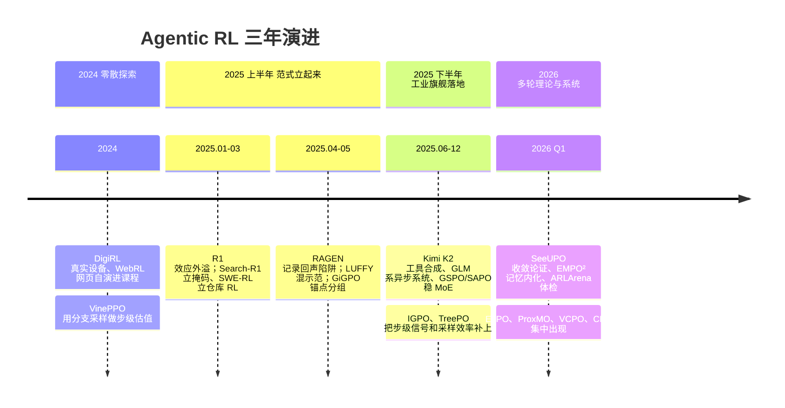

# 4.1 全景速查表与技术演进脉络

!!! abstract "本节摘要"
    把前三章出现过的工作收进一张表，按它解决哪个问题、要不要多花采样、依赖什么来查。再用一条时间线看这个领域三年怎么从单轮外溢走到多轮系统。

## 速查表

| 工作 | 解决什么 | 核心机制一句话 | 额外采样 | 详见 |
| --- | --- | --- | --- | --- |
| Search-R1 ([2503.09516](https://arxiv.org/abs/2503.09516)) | 搜索训练起点 | 检索词元掩码 + 终局奖励，多跳涌现 | 无 | 2.1 |
| RAGEN / StarPO ([2504.20073](https://arxiv.org/abs/2504.20073)) | 多轮崩溃诊断 | 记录回声陷阱，StarPO-S 过滤 + 基线 + 稳定 | 无 | 1.2 |
| ReTool ([2504.14945](https://arxiv.org/abs/2504.14945)) | 何时调解释器 | RL 学战略性代码调用，从报错改代码 | 沙箱执行 | 2.2 |
| SWE-RL ([2502.21936](https://arxiv.org/abs/2502.21936)) | 仓库修复训练 | 从开源演化历史构造较软的训练信号 | 无 | 2.2 |
| WebRL ([2411.02337](https://arxiv.org/abs/2411.02337)) | 网页冷启动 | 失败任务自演进课程 + 结果奖励模型 | 课程生成 | 2.3 |
| IGPO ([2510.14967](https://arxiv.org/abs/2510.14967)) | 步级奖励稀疏 | 标准答案对数概率的边际增量当轮级奖励 | 每轮一次前向 | 1.3 |
| CM2 ([2602.12268](https://arxiv.org/abs/2602.12268)) | 奖励太笼统 | 七字段核查清单逐项判，标准密集、分配稀疏 | 评判调用 | 1.3 |
| VinePPO ([2410.01679](https://arxiv.org/abs/2410.01679)) | 步级估值 | 中间前缀重采续写，蒙特卡洛估值 | 多 | 1.4 |
| GiGPO ([2505.10978](https://arxiv.org/abs/2505.10978)) | 步级归因 | 哈希分组同状态步，比后续回报 | 无 | 1.4 |
| ProxMO ([2602.19225](https://arxiv.org/abs/2602.19225)) | 状态难精确匹配 | TF-IDF 相似度软加权基线 | 无 | 1.4 |
| ELPO ([2602.09598](https://arxiv.org/abs/2602.09598)) | 定位致命步 | 二分重采后缀，找第一个不可挽回步 | 中 | 1.4 |
| TreePO ([2508.17445](https://arxiv.org/abs/2508.17445)) | 采样浪费 | 共享前缀树展开，死枝早剪 | 省总量 | 1.5 |
| LUFFY ([2504.14945](https://arxiv.org/abs/2504.14945)) | 零正例冷启动 | 组里混一条示范，塑形函数托底梯度 | 需示范 | 1.5 |
| EMPO² ([2602.23008](https://arxiv.org/abs/2602.23008)) | 跨回合失忆 | tips 记忆带练，再删提示内化进权重 | 记忆检索 | 1.5 |
| SeeUPO ([2602.06554](https://arxiv.org/abs/2602.06554)) | 多轮不收敛 | 多智能体建模，从最后一轮倒着更新 | 逐轮更新 | 1.6 |
| ARLArena ([2602.21534](https://arxiv.org/abs/2602.21534)) | 崩溃归因 | 四维正交体检，SAMPO 稳定组合 | 无 | 1.6 |
| VCPO ([2602.17616](https://arxiv.org/abs/2602.17616)) | 异步旧数据 | 按未截断权重的 ESS 平方根缩放步长 | 无 | 1.6 |
| MemAgent ([2507.02259](https://arxiv.org/abs/2507.02259)) | 超长任务 | 分块阅读、反复改写固定记忆，用 RL 训改写 | 无 | 2.4 |
| Memory-R1 ([2508.19828](https://arxiv.org/abs/2508.19828)) | 记忆管理 | 增删改查做成动作，RL 训管理策略 | 无 | 2.4 |
| PARL（Kimi K2.5） | 多 Agent 分工 | 只训编排器，子 Agent 冻结当环境 | 子 Agent 执行 | 2.5 |
| Dr. MAS ([2602.08847](https://arxiv.org/abs/2602.08847)) | 多 Agent 尺度干扰 | 按角色各自归一化优势 | 无 | 2.5 |
| SWE-smith ([2504.21798](https://arxiv.org/abs/2504.21798)) | 环境不够 | 真实仓库逆向注错造修复任务 | 造环境 | 3.2 |
| veRL / verl-agent / SkyRL / AReaL | 训练系统 | 计算编排派与环境原生派两条抽象路线 | — | 3.1 |

## 演进脉络

三条线同时在走，和 2.1 旧版的路线划分一致：一是继续修单轮算法的地基（比率、门控、归一化），二是按多轮结构重建模（步级归因、顺序更新），三是造环境、造记忆、造编排这些基础设施。第三条最不显眼，但决定上限——3.2 说过，环境造得多严，算法才学得多真。

## 事实校准说明

这个领域新论文多、版本迭代快，引用时容易踩三个坑，本报告按下面的口径处理：

- **机构与会议以论文正文为准。** 例如 IGPO 的署名包括蚂蚁集团 Venus Team 与中国人民大学等，CM2 来自 UCSB、Zoom、UCF、UCLA 等，ARLArena 来自 UCLA 与 UW–Madison。会议标签（如某年 ICLR/ICML）只在论文页面明确标注时才写。
- **相对提升要带基准和模型。** 「+128.6%」「+43.3%」这类数字都是特定基准、特定基座上的相对量，不带上下文引用等于没说。本报告在正文引用时都带了出处场景，速查表里则不列数字。
- **定理要带前提。** SeeUPO 的收敛论证有明确的理想化假设（1.6），VinePPO 的无偏是给定策略下的蒙特卡洛无偏，GiGPO 的组内差异是统计对照不是因果证明。把这些读成无条件结论，是面试和评审里最常见的扣分点。
