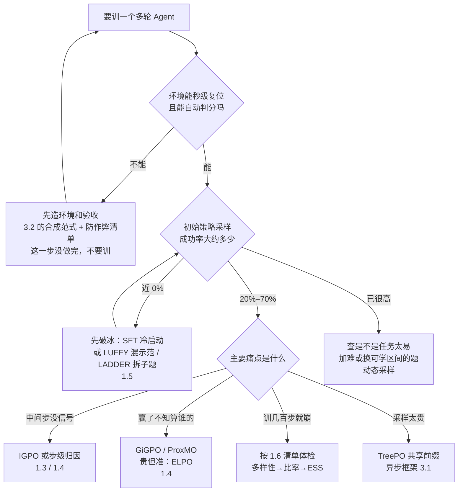

# 4.2 落地决策树、核心判断与未来

!!! abstract "本节摘要"
    先给一张能直接用的决策树：按环境能不能复位、任务几轮、初始成功率、算力四件事，走到该用的方法。再收六条判断和三个时间尺度的展望。

## 从零落地决策树

配套的三条起手检查，和算法无关，但决定成败（和后训练报告 3.3 的结论一致）：

1. 每个 batch 里有没有全对、全错的组在空转（动态采样开了吗）。
2. 验收有没有被钻的洞（3.2 清单过一遍）。
3. 采样端和训练端对同一串 token 算出的对数概率对不对得上（掩码、版本、算子确定性）。

## 六条判断

!!! quote "判断 1：信用分配是最硬的骨头"
    奖励可以加密，稳定性有组合拳，探索可以借示范。唯独「几十步里哪一步真正决定成败」触及因果：现有方法分的都是统计对照。谁能在不成倍增加采样的前提下把归因做准，谁就拿到下一波红利。

!!! quote "判断 2：SeeUPO 的价值在建模视角，不在直接套用"
    「多轮是顺序协作、要倒着更新」这个视角会留下来。但逐轮串行更新在上百轮任务上太贵，能落地的会是分段里程碑式的近似版。

!!! quote "判断 3：记忆内化可能是范式级的"
    EMPO² 的「上下文里快探索、权重里慢固化」复刻了人的学习方式。它把 RL 的循环从「采样—更新」变成「采样—总结—带经验再采样—内化」，这条线值得长期跟踪。

!!! quote "判断 4：系统确定性比损失函数更决定生死"
    非确定性 top-k、重分词错位、旧数据没护栏——这些在论文里不出现的问题，在千卡多轮训练里每一个都能让训练白跑。基础设施不是管道，它决定算法能不能活。

!!! quote "判断 5：环境合成是被低估的命门"
    改公式的论文占大多数，造环境的占少数。但模型能学多复杂，取决于有多少个严密沙箱。百万级高保真环境池，是这个领域还没被填上的最大空缺。

!!! quote "判断 6：下一个涌现点在组合，不在单点"
    长程规划、并行分工、自己写辅助工具、在信息不足时主动求证——这些行为单独看都有雏形。它们在同一个系统里同时出现并互相加强时，才是 Agent 版的「R1 时刻」。

## 展望

=== "短期（2026–2027）"

    原生支持掩码、版本过滤、前缀合并的第二代异步框架成为标配；软门控（SAPO）与步级归因（GiGPO/ProxMO）合流成默认多轮基线；评测从单个仓库修复扩展到跨仓、长时程任务。

=== "中期（2027–2028）"

    Agentic RL 成为基座出厂标配阶段；可学习世界模型把真实沙箱的采样成本再压一个量级；多 Agent 从「只训编排器」走向异构角色的稳定联合训练。

=== "长期"

    | 方向 | 图景 | 难点 |
    | --- | --- | --- |
    | 自进化闭环 | Agent 自己发现盲区、造沙箱、出题、训练自己 | 防退化与防共谋 |
    | 行动级安全 | 有真实权限时，从硬约束层面杜绝越权操作 | 形式化验证与可用性的平衡 |
    | 推理—记忆—行动统一 | 慢思考、经验记忆和工具行动在一个目标下协同 | 目标设计与信用分配 |

## 一句话收尾

Agentic RL 现在处在「单轮配方已收敛、多轮系统刚立起来」的位置。对大多数团队，把环境造严、把掩码和版本管住、把动态采样打开，收益大于再换一个新算法。算法层面最值得押注的，是步级归因和记忆内化这两条线。
