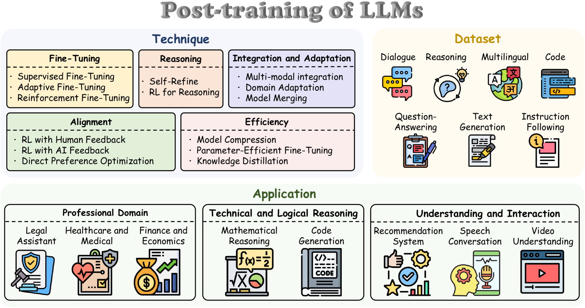

# 1.1 大模型训练全景

!!! abstract "本节摘要"
    本节介绍现代大语言模型训练的三个核心阶段——预训练（Pre-Training）、中间训练（Mid-Training）和后训练（Post-Training），厘清各阶段的数据量级、训练目标与能力边界，并梳理 2025–2026 年的演进趋势。

!!! note "阅读说明"
    本章系统梳理 LLM Post-Training 的算法技术栈：

    - **1.1–1.2 节**：建立大模型训练三阶段全景，统一全书数学符号与评测口径，并对比 **RLHF** 与 **RLVR** 两大后训练范式；
    - **1.3–1.10 节**：从离线偏好优化 **DPO** 与经典在线策略优化 **PPO** 出发，顺着 **GRPO → DAPO → VAPO → CISPO → GSPO → SAPO** 的演进脉络逐一剖析每个算法的设计动机、核心公式与梯度性质；
    - **1.11–1.12 节**：给出全部算法的公式对照速查表与演进路线图。

    每当首次引入关键概念或数学变换时，正文中会先给出直观解释，并通过 **「📖 初学者补充」** 折叠块提供具体数值算例。

---

近年来，大语言模型（LLM）的工业级训练流程逐渐形成了清晰的**三阶段共识**。理解前两个阶段“学到了什么、没学到什么”，是理解 Post-Training 为什么必不可少的前提。

<figure markdown="span">
  { width="100%" }
  <figcaption>LLM Post-Training 技术分类全景：涵盖 Technique（Fine-Tuning / Alignment / Reasoning / Efficiency / Integration）、Dataset 和 Application 三大维度（图源：arXiv:2503.06072）</figcaption>
</figure>

??? info "📖 读图指南：这张分类图和本书章节怎么对应？"
    上图来自综述 *A Survey of Post-training for Large Language Models*（[arXiv:2503.06072](https://arxiv.org/abs/2503.06072)），从三个维度俯瞰整个后训练生态：

    1. **左上 Technique（技术手段）**：本书第 1 章聚焦其中的 **Fine-Tuning**（以 SFT 为起点）、**Alignment**（RLHF / RLAIF / DPO）与 **Reasoning**（面向长思维链推理的强化学习）；**Efficiency** 中的知识蒸馏（Knowledge Distillation）与 **Integration** 中的多模态融合、模型合并则会在第 2 章各家工业流水线（如 DeepSeek-V3.2 专家蒸馏、Kimi K1.5/K2.5）中展开。
    2. **右上 Dataset（数据形态）**：对应本书 [2.9 数据工程专题](../ch2/2.9-data-engineering.md)，涵盖对话、推理、多语言、代码、指令跟随等数据的合成与筛选。
    3. **底部 Application（下游落地）**：专业领域、数学与代码推理、交互式系统，构成了驱动算法演进的真实评测场景。

!!! abstract "核心参考文献"
    - *A Survey of Post-training for Large Language Models* ([arXiv:2503.06072](https://arxiv.org/abs/2503.06072), 2025) — 系统覆盖后训练方法、数据与应用的综述
    - *A Survey on LLM Mid-Training* ([arXiv:2510.23081](https://arxiv.org/abs/2510.23081), 2025) — Mid-Training 专项综述
    - *The Llama 3 Herd of Models* ([arXiv:2407.21783](https://arxiv.org/abs/2407.21783), 2024) — 较早完整披露三阶段工业流水线的代表性技术报告

## 三阶段全景对比

| 阶段 | 典型数据规模 | 核心训练目标 | 算力占比 | 核心产出 |
|------|-------------|-------------|---------|---------|
| **Pre-Training（预训练）** | 万亿（Trillion）级 token | Next-Token Prediction (NTP) | **95%+** | 具备世界知识与语言规律的 Base 基座 |
| **Mid-Training（中间训练）** | 十亿～千亿（B～100B）级 token | 仍以 NTP 为主（退火高质语料 / 长窗口） | ~1%–4% | 具备长上下文、代码或多模态能力的增强基座 |
| **Post-Training（后训练）** | 万～百万级示范/偏好样本 + 大规模 RL 采样 | SFT / DPO / RLHF / RLVR | <1% → **10%+**（快速上升中） | 可直接部署的 Instruct / Thinking / Agent 模型 |

## Pre-Training：从海量文本中学习世界知识

预训练是整个流程的基石。模型在万亿级无标注文本上做 **Next-Token Prediction（预测下一个词元）**，从中习得三层能力：

- **语言的统计与结构规律**：词汇搭配、语法结构、代码语法与篇章组织；
- **世界知识**：事实陈述、领域常识与事件间的关联；
- **推理的“种子”**：局部演绎、模式匹配与短逻辑链——后续强化学习的核心作用之一，正是将这些散落在预训练分布中的推理种子激活、串联并放大为系统的长链推理能力。

预训练的标准损失函数为自回归负对数似然（Negative Log-Likelihood, NLL）：

$$
\mathcal{L}_{\text{PT}}(\theta) = -\mathbb{E}_{x \sim \mathcal{D}} \left[ \sum_{t=1}^{|x|} \log p_\theta(x_t \mid x_{<t}) \right]
$$

??? info "📖 初学者补充：预训练损失公式里的每个符号是什么意思？"
    - $\theta$：神经网络的全部可学习参数；
    - $x = (x_1, x_2, \ldots, x_{|x|})$：从预训练语料库 $\mathcal{D}$ 中取出的一条 token 序列（词元序列），$|x|$ 是序列长度；
    - $x_{<t} = (x_1, \ldots, x_{t-1})$：第 $t$ 个位置之前已经出现的所有上下文 token；
    - $p_\theta(x_t \mid x_{<t})$：模型在看到前文 $x_{<t}$ 后，经过最后一层的 Softmax 对词表打分，分配给真实下一个 token $x_t$ 的预测概率。

    **直观算例**：假设句子被切分为 3 个 token：`["地球", "绕着", "太阳"]`。在 $t=3$ 时，模型看到 `["地球", "绕着"]`，如果它给 `"太阳"` 预测的概率是 $0.8$，这一步的损失就是 $-\log(0.8) \approx 0.223$；如果它预测的概率只有 $0.01$，损失就高达 $-\log(0.01) \approx 4.605$。最小化 $\mathcal{L}_{\text{PT}}(\theta)$，就是调整参数 $\theta$ 让模型在每个位置都尽可能给真实后继 token 赋高概率。

预训练消耗了整个生命周期 **95% 以上的算力**，是成本最高昂的阶段。

## Mid-Training：定向能力增强

Mid-Training（中间训练）是近年在工业界被逐步独立出来的阶段，其核心目标是：**在不破坏预训练通用知识的前提下，使用更高密度的专项语料定向补强基座模型的特定能力**。

??? info "📖 概念澄清：Mid-Training 与 CPT 是什么关系？"
    在不同团队的报告中，Mid-Training 也常被称为 **Continued Pre-Training (CPT，继续预训练)**、**Post Pre-Training** 或 **Annealing Stage（退火阶段）**。综述 [arXiv:2510.23081](https://arxiv.org/abs/2510.23081) 将其统一界定为：“在通用预训练之后、后训练对齐之前，采用中等规模高质量分布数据的继续语言建模阶段”。

**Mid-Training 的五类典型任务：**

| 任务 | 具体做法 | 代表模型 |
|------|----------|---------|
| **长上下文扩展** | 调整 RoPE 基频并在长文档/仓库级数据上将窗口从 4K/8K 渐进拉长至 128K～1M+ | LLaMA 3.1 (128K), Qwen2.5-1M, GLM-5 (4K→200K) |
| **推理与代码补强** | 提高数学、科学推导、代码仓库与 PR/Issue 序列的采样权重并配合学习率退火 | DeepSeek-Coder, MiniMax-M1 (7.5T 推理语料 CPT) |
| **领域适配** | 在医学、法律、金融等高专业壁垒语料上继续训练 | 各类垂直行业基座 |
| **多语言增强** | 针对低资源或目标语种补充高纯净度平行与单语语料 | Qwen 系列多语言增强 |
| **多模态与稀疏注意力适配** | 接入视觉编码器进行图文交错预训练，或将稠密注意力适配为稀疏注意力 | LLaMA 3.2, DeepSeek-V3.2 / GLM-5 (DSA 适配) |

**Mid-Training 的三个核心特征：**

1. **损失函数不变**：仍以 Next-Token Prediction 语言建模为主目标；
2. **数据规模居中**：比预训练少 1–2 个数量级（十亿～千亿 token），但远大于后训练的指令数据；
3. **尚不涉及行为对齐**：只负责把“能力底子”打厚，不区分对话角色，也不直接优化有用性或安全性。

## Post-Training：行为对齐与能力释放

Post-Training 是将“高知识密度的续写器”转化为“可靠助手与推理智能体”的决定性环节。它的任务可以概括为两件事：**对齐人类意图与安全边界（Alignment）**，以及**系统性释放多步推理与工具执行能力（Capability Elicitation）**。

**为什么经过 Mid-Training 的基座模型依然不能直接用？**

| 典型缺陷 | 具体表现 | 根本原因 |
|---------|---------|---------|
| **不遵循用户指令** | 输入一个问题，模型可能接着续写一串同类考试题而非作答 | 预训练目标是“模仿互联网文本的后继分布”，而不是“回应用户请求” |
| **缺乏安全与真实性约束** | 容易顺着提示编造事实（幻觉），或复现训练语料中的有害、偏见言论 | 预训练对语料一视同仁地最大化似然，没有“好坏对错”的负向反馈信号 |
| **长链推理与规划未激活** | 具备单步知识却在复杂问题上跳步、算错后不会回头检查 | 互联网自然语料中极少完整记录人类试错、回溯与验证的完整内部思考过程 |

Post-Training 的经典里程碑来自 OpenAI 的 **InstructGPT**（[arXiv:2203.02155](https://arxiv.org/abs/2203.02155)）：**经过 SFT 与 RLHF 后训练的 1.3B 小模型，在人类评估员的盲测偏好上击败了参数量大 100 多倍的 175B GPT-3 基座模型**。这证明了后训练在释放模型可用价值上的极高杠杆率。

在这一阶段，常见的四类核心方法（将在 1.2–1.10 节详细展开）依次是：

- **SFT（Supervised Fine-Tuning，监督微调）**：用高质量 `<提示, 示范回答>` 对继续做条件语言建模，确立对话格式与基础行为模式；
- **RLHF（基于人类反馈的强化学习）**：先用人类偏好对比数据训练奖励模型（Reward Model），再用在线强化学习（如 PPO）优化模型生成高分回答；
- **DPO（直接偏好优化）**：绕开独立的奖励模型与在线采样，直接在离线偏好对 `(提示, 胜出回答, 落败回答)` 上优化策略概率比；
- **RLVR（基于可验证奖励的强化学习）**：针对数学、代码等有客观对错标准的任务，用确定性规则或测试沙箱直接给出奖励，驱动长思维链推理涌现。

## 三阶段协同关系与 2025–2026 关键趋势

三个阶段并非割裂的单向流水线，而是紧密耦合的能力栈：**Pre-Training 决定知识广度与潜力上限，Mid-Training 拓展上下文与专项底座，Post-Training 塑造推理深度与交互形态**——后训练中通过强化学习探索出的高价值轨迹，还常常通过拒绝采样或蒸馏回灌给下一代训练。

**当前演进的三大核心趋势：**

1. **Mid-Training 与 Post-Training 的边界逐渐交融**：例如在 Mid-Training 退火阶段提前混入思维链格式与仓库级 Agent 轨迹（如 GLM-5），而 DeepSeek-R1 的 Cold-Start SFT 则兼具格式引导与分布过渡的作用；
2. **Post-Training 的算力预算占比大幅跃升**：随着 RLVR 与 Agentic RL 的规模化扩展，后训练已不再是“占总成本不到 1% 的收尾工序”——例如 DeepSeek 从 V3（后训练占总成本 0.18%）演进到 V3.2 时，将后训练算力投入提升至预训练成本的 **10% 以上**，并明确指出 RL Scaling 尚未饱和；
3. **“轻量 SFT + 重度在线 RL”成为主流配方**：SFT 的职责收敛为提供输出格式与最小推理种子，过重的 SFT 反而会压缩策略探索空间；核心推理与工具规划能力主要由大规模在线强化学习（配合面向中小模型的强弱蒸馏）来完成。
