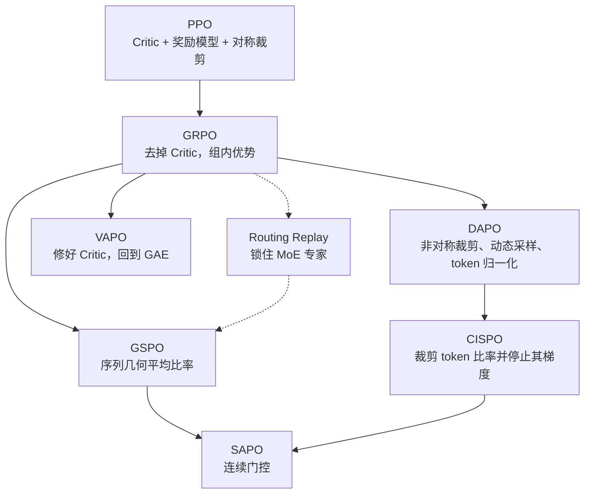

# 1.12 演进逻辑

PPO 把策略更新限制在裁剪信任域里，代价是 Critic、奖励模型和四个网络的显存。GRPO 用同题一组回答的相对奖励替换 Critic。规则奖励是使用方式，不是 GRPO 的定义。

从 GRPO 分出两条线。

**token 上的修补。** DAPO 放宽正优势的上界，丢掉没有区分度的题，并让每个 token 权重相同。CISPO 不再把越界 token 的对数概率梯度掩掉，只把比率收成常数。SAPO 连平台一起换成平滑权重。

**比率粒度。** GSPO 在奖励仍是整段一个分数时，把重要性比率改成序列几何平均，用来对付 MoE 路由噪声。Routing Replay 从另一头把专家路径锁住，和 GSPO 可以同时用。

**价值网络。** VAPO 认为长思维链仍需要 token 级优势。它继承 DAPO 的策略侧改动，用预训练、解耦 \(\lambda\) 和长度自适应 \(\lambda\) 让 Critic 可用。671B 上不用它，主要是显存。

## 旁边的三篇

| 算法 | 论文 | 它补上的一点 |
| --- | --- | --- |
| Dr. GRPO | [2503.20783](https://arxiv.org/abs/2503.20783) | 组内除以标准差、再除以长度，会让错误回答变长；给出不带这两项的更新 |
| REINFORCE++ | [2501.03262](https://arxiv.org/abs/2501.03262) | 优势在整个 batch 上归一化，指出只在组内归一化会带来偏差 |
| PRIME | [2502.01456](https://arxiv.org/abs/2502.01456) | 用隐式过程奖励做在线过程监督。过程奖励在大规模 RL 里仍然难标、易被钻，R1 的负面结果见 2.1 |
