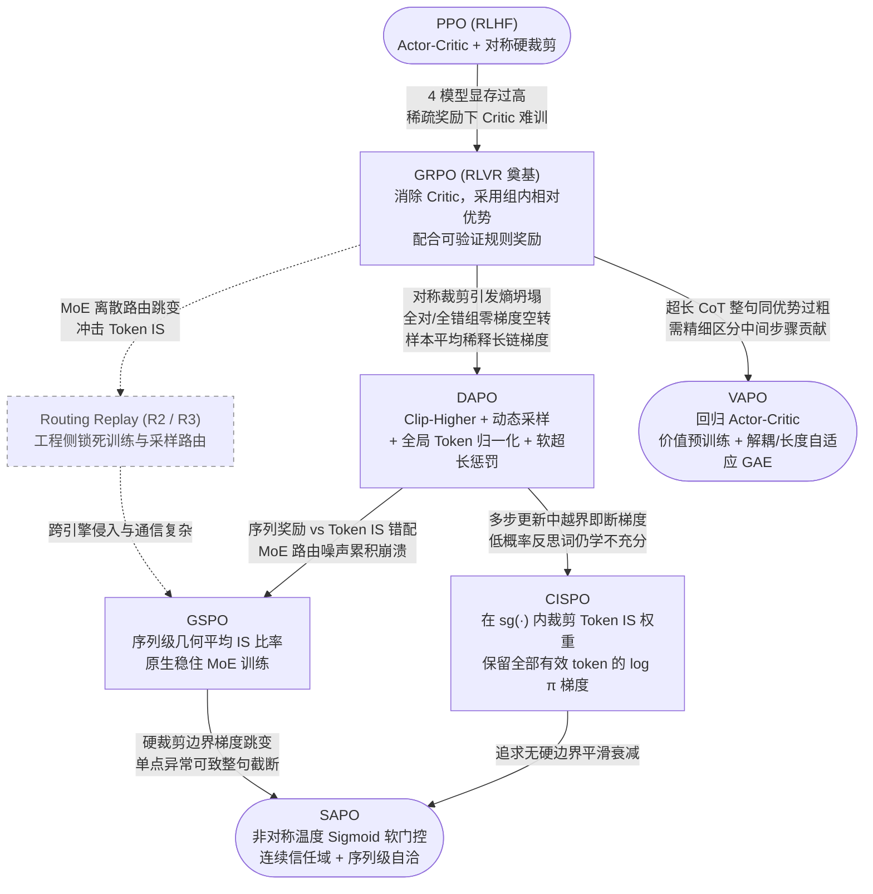

# 1.12 演进逻辑总结

将本章介绍的在线策略优化算法串联起来，每一个新算法都不是凭空设计的变体，而是精准针对上一代算法在大规模推理或 MoE 训练中暴露出的某个具体痛点：

## 演进图中的三条技术主线

!!! note "三条主线的分野与汇流"
    1. **Token 级信任域精炼线（GRPO → DAPO → CISPO → SAPO）**：始终保持逐 token 计算比率，依次解决探索空间不足（Clip-Higher）、越界梯度消失（CISPO 裁权重留梯度）以及裁剪边界不连续（SAPO 软门控）；
    2. **MoE 粒度对齐线（GRPO → Routing Replay / GSPO → SAPO）**：针对 MoE 专家路由切换对逐 token 比率的噪声污染，一条路在工程侧锁死专家选择（Keep Routing / R3），另一条路在算法侧升维到序列几何平均（GSPO），最终与第一条线在 **SAPO** 处汇合（Token 级软门控在小步长下自然展现序列级平滑性，同时保留单点异常隔离能力）；
    3. **精细价值归因线（PPO → VAPO）**：在显存允许的模型规模（如 32B～200B MoE）下，通过 Value Pretraining 与长度自适应 GAE 修好 Critic，夺回长思维链内部的逐词元信用分配精度优势。

## 其他值得关注的同期代表算法

除上述主干算法外，围绕组优势偏差、全局归一化与隐式过程奖励，以下三项工作也经常在工业与学术讨论中被引用：

| 算法 | 论文链接 | 核心发现与贡献 |
|------|----------|---------------|
| **Dr. GRPO** | [arXiv:2503.20783](https://arxiv.org/abs/2503.20783) | 指出标准 GRPO 中的 $\frac{1}{|o_i|}$ 长度除法与 $\mathrm{std}(\mathbf{R})$ 组标准差除法引入了优化偏差（促使错误回答越写越长、并过度放大极难/极易题偶然样本），提出去掉这两处除法的无偏版本 |
| **REINFORCE++** | [arXiv:2501.03262](https://arxiv.org/abs/2501.03262) | 无需 Critic，兼容单提示单采样（无需强制大 Group），改在整个全局训练 batch 上做奖励与优势标准化以降低小分组带来的估计偏差 |
| **PRIME** | [arXiv:2502.01456](https://arxiv.org/abs/2502.01456) | 利用策略模型与参考模型的对数概率比参数化**隐式过程奖励模型（Implicit PRM）**，仅靠终局结果标签即可在线更新过程级优势，缓解稀疏奖励问题 |
