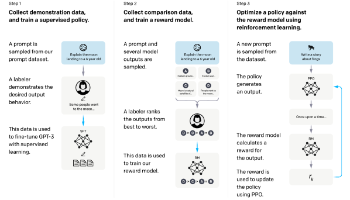
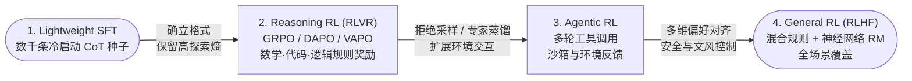

# 1.2 RLHF 与 RLVR 两大范式

!!! abstract "本节摘要"
    本节首先建立全书统一的数学符号与强化学习前置概念（策略、旧策略 vs 参考模型、重要性采样、KL 散度与策略熵），随后对比 **RLHF** 与 **RLVR** 两大后训练范式的核心机制、适用边界与已知挑战，并总结 2025–2026 年趋同的多阶段后训练流水线。

Post-Training 的核心问题是：**如何向模型定义“什么是好的回答”，并把它转化为可优化的训练信号？** 围绕奖励信号的来源，后训练形成了 **RLHF** 与 **RLVR** 两大范式。

---

## 全局符号与前置概念（必读铺垫）

在进入具体公式之前，我们先固定全书共用的符号体系。大语言模型的文本生成可以自然地看作一个序列决策过程：**状态（State）**是提示词加上已生成的词元前缀 $(q, o_{<t})$，**动作（Action）**是从词表中选出下一个词元 $o_t$，**策略（Policy）**就是语言模型本身给出的条件概率分布 $\pi_\theta(o_t \mid q, o_{<t})$。

### 统一符号表

| 符号 | 名称 | 精确含义与常见误区提醒 |
|------|------|----------------------|
| $q$ 或 $x$ | 提示 / 问题 (Prompt / Query) | 输入给模型的用户指令或题目，采样自题目分布 $\mathcal{D}$ 或 $P(Q)$ |
| $o$ 或 $y$ | 生成序列 (Output / Response) | 模型输出的完整回答 $o = (o_1, o_2, \ldots, o_{|o|})$，$|o|$ 为回答的 token 长度 |
| $\pi_\theta$ | **当前策略 (Current Policy)** | 正在接受梯度更新的语言模型，参数为 $\theta$ |
| $\pi_{\theta_{\text{old}}}$ | **旧策略 / 行为策略 (Old / Behavior Policy)** | **生成当前这批采样轨迹时的模型快照**。当一批采样数据被复用做多步梯度更新时，$\pi_\theta$ 会逐渐偏离 $\pi_{\theta_{\text{old}}}$；**重要性采样比率的分母永远是 $\pi_{\theta_{\text{old}}}$** |
| $\pi_{\text{ref}}$ | **参考模型 (Reference Policy)** | 通常是 SFT（或冷启动）完成后**永久冻结**的模型副本。**KL 散度惩罚的锚点是 $\pi_{\text{ref}}$**，用来防止模型遗忘正常语言分布，它不负责在线采样 |
| $r_t(\theta)$ | Token 级重要性比率 (IS Ratio) | $r_t(\theta) = \dfrac{\pi_\theta(o_t \mid q, o_{<t})}{\pi_{\theta_{\text{old}}}(o_t \mid q, o_{<t})}$，衡量新旧策略在当前 token 上的概率比 |
| $R(q, o)$ | 序列奖励 (Reward) | 对完整回答打出的标量分数：在 RLHF 中来自奖励模型 $r_\varphi(q, o)$，在 RLVR 中来自规则验证器（如 $+1/-1$ 或 $1/0$） |
| $\hat{A}_t$ | 优势估计 (Advantage) | 衡量第 $t$ 个动作相比“平均/预期水平”好多少：$\hat{A}_t > 0$ 表示优于基线（应提高概率），$\hat{A}_t < 0$ 表示劣于基线（应压低概率） |

!!! warning "最容易混淆的两个模型：$\pi_{\theta_{\text{old}}}$ 与 $\pi_{\text{ref}}$"
    初学者常把这两个下标混为一谈，其实它们各司其职：

    - **$\pi_{\theta_{\text{old}}}$ 管“数据是谁采的”**：RL 训练为了提高 GPU 利用率，通常用 $\pi_{\theta_{\text{old}}}$ 一次性采样一大批回答，然后分成多个 mini-batch 连续更新 $\pi_\theta$ 好几步。从第 2 步起，数据相对于最新 $\pi_\theta$ 就变成了 **Off-policy（异策略）** 数据，必须除以 $\pi_{\theta_{\text{old}}}$ 做重要性采样校正。一轮大迭代结束后，$\pi_{\theta_{\text{old}}}$ 会同步更新为最新的 $\pi_\theta$。
    - **$\pi_{\text{ref}}$ 管“模型别跑偏太远”**：它在整个 RL 阶段通常保持冻结（除非像 ProRL 那样显式做周期性重置），用来计算 $\mathrm{KL}(\pi_\theta \| \pi_{\text{ref}})$。

??? info "📖 初学者补充：On-policy / Off-policy、KL 散度、策略熵与评测指标（Pass@k vs avg@k）"
    1. **On-policy（同策略）与 Off-policy（异策略）**：
        - 如果训练用的每一条回答都是用**当前最新参数** $\pi_\theta$ 刚刚生成的（此时 $\pi_\theta = \pi_{\theta_{\text{old}}}$，$r_t(\theta)=1$），称为严格 **On-policy**；
        - 如果回答来自几步之前的旧参数 $\pi_{\theta_{\text{old}}}$、异步推理节点或外部示范模型（此时 $\pi_\theta \neq \pi_{\theta_{\text{old}}}$），称为 **Off-policy**。重要性采样（Importance Sampling）正是利用恒等式 $\mathbb{E}_{a \sim \pi_\theta}[f(a)] = \mathbb{E}_{a \sim \pi_{\theta_{\text{old}}}}\!\left[\frac{\pi_\theta(a)}{\pi_{\theta_{\text{old}}}(a)} f(a)\right]$，用旧策略采出的样本来估计新策略下的期望（前提是旧策略对该动作的概率非零）。
    2. **KL 散度（Kullback-Leibler Divergence）**：
        $$\mathrm{KL}\big(\pi_\theta(\cdot\mid x) \,\|\, \pi_{\text{ref}}(\cdot\mid x)\big) = \mathbb{E}_{y \sim \pi_\theta(\cdot\mid x)}\left[\log \frac{\pi_\theta(y\mid x)}{\pi_{\text{ref}}(y\mid x)}\right] \ge 0$$
        它衡量当前策略分布与参考分布之间的偏离程度：两分布完全一致时为 $0$，差异越大值越大。注意 KL 不对称，$\mathrm{KL}(P\|Q) \neq \mathrm{KL}(Q\|P)$。
    3. **策略熵（Policy Entropy）**：
        在位置 $t$，词表 $\mathcal{V}$ 上的条件熵定义为 $H(\pi_\theta(\cdot \mid s_t)) = -\sum_{v \in \mathcal{V}} \pi_\theta(v \mid s_t) \log \pi_\theta(v \mid s_t)$。
        - **高熵**：概率均匀分布在许多候选词上，模型在积极**探索（Exploration）**不同表述与思路；
        - **熵坍塌（Entropy Collapse）**：概率迅速集中到极少数最高频词上，熵跌至接近 $0$。一旦过早发生熵坍塌，模型对同一道题采样 16 次会吐出几乎一模一样的回答，失去探索新解法的能力。
    4. **常见基准与 `avg@k` vs `Pass@k`**：
        - **AIME**（美国数学邀请赛，每年两卷共 30 道整数填空难题，单次测试方差大，故论文普遍重复采样 32 或 64 次）；**SWE-bench Verified**（真实 GitHub 仓库 Issue 修复基准，靠单元测试判分）。
        - **`avg@k`（常简写为单题平均准确率）**：对同一题独立采样 $k$ 次，计算**平均做对的比例** $\frac{1}{k}\sum_{i=1}^k \mathbb{I}(\text{第 }i\text{ 次正确})$。它是单次采样准确率 `Pass@1` 的低方差无偏估计。
        - **`Pass@k`**：对同一题独立采样 $k$ 次，**至少有 1 次做对**的概率（若真实单次成功率为 $p$，则 $\text{Pass@}k = 1 - (1-p)^k$）。例如一道题模型单次只有 $p=20\%$ 概率做对，它的 `avg@10` 是 $20\%$，但 `Pass@10` 高达 $1 - 0.8^{10} \approx 89.3\%$！阅读论文与筛选题目时切勿将两者混同。

---

## RLHF 范式：从人类偏好反馈中学习

RLHF (Reinforcement Learning from Human Feedback) 的核心洞察是：**人类很难直接写出面面俱到的标准答案，但非常擅长比较两个候选回答哪个更好（生成难，判别易）**。

<figure markdown="span">
  { width="100%" }
  <figcaption>InstructGPT 的 RLHF 经典三阶段流程：Step 1 监督微调 (SFT) → Step 2 奖励模型训练 (RM) → Step 3 PPO 强化学习优化（图源：arXiv:2203.02155）</figcaption>
</figure>

### 经典三阶段流程与数学形式

1. **Step 1 — 监督微调（SFT）**：收集人工撰写的示范数据 $(x, y)$，用与预训练相同的交叉熵损失微调基座模型，得到 $\pi^{\text{SFT}}$（随后也作为冻结的 $\pi_{\text{ref}}$）。
2. **Step 2 — 奖励模型训练（Reward Modeling）**：对同一提示 $x$ 让模型生成多个候选回答（如图中 A、B、C、D），由人类标注员给出偏好排序，拆分为成对比较 $(x, y_w, y_l)$，其中 $y_w$（winner）优于 $y_l$（loser）。奖励模型 $r_\varphi(x, y)$（通常在语言模型主干上把词表输出头替换为标量线性头）采用 **Bradley-Terry 偏好模型** 将分数差映射为胜出概率：

$$
P(y_w \succ y_l \mid x) = \sigma\!\big(r_\varphi(x, y_w) - r_\varphi(x, y_l)\big) = \frac{1}{1 + \exp\!\big(-(r_\varphi(x, y_w) - r_\varphi(x, y_l))\big)}
$$

通过最大化人类偏好对的对数似然来训练参数 $\varphi$：

$$
\mathcal{L}_{\text{RM}}(\varphi) = -\mathbb{E}_{(x, y_w, y_l) \sim \mathcal{D}_{\text{pref}}} \Big[ \log \sigma\!\big(r_\varphi(x, y_w) - r_\varphi(x, y_l)\big) \Big]
$$

3. **Step 3 — 强化学习策略优化（RL Optimization）**：冻结奖励模型 $r_\varphi$，采样新提示并用 PPO 等策略梯度算法优化 $\pi_\theta$，最大化期望奖励并施加 KL 散度约束：

$$
\max_{\pi_\theta} \; \mathbb{E}_{x \sim \mathcal{D},\, y \sim \pi_\theta(\cdot\mid x)} \big[ r_\varphi(x, y) \big] - \beta \, \mathrm{KL}\!\left[\pi_\theta(\cdot\mid x) \,\|\, \pi_{\text{ref}}(\cdot\mid x)\right]
$$

其中 $\beta > 0$ 控制 KL 惩罚强度，防止策略为了迎合奖励模型的打分漏洞而退化出语无伦次的高分文本。

### 神经网络奖励模型（RM）的四大已知瓶颈

| 问题 | 具体表现 | 典型应对策略 |
|------|----------|--------------|
| **Reward Hacking（奖励钻空子）** | 策略学会用排比句、套话、过度奉承等表面特征骗取 RM 高分，实际质量不升反降 | KL 惩罚、多 RM 权重平均/集成（如 WARM）、限制 RM 暴露步数（如 R1 仅最后 400 步启用） |
| **长度偏差（Length Bias）** | RM 普遍倾向于给更长、铺陈更多的回答打高分 | 长度归一化、构造同长度偏好对、显式长度惩罚 |
| **域外泛化不足** | RM 在未见过的复杂数学推导或长代码上完全判不准对错 | 多轮迭代重训 RM（如 LLaMA 3.1 的 6 轮迭代）、CoT RM（让 RM 先推理再打分） |
| **分布偏移（Distribution Shift）** | 随着 $\pi_\theta$ 不断更新，生成的回答分布偏离 RM 的初始训练集，导致打分失真 | 在线采集新样本重训 RM，或在可验证任务上用 **RLVR** 绕过神经网络 RM |

??? info "📖 初学者补充：为什么 SFT 是必要的第一步，却又“宜轻不宜重”？"
    - **为什么不能没有 SFT**：基座模型没有“对话轮次”和“格式标签”的概念。DeepSeek-R1-Zero 尝试完全跳过 SFT 直接在基座上跑 RL，虽然涌现出了强推理能力，但出现了严重的中英夹杂、排版混乱与无休止重复。轻量 SFT 能迅速教会模型 `<think>...</think>` 与问答结构，把搜索空间收拢到可读范围内。
    - **为什么 SFT 不能过重**：SFT 是在模仿固定样本，训练过多会让输出分布变得极尖（低熵），抹掉基座中原本存在的其他潜在线索。Seed1.5-Thinking 的对照实验证实，在 RL 前用过多拒绝采样正确样本做微调（RFT），反而导致后续 RL 的最终 AIME `avg@32` 从 58% 降到 54%。因此当前工业界的共识是**“冷启动 SFT 只做格式与最小种子引导，把能力上限留给在线 RL”**。

---

## RLVR 范式：基于可验证奖励的强化学习

RLVR (Reinforcement Learning with Verifiable Rewards) 随着 DeepSeek-R1（[arXiv:2501.12948](https://arxiv.org/abs/2501.12948)）的成功而成为推理后训练的核心范式。其核心思想非常直接：**对于存在客观真值的任务（数学计算、代码编程、形式逻辑、可校验格式），直接用确定性规则或执行沙箱判定答案对错来给奖励，彻底省去神经网络 RM。**

$$
R(\hat{y}, y^*) = \begin{cases} +1 \;\text{（或 } 1\text{）}, & \text{is\_equivalent}(\hat{y}, y^*) \\ -1 \;\text{（或 } 0\text{）}, & \text{otherwise} \end{cases}
$$

其中 $\hat{y}$ 是从模型输出中解析出的最终答案（或提交的代码），$y^*$ 是标准答案（或单元测试套件）。

### RLHF vs RLVR 全面对比

| 维度 | RLHF | RLVR |
|------|------|------|
| **奖励来源** | 训练出的神经网络 RM（拟合人类偏好） | 确定性外部验证器（符号等价匹配、编译器与单测沙箱） |
| **Reward Hacking 风险** | **高**（连续可微网络必然存在盲区与高分捷径） | **对神经网络盲区免疫**（但仍需防范单测覆盖不全或答案解析器被蒙混） |
| **适用任务范围** | **全场景通用**（创意写作、开放对话、价值观与安全对齐） | **限于可验证任务**（数学、代码、科学计算、可测 Agent 环境） |
| **数据标注成本** | 需要持续的人类或强 AI 偏好对比标注 | 只需 `(题目, 标准答案 / 测试脚本)`，易于合成扩增 |
| **常用优化算法** | PPO、DPO | GRPO、DAPO、VAPO、CISPO、GSPO、SAPO |
| **代表模型阶段** | InstructGPT, LLaMA 2, 各模型的 General RL 阶段 | DeepSeek-R1, Qwen3 Reasoning RL, Seed1.5-Thinking |

### 为什么 RLVR 能在复杂推理上取得突破？

1. **避免打分网络失真**：在十步以上的竞赛数学题里，神经网络 RM 往往连算式对错都分不清，很容易被华丽的推导步骤骗过；而符号匹配或代码单测在客观正确性上给出干净的二元信号。
2. **允许极长训练步数的持续扩展**：因为没有神经网络 RM 被越训越偏（Reward Over-optimization）的问题，模型可以安全地运行数千步大规模在线 RL。
3. **不限制中间推理路径**：RLVR **只看最终结果对不对，不规定中间怎么想**。只要自我检查、回溯重算、分情况讨论能提高最终答对的概率，策略梯度就会自发强化这些行为——这正是 DeepSeek-R1-Zero 涌现出 *"Wait, let me recalculate..."*（反思时刻）的根本机制。

---

## 2025–2026 趋同的工业级后训练流水线

由于 RLVR 擅长释放客观推理与工具执行能力，而 RLHF 擅长开放场景体验与安全边界控制，当前主流大模型（DeepSeek、Qwen3、Kimi K2、GLM-5 等）的后训练流水线正高度收敛为**“两者分阶段协同”**的四步闭环：

部分流水线（如 DeepSeek-V3.2 的 Mixed RL）还会将推理 RL、Agentic RL 与通用对齐合并在统一的混合阶段中联合优化，或像 GLM-5 那样在末尾追加一轮 **On-Policy Cross-Stage Distillation（跨阶段蒸馏）** 来消除多阶段顺序训练带来的能力遗忘。
