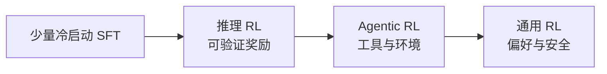

# 1.2 RLHF 与 RLVR

后训练要回答的问题是：怎样告诉模型一条回答比另一条好。RLHF 用学出来的奖励模型近似人类偏好。RLVR 用外部规则直接判定对错。两种奖励都可以套进后面的策略优化算法。

## 后文共用的符号

| 符号 | 含义 |
| --- | --- |
| \(q\) 或 \(x\) | 题目或用户提示 |
| \(y\) 或 \(o\) | 模型生成的回答，由 token \(o_1,\ldots,o_T\) 组成 |
| \(\pi_\theta\) | 当前要更新的策略，也就是语言模型本身 |
| \(\pi_{\theta_{\mathrm{old}}}\) | **旧策略**。这批回答是它采样出来的。重要性采样的分母是它 |
| \(\pi_{\mathrm{ref}}\) | **参考模型**。通常是 SFT 或冷启动之后冻住的副本。KL 惩罚拿它做锚，它不负责采样 |
| \(r_t(\theta)\) | token 级重要性比率 \(\pi_\theta(o_t\mid q,o_{<t}) / \pi_{\theta_{\mathrm{old}}}(o_t\mid q,o_{<t})\) |
| \(R\) | 整条回答的奖励。规则奖励常取 \(+1/-1\) 或 \(0/1\)，奖励模型则给出连续分数 |
| \(\hat A\) | 优势。这条回答或这个 token 比基线好多少 |

旧策略和参考模型是两个对象。采样分布变了，要修正的是 \(\pi_{\theta_{\mathrm{old}}}\)。防止模型为了刷分而离开正常语言，约束的是相对 \(\pi_{\mathrm{ref}}\) 的距离。

## 两个会反复出现的量

**KL 散度**衡量两个分布差多远。后训练里写的通常是 \(\mathrm{KL}(\pi_\theta \| \pi_{\mathrm{ref}})\)：按当前策略采样时，它和参考模型的对数概率平均差多少。KL 越大，当前模型越不像参考模型。它不对称，左右对调不是同一个数。

**重要性采样**解决「数据是旧策略采的，梯度却要更新新策略」。单个 token 的修正系数就是上面的 \(r_t\)。\(r_t=1\) 表示新旧策略给这个 token 的概率相同；\(r_t>1\) 表示新策略更愿意生成它。比率只在两个分布都能生成这个 token 时有意义。

**策略熵**是下一个 token 分布有多分散。熵下降，表示模型越来越确定，探索变少。后文说的熵坍塌，就是这个分布过早收成少数几种句式。

## RLHF：人负责比较，模型负责打分

人很难写出完美回答，但比较两条回答的高下更容易。InstructGPT 把这件事做成三步。

<figure markdown="span">
  { width="100%" }
  <figcaption>InstructGPT：示范数据做 SFT，标注员把多次采样从好到差排序并训练奖励模型，再用 PPO 提高奖励。图源 arXiv:2203.02155。</figcaption>
</figure>

### 奖励模型怎么从排序里学出来

Bradley-Terry 模型把两条回答的偏好概率写成奖励差的 sigmoid：

$$
P(y_w \succ y_l \mid x)
= \sigma\big(r_\varphi(x, y_w) - r_\varphi(x, y_l)\big)
$$

\(y_w\) 是被选中的较好回答，\(y_l\) 是较差的那条，\(\sigma\) 是 logistic 函数。训练奖励模型，就是让这个概率拟合标注员的选择。图里的「从最好排到最差」可以拆成多对比较，再套同一个公式。

### 策略的优化目标

有了奖励模型 \(r_\varphi\)，策略要提高奖励，同时不要离开参考模型太远：

$$
\max_{\pi_\theta}
\mathbb{E}_{x \sim \mathcal{D},\, y \sim \pi_\theta(\cdot\mid x)}
\big[r_\varphi(x, y)\big]
- \beta \, \mathrm{KL}\big(\pi_\theta(\cdot\mid x) \,\|\, \pi_{\mathrm{ref}}(\cdot\mid x)\big)
$$

\(\beta\) 越大，KL 惩罚越强。PPO 在实现里常把 KL 变成每个 token 的惩罚，加进奖励，而不是直接优化上面这一行。1.4 给出的是实际使用的裁剪目标。

### 奖励模型的四个老问题

| 问题 | 表现 | 常见处理 |
| --- | --- | --- |
| Reward hacking | 模型学会讨好打分器 | KL、多模型集成、缩短奖励模型的使用窗口 |
| 长度偏差 | 更长的回答更容易得高分 | 长度归一化或显式长度惩罚 |
| 域外失效 | 训练分布以外的题打分不稳 | 多轮更新奖励模型 |
| 分布漂移 | 策略更新后，打分器看到的输入变了 | 在线更新，或在可验证任务上改用规则 |

### SFT 在这条流水线里的位置

SFT 先教两件事：输出是「问题后面接回答」，以及基本的指令格式。没有这个起点，强化学习会花很多样本在格式上。R1-Zero 跳过 SFT 之后，推理行为会出现，同时伴随语言混杂和不可读输出。

SFT 数据过多会把概率质量收窄，后面的 RL 能探索的回答变少。Seed1.5 的对比里，RL 之前先做拒绝采样微调，avg@32 从 58% 降到 54%。冷启动因此宜少，用来放进格式和少量推理样例。

## RLVR：规则能判定时，不必先学一个奖励模型

RLVR（reinforcement learning with verifiable rewards）在 DeepSeek-R1（[arXiv:2501.12948](https://arxiv.org/abs/2501.12948)）里成为主流做法。数学、代码和部分逻辑题有标准答案或测试，奖励由规则给出：

$$
R(\hat y, y) =
\begin{cases}
+1, & \text{核验通过} \\
-1, & \text{否则}
\end{cases}
$$

也有实现用 \(0/1\)。核验函数可以是答案等价、单元测试通过或格式检查。

| | RLHF | RLVR |
| --- | --- | --- |
| 奖励从哪来 | 奖励模型近似偏好 | 规则核验 |
| 被钻空子的方式 | 讨好打分器 | 测试、抽取脚本或格式规则的漏洞 |
| 适合的任务 | 对话、写作、安全 | 有确定核验标准的任务 |
| 需要的标注 | 偏好比较 | 题目和标准答案或测试 |
| 常搭配的算法 | PPO、DPO | GRPO、DAPO、VAPO、CISPO、GSPO、SAPO |

规则奖励去掉了「打分网络被梯度利用」这一条，核验器本身仍可能被利用。单元测试覆盖不足、答案只从最后一个盒子里抽取、长度和格式奖励，都会给策略留下捷径。

RLVR 在推理任务上成立，有四个互相加强的原因：对错信号相对干净；题目可以按规则扩写；数学答案没有「写得更讨喜」这种连续空间；DeepSeek-R1-Zero 观察到纯规则奖励下出现自我修正一类行为。它覆盖不了没有标准答案的写作和开放问答，那些任务仍要回到偏好模型或评分量表。

## 2025 年以后常见的顺序

冷启动把搜索空间收进可读的对话格式。推理 RL 用可验证奖励加强多步推导。工具调用和环境交互是后面的扩展，各家名字不同。最后一轮再用偏好或安全奖励覆盖开放场景。DeepSeek-R1 的偏好奖励模型只在这一段的后部使用，时间拉长会出现 reward hacking。
