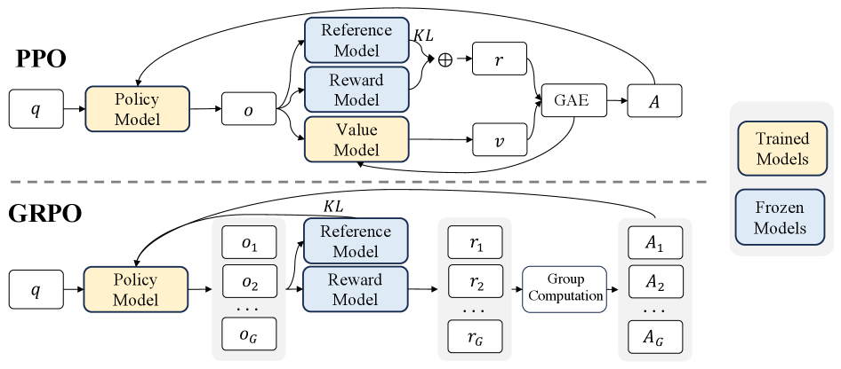

# 1.5 GRPO

论文：*DeepSeekMath*（Shao et al., 2024，[arXiv:2402.03300](https://arxiv.org/abs/2402.03300)）。DeepSeek-R1 沿用了这套组内优势。

GRPO 去掉的是价值网络。同一道题采样一组回答，用组内奖励的相对位置代替 GAE。奖励可以仍由奖励模型给出，也可以换成规则。**去掉 Critic 和改用规则奖励是两件事。** DeepSeekMath 的图里还保留着奖励模型；R1 在数学和代码上把这个盒子换成了规则。

<figure markdown="span">
  { width="90%" }
  <figcaption>DeepSeekMath 的原图。GRPO 没有 Value Model，优势来自一组奖励的相对计算。图中的 Reward Model 是当时的打分器；RLVR 用规则替换这个盒子，算法的其余部分不变。图源 arXiv:2402.03300。</figcaption>
</figure>

## 目标函数

对题目 \(q\) 从旧策略采样 \(G\) 条回答 \(\{o_i\}_{i=1}^{G}\)：

$$
\mathcal{J}_{\mathrm{GRPO}}(\theta)
= \mathbb{E}
\left[
\frac{1}{G}
\sum_{i=1}^{G}
\frac{1}{|o_i|}
\sum_{t=1}^{|o_i|}
\left(
\min \big(
r_{i,t}(\theta)\, \hat A_{i,t},\;
\mathrm{clip}(r_{i,t}(\theta), 1-\varepsilon, 1+\varepsilon)\, \hat A_{i,t}
\big)
- \beta \, \mathbb{D}_{\mathrm{KL}}
\right)
\right]
$$

外层先对每条回答按长度平均，再对 \(G\) 条回答平均。这是 sample-level 归一化。DAPO 会改掉这一层。

DeepSeekMath 里的优势是组内标准化，而且同一条回答的每个 token 共用一个值：

$$
\hat A_{i,t}
= \frac{R_i - \mathrm{mean}(\mathbf{R})}{\mathrm{std}(\mathbf{R})}
$$

\(\mathbf{R}=\{R_1,\ldots,R_G\}\)。DeepSeek-V3.2 的公式写成只减组均值、不除标准差。除以标准差会把「偶然只有一条做对」的题目放大：通过率越接近 0 或 1，分母越小，那条例外样本的优势越大。Dr. GRPO（[arXiv:2503.20783](https://arxiv.org/abs/2503.20783)）指出这个分母会改变不同题目的梯度权重，并主张去掉它。读论文时要看具体实现用的是哪一种。

全对或全错时，分子和标准差都是 0。加一个很小的 \(\epsilon\) 只能避免除零，造不出方向。这条题的梯度是 0，DAPO 会把它换掉。

### 一个算完的组

题目采样 4 条，奖励为 \(+1,-1,+1,-1\)。均值是 0，总体标准差是 1。正确样本优势为 \(+1\)，错误样本为 \(-1\)。这四条回答内部的每个 token 都用同一个优势，GRPO 不区分「哪一个 token 导致了答对」。

## KL 估计

GRPO 常用 Schulman 的 K3 估计器，对单个被采样 token：

$$
k_3
= \frac{\pi_{\mathrm{ref}}}{\pi_\theta}
- \log \frac{\pi_{\mathrm{ref}}}{\pi_\theta}
- 1
$$

当样本来自**当前**策略 \(\pi_\theta\) 时，\(k_3\) 的期望等于 \(\mathrm{KL}(\pi_\theta \| \pi_{\mathrm{ref}})\) 的对应项，所以它是这个数值的无偏估计。GRPO 的样本来自 \(\pi_{\theta_{\mathrm{old}}}\)。V3.2 因此再乘上重要性比率，使梯度在旧策略采样下无偏：

$$
\mathbb{D}_{\mathrm{KL}}
= \frac{\pi_\theta}{\pi_{\theta_{\mathrm{old}}}}
\left(
\frac{\pi_{\mathrm{ref}}}{\pi_\theta}
- \log \frac{\pi_{\mathrm{ref}}}{\pi_\theta}
- 1
\right)
$$

未乘这一项时，若 \(\pi_\theta \ll \pi_{\mathrm{ref}}\)，K3 的梯度会给这些 token 过大的权重。1.5 的目标和 V3.2 的修正差的就是这个因子。DAPO 在长思维链场景里则把 KL 整个去掉。

## 硬裁剪为什么让梯度变成 0

单个 token 的贡献是

$$
L_t = \min\big(r_t \hat A_t,\; \mathrm{clip}(r_t, 1-\varepsilon, 1+\varepsilon)\, \hat A_t\big)
$$

优势为正且 \(r_t>1+\varepsilon\) 时，`min` 取到常数 \((1+\varepsilon)\hat A_t\)，\(\nabla_\theta L_t = 0\)。优势为负且 \(r_t<1-\varepsilon\) 时同样为 0。其余情况梯度还在。写成掩码就是

$$
\nabla_\theta L_t = M_t \cdot \hat A_t \cdot \nabla_\theta \log \pi_\theta(o_t \mid \cdots)
$$

\(M_t\) 在上述两种越界时为 0，否则为 1。优势本身为 0 时，即使 \(M_t=1\)，梯度也是 0。

低概率的转折词最容易撞上第一种情况。旧概率 0.005、新概率 0.01 时，比率已经是 2，超过 \(1.2\)。绝对概率仍只有 1%，这一步却不再更新它。CISPO 改的就是这个掩码。

## 这套设计换来了什么

| 选择 | 结果 |
| --- | --- |
| 去掉 Critic | 少一个同规模网络。DeepSeek 在 671B 上认为这块显存放不下 |
| 奖励仍可来自模型或规则 | 规则奖励避开打分网络；开放任务仍要用奖励模型 |
| 组内相对优势 | 不需要每个 token 的价值估计 |
| 保留 PPO 裁剪 | 单步仍有信任域，越界 token 的梯度会断 |

留下的三个问题是：越界 token 梯度为 0；token 级比率在长序列和 MoE 上方差大；整段回答共用一个优势，分不清内部贡献。后面几节分别处理这三件事。
