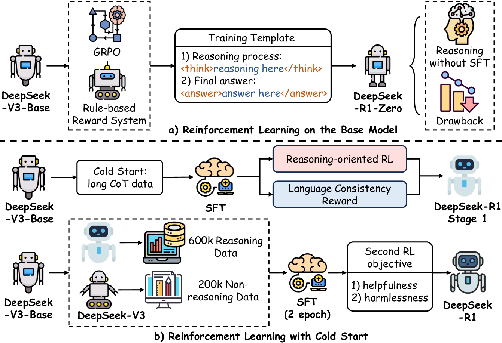
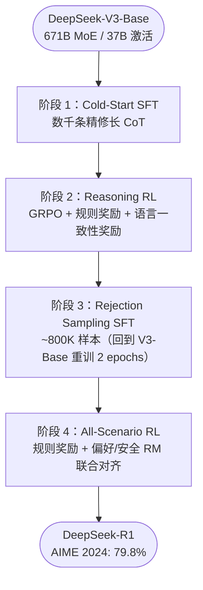
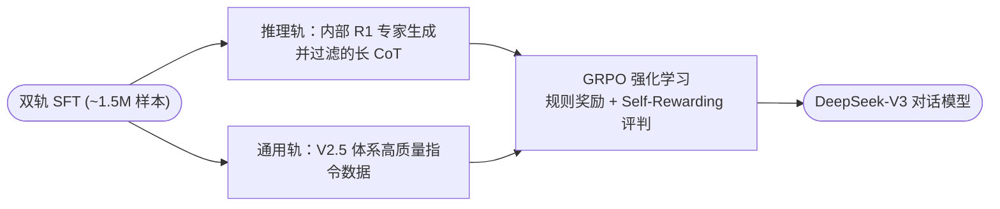
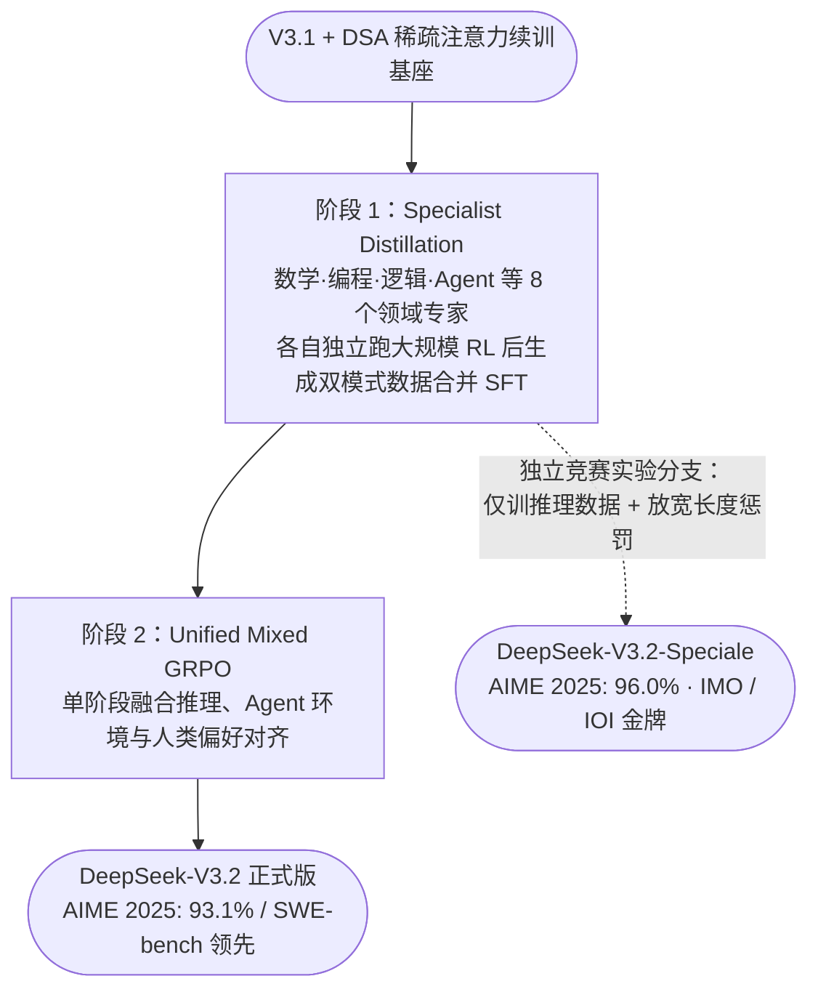

# 2.1 DeepSeek — 从纯 RL 涌现到 Specialist Distillation

!!! abstract "本节摘要"
    DeepSeek 系列在后训练领域确立了三条极具影响力的路径：**R1** 证明纯可验证强化学习可从基座涌现出长思维链与自我反思能力；**V3** 展示了利用强推理教师以极低成本（后训练仅占总成本 0.18%）整合推理能力的路径；**V3.2** 则引入 8 域 **Specialist Distillation** 与 4 项 GRPO 大规模稳定化技术，将后训练预算提升至预训练成本的 **>10%**，实现 AIME 2025 通用模式 93.1%、Speciale 推理分支 96.0% 的跨越。

!!! note "本章阅读说明"
    本章对 2024–2026 年主流大模型的 Post-Training 技术报告进行逐家拆解，分析均遵循**“核心动机 → 流水线与算法 → 关键发现与负面教训 → 系列演进”**的结构：

    - **深度解读（2.1–2.6 节）**：DeepSeek、Kimi、Qwen、MiniMax、GLM-5、Seed 六大公开了详尽技术报告的代表模型线；
    - **概要参考（2.7 节）**：OpenAI、Google、Anthropic 等闭源模型中可考证的安全与后训练细节；
    - **横向综合与数据工程（2.8–2.10 节）**：跨模型流水线对比、后训练数据获取全景以及基座 Agentic 能力的完整构建链路。

!!! abstract "核心报告来源"
    - **DeepSeek-V3**: *DeepSeek-V3 Technical Report*, [arXiv:2412.19437](https://arxiv.org/abs/2412.19437) (2024.12)
    - **DeepSeek-R1**: *Incentivizing Reasoning Capability in LLMs via Reinforcement Learning*, [arXiv:2501.12948](https://arxiv.org/abs/2501.12948) (2025.01)
    - **DeepSeek-V3.2**: *DeepSeek-V3.2: Pushing the Frontier of Open Large Language Models*, [arXiv:2512.02556](https://arxiv.org/abs/2512.02556) (2025.12)

---

## DeepSeek-R1 — 纯 RL 推理涌现与四阶段精炼

<figure markdown="span">
  { width="95%" }
  <figcaption>DeepSeek-R1 训练流程概览：(a) R1-Zero 跳过 SFT 直接在 V3-Base 上运行 GRPO；(b) R1 完整四阶段流水线 — Cold-Start SFT → Reasoning RL → Rejection Sampling SFT → All-Scenario RL（图源：arXiv:2503.06072，绘自 arXiv:2501.12948）</figcaption>
</figure>

### 核心动机

R1 面对的核心问题是：**能否不依赖昂贵的人工长思维链标注，让大模型自己探索出竞赛级的复杂多步推理能力？** 传统在人工 CoT 上做 SFT 的路线既受限于人类标注员的解题上限，也容易让模型流于表面模仿。DeepSeek 的假设是：万亿 token 预训练已在基座内部埋下了丰富的局部推理“种子”，强化学习只需通过客观对错反馈将这些潜在行为激活并串联起来。

### R1-Zero：无 SFT 纯 RL 涌现实验

为了验证这一假设，团队首先做了极端的 **DeepSeek-R1-Zero** 实验：完全跳过 SFT，直接在 **DeepSeek-V3-Base**（671B MoE，每 token 激活 37B）上运行 GRPO，仅要求模型将思考放入 `<think>...</think>`、答案放入 `<answer>...</answer>`，使用**纯规则奖励（答案准确性奖励 + 标签格式奖励）**，不引入任何神经网络奖励模型。

!!! success "自然涌现的三大高级推理行为"
    - **“Aha Moment”（顿悟与自我纠错）**：训练中途，模型在无人示范的情况下自发生成 *"Wait, wait. Wait. That's an aha moment I can flag here..."*，主动推翻前文有误的中间推导并重新验算；
    - **测试时计算（思维链长度）按需自适应增长**：随着 RL 步数推进，平均回答长度从数百 token 自然延伸至上万 token，且模型在难题上自动投入更长思考；
    - **反思词汇频率跃升**：诸如 `"wait"`、`"recheck"`、`"alternatively"` 等回溯与验证词的出现频率增长了 5–7 倍。

!!! warning "R1-Zero 暴露的缺陷"
    虽然 R1-Zero 在 AIME 2024 `Pass@1` 上飙升至 **71.0%**（多数投票 `cons@64` 达 86.7%，显著超越此前通用对话版 DeepSeek-V3 的 39.2%），但其思维链存在严重的**中英多语言混杂、可读性差、排版混乱**等问题——证明纯 RL 足以激发核心推理能力，但仍需轻量 SFT 提供人类可读的语言规范与格式起点。

### DeepSeek-R1 完整四阶段流水线

| 阶段 | 核心数据与超参设计 | 工程与算法设计理由 |
|------|-------------------|-------------------|
| **1. Cold-Start SFT** | **数千条**高质量长 CoT（采样自 R1-Zero 高可读输出并经人工精修，含末尾结构化总结） | 用最少的数据规范可读格式与总结习惯，最大限度保留后续 RL 的策略探索空间 |
| **2. Reasoning RL** | 聚焦数学、代码、科学、逻辑；叠加轻微的**语言一致性奖励**（目标语种词汇占比） | 消除多语混杂（虽轻微折损一点点纯推理分，但大幅提升人类可读性）；GRPO 省去 671B Critic 显存 |
| **3. Rejection Sampling SFT** | **~800K 样本**：约 600K 推理轨迹（从阶段 2 checkpoint 多采样过滤，引入 V3 辅助生成式评判）+ 200K 通用写作/QA 数据 | **回到 DeepSeek-V3-Base 重新微调 2 个 epoch**（而非在 RL 模型上继续 SFT），干净地融合通用能力并消除前序 RL 的局部模式偏移 |
| **4. All-Scenario RL** | 推理题继续用规则奖励；开放场景用有用性 RM（仅评估 `<answer>` 最终摘要，不干涉 `<think>` 内部思考）与安全性 RM（106K 安全提示） | 神经网络偏好 RM **严格限制在最后 400 步（总 1700 步）启用**，避免长时间暴露引发 Reward Hacking |

### 极具价值的负面实验记录（R1 报告 §4.2）

| 探索方向 | 实验结论 | 失败根因剖析 |
|----------|----------|-------------|
| **Process Reward Model (PRM，过程奖励模型)** | 综合性价比不及规则结果奖励 | ① 一般推理难以界定清晰的“单步”边界；② 自动标注中间步对错不够准，人工标注无法扩展；③ 神经网络 PRM 在大规模 RL 中**必然遭遇严重的 Reward Hacking**，且重训管线极其繁琐 |
| **Monte Carlo Tree Search (MCTS，蒙特卡洛树搜索)** | 未能复现 AlphaGo 式的自我迭代提升 | ① 词元生成搜索空间相比围棋呈指数级膨胀，局部剪枝极易漏掉正途；② 训练出的细粒度 Value 模型质量不足以准确引导搜索树扩展 |

### 强模型蒸馏发现：小模型上“SFT 蒸馏 >> 从头直接 RL”

团队用训练好的 R1 生成了约 **800K** 高质量样本，直接对 Qwen 与 Llama 系列开源基座（1.5B～70B）做**纯 SFT 蒸馏（未跑额外 RL）**，并与在 Qwen2.5-32B-Base 上直接做一万步以上大规模 RL 的结果做公平对比：

| 模型 | 后训练方式 | AIME 2024 (`Pass@1`) | MATH-500 |
|------|-----------|----------------------|----------|
| Qwen2.5-32B-Zero-RL（10K+ 步） | 小基座直接从头 RL | 47.0 | 91.6 |
| QwQ-32B-Preview | 推理 RL | 50.0 | 90.6 |
| **DeepSeek-R1-Distill-Qwen-32B** | **纯 SFT 蒸馏自 R1** | **72.6** | **94.3** |
| **DeepSeek-R1-Distill-Qwen-1.5B** | **纯 SFT 蒸馏自 R1** | **28.9**（超越 GPT-4o 的 9.3） | **83.9** |

!!! success "关键结论"
    在 32B 规模上，直接继承 671B 大教师探索出的高级推理模式，比让 32B 模型自己从零做 RL 高出 **+25.6 分**且算力成本低一个数量级。这确立了**“前沿超大模型重度 RL 探路上限，中小尺寸模型先蒸馏吸收再辅以轻量 RL”**的产业分工范式。

---

## DeepSeek-V3 — 高效双轨蒸馏与极致后训练性价比

早于 R1 一个月发布的 DeepSeek-V3（对话通用版）回答了另一个工程问题：**当内部已经拥有早期 R1 系列推理专家模型时，如何以最小代价把推理能力迁移进通用对话主力模型而不损害日常交互体验？**

- **专家拒绝采样平衡冗长与准确率**：直接蒸馏原始 R1 输出会让日常模型变得罗嗦；V3 先在各领域训练专项推理模型，混合常规 `<问题, 简洁解答>` 与带反思验证的 `<系统提示, 问题, R1 解答>` 做高温 RL，再用拒绝采样筛出**既保留反思准确性、行文又干练紧凑**的轨迹汇入 1.5M SFT 库。
- **Self-Rewarding（自我评判 RM）**：在开放问答上，V3 本身借助 Constitutional AI 与投票机制充当生成式评判器，在 RewardBench 上取得 **87.0**（`maj@6` 达 89.6），与 GPT-4o（86.7）、Claude-3.5-Sonnet（88.7）持平。
- **Multi-Token Prediction (MTP)**：预训练引入深度 $D=1$ 的额外下一词元预测模块（训练损失权重由 $0.3$ 退火至 $0.1$），不仅加密了表征监督信号，还能在部署推理时直接用作投机解码草稿头（接受率 85%–90%，生成吞吐提升 **1.8×**）。

### DeepSeek-V3 全生命周期算力账单

| 训练阶段 | H800 GPU 小时 | 折算租赁成本（按 $2/GPU·h） | 成本占比 |
|----------|--------------|----------------------------|----------|
| 预训练（14.8T tokens） | 2,664K | $5.328M | 95.55% |
| 长上下文扩展（32K → 128K） | 119K | $0.238M | 4.27% |
| **后训练（SFT + GRPO RL）** | **5K** | **$0.010M（仅 1 万美元）** | **0.18%** |
| **全流程总计** | **2,788K** | **$5.576M** | **100%** |

这张表清晰表明：在已有现成推理教师的前提下，后训练只需 **5K GPU 小时** 就能完成能力整合；同时也引出了下一代的核心追问——如果后训练不再只花 0.18% 的零头算力，而是投入重兵继续扩展 RL，天花板还能推多高？

---

## DeepSeek-V3.2 — Specialist Distillation 与大规模 GRPO 工程化

DeepSeek-V3.2（[arXiv:2512.02556](https://arxiv.org/abs/2512.02556)）正面回答了上面的追问：它将后训练算力预算大幅拉升至**预训练总成本的 10% 以上**，并在复用 671B/37B MoE 骨干的基础上，通过约 946B tokens 继续预训练引入了 **DeepSeek Sparse Attention (DSA)** 将长文本注意力复杂度降至近线性。

### 后训练架构：8 域专家分治蒸馏 + 单阶段混合 GRPO

1. **阶段 1 — Specialist Distillation（分治专家蒸馏）**：不同于 V3 仅靠单一 R1 模型蒸馏，V3.2 先从同一基座针对**数学、竞赛编程、通用逻辑、Agentic Coding、Agentic Search、通用写作等约 8 个专门领域**各自独立训练专精教师（每个专家都分配充裕的专属 RL 算力预算），随后让各专家同时产出 `<thinking>` 与 `<non-thinking>` 轨迹，合并蒸馏出一个高起点学生模型。实验证实“先分域重度 RL 探顶、再蒸馏合流”显著优于单一通用教师。
2. **阶段 2 — Unified Mixed GRPO（单阶段混合强化学习）**：将数学代码推理（规则 + 长度 + 语言一致性奖励）、Agent 多步环境交互（1,827 个合成与真实环境 / 4,417 个任务）以及通用人类对齐（每个 prompt 附带专属评分 Rubric 的生成式 RM）**合并进同一个 GRPO 训练阶段**，避免了传统多阶段串联训练“训了后面忘前面”的灾难性遗忘。
3. **实验分支 — DeepSeek-V3.2-Speciale**：为探索长链极限推理而拉出的平行实验分支，在 RL 中仅聚焦推理数据并大幅放宽长度惩罚（平均输出约 23K tokens，对比标准 Thinking 版的 16K tokens），一举拿下 IMO 2025 金牌（35/42 分）、IOI 2025 金牌（第 10 名）与 ICPC World Finals 金牌（第 2 名）。

### 四项大规模 GRPO 训练稳定化技术

当 GRPO 训练步数与异策略程度大幅增加时，V3.2 总结了四项缺一不可的底层修复：

| 稳定化技术 | 针对的具体失稳现象 | 精确数学 / 工程实现方案 |
|------------|-------------------|------------------------|
| **1. Unbiased KL Estimate（无偏 KL 梯度估计）** | 数据采样自 $\pi_{\text{old}}$ 时，原始 K3 散度在 $\pi_\theta \ll \pi_{\text{ref}}$ 处产生无界偏置梯度，逐步污染生成质量 | 在 K3 项外乘上逐 token 重要性比率：$\mathbb{D}_{\text{KL}} = \dfrac{\pi_\theta}{\pi_{\text{old}}}\!\left(\dfrac{\pi_{\text{ref}}}{\pi_\theta} - \log\dfrac{\pi_{\text{ref}}}{\pi_\theta} - 1\right)$，使梯度在 $\pi_{\text{old}}$ 采样下恢复严格无偏；同时对数学域采用弱/零 KL，对其他域保留较强 KL |
| **2. Off-Policy Sequence Masking（异策略负样本序列掩码）** | 大 rollout 分多 mini-batch 更新或异步采样时，偏离过远的负优势序列引入剧烈破坏性梯度 | 计算序列平均实测 KL 散度，若某条回答**优势 $\hat{A}_i < 0$ 且新旧策略偏离超过阈值**，直接将该条序列整段 Mask 置零不参与更新 |
| **3. Keep Routing（MoE 专家路由保持）** | 推理采样引擎与训练引擎在 MoE 层激活了不同的 top-k 专家子网，导致 $r_{i,t}$ 失真震荡 | 记录推理采样阶段每层实际激活的专家路由索引，在训练前向与反向传播时**强制沿用相同专家路由**（自 V3-0324 起标配） |
| **4. Keep Sampling Mask（采样截断掩码保持）** | 采样时开启了 `top-p` / `top-k` 截断，训练重算全词表 Softmax 时概率分布支撑集不一致 | 保存采样时的截断掩码并在训练端对 $\pi_\theta$ 施加完全相同的掩码归一化，确保 $\pi_\theta$ 与 $\pi_{\text{old}}$ 共享同一行动空间 |

### 核心评测与已知局限

=== "V3.2 通用模式 vs Speciale 推理分支"

    | 基准 / 竞赛 | DeepSeek-V3.2 (Thinking) | DeepSeek-V3.2-Speciale | 备注 |
    |-------------|--------------------------|------------------------|------|
    | **AIME 2025 (`Pass@1`)** | **93.1%** | **96.0%** | Speciale 输出 token 约为标准版 1.4–2× |
    | **HMMT Feb 2025** | 92.5% | **99.2%** | 逼近满分 |
    | **IMO 2025 / IOI 2025 / ICPC WF** | — | **三项全金牌** | 达到人类顶级奥赛选手水平 |

=== "报告坦诚披露的局限"

    - **Token 效率仍落后顶级闭源模型**：实现同等推理精度时，V3.2（尤其是 Speciale）消耗的思维链 token 长度仍显著多于 Gemini-3.0-Pro，后续需进一步优化单位 token 推理密度；
    - **超长多轮 Agent 上下文压力**：复杂仓库与多步搜索轨迹容易触及 128K 窗口上限，需结合上下文管理机制；
    - **极端组合难题天花板**：在 IMO 2025 最难的第 6 题上仍为 0 分。

---

## DeepSeek 系列演进纵览

| 对比维度 | DeepSeek-V3 (2024.12) | DeepSeek-R1 (2025.01) | DeepSeek-V3.2 (2025.12) |
|----------|----------------------|----------------------|------------------------|
| **核心定位** | 高性价比通用主力对话模型 | 专用深度思考推理旗舰 | **通用对话 + 深度推理 + Agent 大一统** |
| **注意力机制** | MLA（稠密跨度） | MLA | **MLA + DSA（细粒度动态稀疏注意力）** |
| **后训练核心配方** | 单一 R1 蒸馏 + 双轨 SFT + Self-Rewarding | Cold SFT → 纯规则 GRPO → RS SFT → 混合 RL | **8 域 Specialist Distillation → 单阶段 Mixed GRPO** |
| **GRPO 实现演进** | 标准 GRPO | 标准 GRPO（组内标准化） | 去均值优势 + **无偏 KL + 负样本序列 Mask + Keep Routing + Keep Sampling Mask** |
| **后训练算力投入** | 5K H800 小时（占总成本 **0.18%**） | 大规模推理 RL 投入 | 跃升至预训练成本的 **>10%** |
| **代表数学表现** | AIME 2024: 39.2 | AIME 2024: **79.8**（Zero: 71.0） | AIME 2025: **93.1**（Speciale: **96.0**） |
