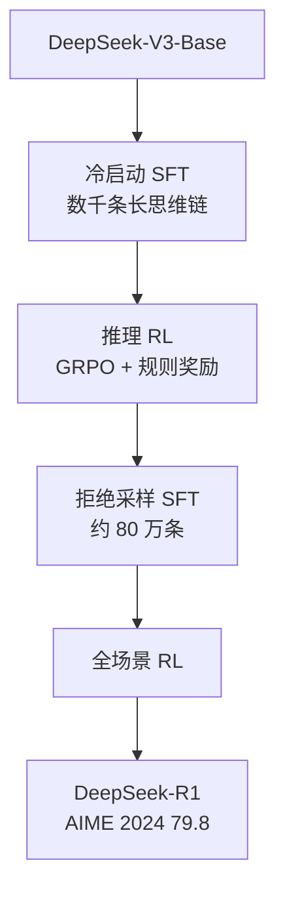

# 2.1 DeepSeek

报告：

- R1：[arXiv:2501.12948](https://arxiv.org/abs/2501.12948)
- V3：[arXiv:2412.19437](https://arxiv.org/abs/2412.19437)
- V3.2：[arXiv:2512.02556](https://arxiv.org/html/2512.02556)

这一家留下三条还能复用的路径：R1 证明规则奖励可以从基座里放出长推理；V3 用蒸馏把推理能力便宜地装进通用模型；V3.2 改成多个领域专家各自强化学习，再把后训练预算从可忽略加到预训练的 10% 以上。

## R1：先看纯规则奖励能走出什么

R1 要解决的问题是竞赛级多步推理，而标注员写不了那么多可靠的长思维链。他们的假设是：预训练已经留下推理模式，RL 负责把这些模式的概率抬上去。

### R1-Zero

R1-Zero 跳过 SFT，直接在 DeepSeek-V3-Base（671B MoE，约 37B 激活）上做 GRPO。奖励只有数学正确性和格式，没有神经网络打分器。

AIME 2024 达到 71.0。训练中出现自发的 “Wait, let me reconsider”，困难题的思维链变长，反思类词频增加大约 5 到 7 倍。同时出现语言混杂和不可读输出。纯规则奖励能改变推理行为，可读格式仍要靠少量 SFT。

论文对比表里的 39.2 是已经后训练过的 **DeepSeek-V3**，不是 V3-Base 的起点。R1-Zero 从基座训到 71.0，不能写成「基座原来就是 39.2」。

<figure markdown="span">
  { width="95%" }
  <figcaption>上半是 R1-Zero。下半是带冷启动的 R1：长思维链 SFT、带语言一致性奖励的推理 RL，再用约 60 万推理样本和 20 万非推理样本做第二次 SFT，最后做有用性和无害性的第二轮 RL。图源 arXiv:2503.06072，依据 R1 论文。</figcaption>
</figure>

### 四段流水线

| 阶段 | 数据与超参 | 为什么这样 |
| --- | --- | --- |
| 冷启动 | 数千条，来自 R1-Zero 的过滤输出和人工修改 | 只放入格式，把探索空间留在 RL |
| 推理 RL | 学习率 \(3\times 10^{-6}\)，每题 16 条，最长 65K | 671B 上不再训练同规模 Critic |
| 拒绝采样 SFT | 数学约 39.5 万、代码 21.1 万、STEM 1 万、逻辑 1 万、通用 17.8 万 | **从 V3-Base 重新 SFT**，避免直接继承 RL 的分布 |
| 全场景 RL | 偏好模型只看最终摘要；安全数据约 10.6 万 | 偏好模型只用最后约 400/1700 步，更长会出现 reward hacking |

语言一致性奖励加在推理 RL 里，用来压住 R1-Zero 的语言混杂。图上的第二轮 RL 同时看有用和无害。

GRPO 在这里的优势是组内相对奖励。数学和代码用规则分。过程奖励模型没有胜过结果奖励：中间步骤难标注，大规模训练里容易被钻，而且策略一变就要重训。蒙特卡洛树搜索也没有跑通，token 空间比棋盘大得多，价值估计站不住。

### 蒸馏比同尺寸直接 RL 高

用 R1 生成的约 80.4 万条推理样本对小模型做纯 SFT：

| 模型 | 做法 | AIME 2024 |
| --- | --- | --- |
| Qwen2.5-32B 直接 RL | 一万步以上 | 47.0 |
| QwQ-32B-Preview | RL | 44.0 |
| R1-Distill-Qwen-32B | SFT 蒸馏 | 72.6 |
| R1-Distill-Qwen-1.5B | SFT 蒸馏 | 28.9 |

32B 上蒸馏比同尺寸从头 RL 高约 25 分。1.5B 蒸馏高于当时表中 GPT-4o 的 9.3。学生模型这 80 万条里没有再做 RL。报告认为在蒸馏模型上继续 RL 还会涨，实验留给了后续工作。

## V3：把 R1 的推理便宜地装回去

V3 要的是通用模型，而不是再训一个专用推理模型。流水线是约 150 万条双轨 SFT（R1 风格的长思维链，加上原有通用数据），然后 GRPO，奖励里既有规则也有模型分。V3 自己做评判时，RewardBench 约 87.0，多数投票约 89.6。

| 阶段 | H800 GPU 小时 | 费用 |
| --- | --- | --- |
| 预训练 | 2,664K | 532.8 万美元 |
| 上下文扩展 | 119K | 23.8 万美元 |
| 后训练 | 5K | 1 万美元 |
| 合计 | 2,788K | 557.6 万美元 |

后训练占合计的 0.18%。557.6 万美元是这一次从预训练到后训练的总账单，不是 R1 的 RL 账单，也不能拿来和只报告 RL 租金的模型直接比「十分之一」。

V3 还有一个深度为 1 的多 token 预测头，用于投机解码，接受率约 85% 到 90%，吞吐约 1.8 倍。训练权重从 0.3 降到 0.1，推理不用投机解码时可以丢掉这个头。

## V3.2：专家分开练，再合成一次 RL

架构与 V3 相同，新增 DeepSeek Sparse Attention，在 V3 检查点上继续训练约 946B token 来适配。后训练分成两件独立的事，而不是一条把 Speciale 串在最后的链：

1. **领域专家蒸馏。** 数学、代码、科学、写作、Agent 等约 8 个专家各自做大规模 RL，再把各自的蒸馏数据合并。这和 V3 只用一个 R1 教师不同。
2. **混合 GRPO。** 推理、Agent 和人类偏好放进同一个 RL 阶段。
3. **V3.2-Speciale 是分支。** 它放松长度惩罚，用更多 token 做深推理。AIME 2025 为 96.0，通用模式是 93.1。Speciale 不是 93.1 的上游步骤。

通用模式的其他成绩包括 IMO 2025 金牌（35/42）、IOI 2025 金牌（第 10）、ICPC World Finals 2025 金牌（第 2）。Speciale 在 HMMT 2025 年 2 月场为 99.2，token 消耗约为通用模式的 2 到 3 倍，也高于 Gemini-3.0-Pro 的消耗。IMO 最难题 P6 得 0 分。

### 四项稳定化

| 技巧 | 处理的问题 | 做法 |
| --- | --- | --- |
| 无偏 KL | 样本来自旧策略时，裸的 K3 梯度有偏 | 乘上 \(\pi_\theta/\pi_{\theta_{\mathrm{old}}}\)，公式见 [1.5](../ch1/1.5-grpo.md) |
| 序列掩码 | 负优势且 KL 偏离大的样本噪声大 | 整段不参与梯度 |
| Keep Routing | 采样和训练的 MoE 专家不一致 | 训练时沿用采样时的路由 |
| Keep Sampling Mask | top-p / top-k 的截断在训练时丢失 | 用采样时的掩码计算概率 |

Keep Routing 和 GSPO 处理的是同一类路由不一致。V3.2 选择锁住路由，GSPO 选择改比率的粒度，二者不是互相否定。数学任务用很弱甚至为零的 KL 更好，其他领域需要更强的 KL，所以超参按领域分开。

后训练从 V3 的约 5K 小时升到预训练成本的 10% 以上，绝对小时数没有精确公开。报告认为继续加 RL 计算仍能涨。

## 三代怎么接上

| | V3 | R1 | V3.2 |
| --- | --- | --- | --- |
| 角色 | 通用模型，外加蒸馏来的推理 | 推理模型 | 通用和推理放在一起 |
| 后训练 | R1 蒸馏和自我评判 | 规则奖励 GRPO，再拒绝采样 | 多专家蒸馏，再混合 GRPO |
| 算法 | GRPO | GRPO | GRPO，加上面四项 |
| 公开成本 | 后训练 5K 小时 | 综述常引用约 147K H800 小时 | 后训练超过预训练的 10% |
| AIME | 对话模型 2024 为 39.2 | Zero 71.0，R1 79.8 | 2025：通用 93.1，Speciale 96.0 |

147K 小时来自围绕 R1 的公开成本讨论，不是 V3 报告那张 5K 小时的表。比较成本时要先看它覆盖的是 RL 阶段还是整次预训练。
