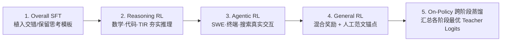

# 2.10 基座的 Agentic 能力是怎么训出来的

!!! abstract "本节摘要"
    一个真正能在真实代码库里修 Bug、敲终端排障、做多跳网页调研的基座模型，绝不是在最后一步塞几千条工具调用提示词微调出来的。本节以 **GLM-5** 为主线，串联 **Kimi K2.5** 与 **MiniMax M2/M2.5**，从 **(1) 贯穿 Pre/Mid/Post-Training 的全链路协同设计**、**(2) SWE / Terminal / Search 三大核心场景的环境与任务合成方法**，以及 **(3) 异步大规模 RL 中的训推不一致、异策略失控与多智能体编排挑战** 三个维度完整拆解现代 Agent 基座的锻造逻辑。

!!! info "延伸背景参考"
    本节分析框架融合了 GLM-5、Kimi K2.5、MiniMax 等一手技术报告，以及社区深度拆解长文《[Agentic 能力从哪里来？拆解基座大模型的训练过程](https://zhuanlan.zhihu.com/p/2015552122071037375)》的系统脉络。

    本节是纵向视角：一个旗舰基座从预训练到五阶段后训练的完整故事。跨流派的横向全景——多轮算法、五大场景、开源框架与评测——见 [Agentic RL 调研报告](../../agentic-rl/index.md)，尤其是 [1.1 多轮交互闭环](../../agentic-rl/ch1/1.1-pomdp-trajectory.md) 与 [3.1 框架对比](../../agentic-rl/ch3/3.1-frameworks.md)。

---

## 一、全链路协同：从底座预埋到五阶段渐进后训练

以面向 **ARC（Agentic, Reasoning, Coding）** 统一目标设计的 GLM-5 为例，Agent 能力在预训练与中间训练阶段就已经开始铺路：

1. **Pre-Training（打牢代码与科学推理底座）**：在 27T 早期语料中将代码与数学科学权重拉高至三分之一（9T），使模型原生具备极强的程序结构与形式逻辑表征；
2. **Mid-Training（拓展 200K 窗口 + 仓库级行动序列建模）**：
    - 渐进拉长窗口（`4K → 32K → 128K → 200K`），支撑数十轮工具输出不爆上下文；
    - **软件工程演进序列构造（约 160B tokens）**：不再只喂静态源码文件，而是把真实仓库的 **目录树 + Issue 问题描述 + 定位讨论 + Commit Diff 补丁 + PR 评审修改** 按时间因果顺序拼成完整长序列，让基座提前学到“从问题现象到代码变更”的状态转移规律。
3. **Post-Training（顺序解耦强化 + 末尾在线蒸馏合流）**：

- **为什么一定要先做 Reasoning RL 再做 Agentic RL？** 工具规划与报错归因的本质是多步条件推理；如果内部推理链本身脆弱跳步，直接扔进高延迟、稀疏反馈的多步工具沙箱里只会盲目试错。先在低开销可验证题目上把推理底座练硬，再进入多轮工具交互，样本效率高得多。
- **Agentic RL 轨迹与优势构造**：一条多轮交互轨迹记为交替序列 $y = (r_1, a_1, o_1, r_2, a_2, o_2, \ldots, r_n, a_n, o_n)$，其中 $r_k$ 是内部 `<think>` 推理，$a_k$ 是发出的工具调用动作，$o_k$ 是外部环境返回的观测文本（计算损失时通过动作掩码**仅对模型自己生成的 $(r_k, a_k)$ 计算策略梯度，对环境返回的 $o_k$ 屏蔽梯度**）。终局由沙箱验证器给出得分 $R(x, y_i)$，采用组内去均值优势 $A(x, y_i) = R(x, y_i) - \bar{R}(x)$ 更新。
- **On-Policy Cross-Stage Distillation（OPD 防遗忘收口）**：以前序各阶段巅峰检查点为 Teacher，让学生自采样并按逐 token 对数概率差 $\hat{A}_t = \mathrm{sg}[\log \pi_{\text{teacher}} - \log \pi_{\text{student}}]$ 更新——兼具 On-policy 不毁分布与 Logit 级高密度知识传递双重优势。

---

## 二、三大 Agentic 核心场景的环境与任务合成

Agentic 数据工程的核心口诀是：**不直接编造静态文本轨迹，而是批量建造“可重置、可交互、可自动判分”的任务环境**。标准化六步流水线为：

| 步骤 | 核心操作 | 交付产物 |
|------|----------|----------|
| **① 采集真实世界种子** | 挖掘 GitHub 历史 PR、技术排障文档、真实网页图谱或早期智能体探索日志 | 原始高复杂度素材 |
| **② 封装结构化任务** | 明确自然语言任务书、初始工作目录、允许调用的工具集与超时限制 | 标准化 Task 定义 |
| **③ 构建隔离执行环境** | 打包可秒级复位的 Docker 容器镜像或有状态模拟器 | 确定性初始状态与状态转移 |
| **④ 挂载防作弊验证脚本** | 编写单元测试套件、系统最终状态断言或唯一答案比对器 | 可靠的 0/1 或分步奖励源 |
| **⑤ 探索采样与双向质检** | 跑多轮 Rollout，剔除环境本身不稳定（Flaky）、存在作弊捷径（如直接 `git log` 偷看历史答案）或难度失衡的坏题 | 高信噪比任务池 |
| **⑥ 分流驱动训练** | 高分干净轨迹送入 SFT 建立行为模板；`(任务 + 容器镜像 + 测试脚本)` 直接送入 Agentic RL 在线采样 | SFT 轨迹集 + RL 环境集 |

### 1. SWE（软件工程仓库修复）环境合成

模型面对的是一个包含成百上千个源码文件的真实代码仓，必须自己用命令行搜索代码、阅读调用链、编辑文件、运行测试并根据报错迭代修改。判分严格依赖两组正交测试集：

- **F2P（Fail-to-Pass，故障修复测试）**：打补丁前必定失败、修复后必须全部通过，验证 Bug 是否真被修好；
- **P2P（Pass-to-Pass，回归保护测试）**：仓库原有的正常功能测试，修复后必须依然全部通过，防止“拆东墙补西墙”把别处改崩。

### 2. Terminal（命令行与系统运维）环境合成

GLM-5 等实践主要采用两条自动化合成路径：

- **种子场景扩写 + 多 Agent 落地验真**：从真实运维/编译/数据处理需求出发 → 任务设计 Agent 编写题目描述、Dockerfile 与验收测试脚本 → 验证 Agent 进容器实测环境能否正常构建与判分 → 修复 Agent 迭代打磨直至验收严密；
- **技术文档逆向生成 + 自验证**：从高质量 Linux / DevOps 技术文档中抽取复杂命令链路，让编码 Agent 逆向搭建出初始故障容器环境，并要求参考解法必须在真实容器内跑通全部断言方可入库。

### 3. Deep Search（多跳深度网页调研）数据合成

深度搜索最怕造出“模型靠预训练记忆直接秒答”或“搜一下标题第一条就出答案”的假多跳题。两家代表团队分别给出了精妙解法：

- **GLM-5 基于真实浏览图谱（Web Knowledge Graph）构造**：从早期搜索 Agent 真实访问过的网页集合中抽取实体、属性与跨页关联构建知识图谱 → 专门挑选**中低频长尾实体**沿图谱向外扩展多跳子图，改写为需要跨多个网页交叉印证的自然语言问题 → 施加**双层过滤**（剔除不调搜索就能答对的题 + 剔除单步搜索即可答对的题），并校验答案唯一性与证据链闭合；
- **MiniMax M2 基于主动探索与逆向模糊进化（Query Evolution）**：先让 Agent 从种子实体出发自主多轮搜索浏览收集一条长证据链生成初始详尽问题，再连续施加三种逆向改写算子——**Removing（删去显眼锚点词）**、**Obfuscation（模糊化具体时间/数字特征）** 与 **Replace（将专有名词替换为间接关系描述，如把具体公司名换成“某家在某年开源混合线性注意力模型的团队”）**，迫使模型必须经过多轮假设、检索、排查才能锁定目标。

---

## 三、大规模 Agentic RL 的三大系统级挑战与解法

### 1. 训推不一致（Training-Inference Mismatch）的全面治理

在线策略梯度要求训练端重算的动作概率必须忠实反映推理采样端生成该动作时的真实分布。一旦两端算出的概率不一致，重要性比率就会掺入系统误差。工业实践中主要从三层拦截：

- **分词层一致性 — TITO Gateway**：全程传递原始 Token IDs，跳过对历史记录的二次文本分词（见 [2.5 节](2.5-glm.md)）；
- **算子层确定性 — DSA 确定性 `torch.topk` + 冻结 Indexer**：消除稀疏注意力在并列零分集合上的 CUDA 原子竞争随机性，避免数步内发生熵崩塌；
- **分布层偏差截断 — IcePop 掩码机制**：即便对齐了分词与算子，推理引擎（FP8/BF16 高吞吐算子）与训练引擎（Megatron 算子）仍可能存在微小数值差异。**IcePop** 显式计算**同一套旧参数 $\theta_{\text{old}}$** 在训练引擎与推理引擎下对采样词元的概率比：

$$
\rho_{i,t} = \frac{\pi_{\theta_{\text{old}}}^{\text{train}}(y_{i,t} \mid x, y_{i,<t})}{\pi_{\theta_{\text{old}}}^{\text{infer}}(y_{i,t} \mid x, y_{i,<t})}
$$

若 $\rho_{i,t} \in [1/\beta,\, \beta]$（两端数值基本吻合）则正常保留更新；一旦偏离超出该安全带，说明该位置发生了严重的跨引擎数值或路由失配，直接将该 token 的梯度置零丢弃，防止脏比率炸毁策略网络。

### 2. 异步 Rollout 下的极端 Off-Policy 控制

Agent 交互动辄耗时数分钟，异步解耦架构下，当一条 150 步的长轨迹终于跑完送回训练器时，训练器可能已经往前更新了好几个版本——甚至一条长轨迹的前半段是模型版本 $v_1$ 生成的，中途推理节点同步了新权重，后半段变成了版本 $v_2$ 生成的！GLM-5 采用了四重防护：

1. **周期性权重同步 + 优化器动量重置**：定期向推理池推送新权重，并在同步点重置或衰减 AdamW 动量，防止优化器带着旧分布惯性冲过头；
2. **直接复用采样端记录的行为对数概率**：以轨迹生成时真实记录的 $\pi_{\text{rollout}}(a_t \mid s_t)$ 作为重要性采样比率的分母；
3. **双边比率掩码裁剪（Double-Sided Masking）**：对新旧比率超出 $[1-\epsilon_l, 1+\epsilon_h]$ 的严重过时 token 直接掩码跳过（“偏差小的放心学，偏差过大的干脆不学”）；
4. **轨迹级版本新鲜度过滤（Freshness Control）**：为每条轨迹打上所历经的模型版本号戳，若轨迹中最老模型版本落后当前训练版本超过最大容忍步差 $\tau_{\text{ver}}$，整条过期轨迹直接丢弃不入库。

### 3. 多智能体并行协作与上下文分片（Kimi K2.5 Agent Swarm）

面对需要查阅几十篇资料的超宽任务，单智能体把所有网页全塞进同一个上下文窗口既慢又容易注意力涣散。Kimi K2.5 的 **Agent Swarm（PARL）** 给出了优雅的架构解耦：

- **只训主编排器，冻结子执行器**：Orchestrator 负责拆分子课题并并行唤起多个冻结的 Sub-agent；每个 Sub-agent 在**各自独立干净的局部上下文**里完成专项搜索阅读，只把提炼后的紧凑结论返回给主编排器（天然实现了**结构化上下文分片隔离**，远优于事后粗暴截断历史）；
- **三项奖励退火引导**（$r_{\text{PARL}} = \lambda_1 r_{\text{parallel}} + \lambda_2 r_{\text{finish}} + r_{\text{perf}}$，前期防串行偷懒与空壳假并行，后期 $\lambda_1, \lambda_2 \to 0$ 纯化终局目标），让模型完全通过环境反馈自发学会“简单题单干、复杂题并行拆解”的动态调度能力。

---

## 本节核心小结：锻造基座 Agent 能力的四大支柱

1. **合成 2.0（造环境而非编对话）**：依托真实仓库逆向注入、Docker 验收测试与知识图谱模糊演化，规模化生产可自动验证的交互沙箱；
2. **全栈能力递进（CPT → SFT → Reasoning RL → Agentic RL → OPD）**：先夯实长窗口仓库表征与纯推理底座，再进入高延迟工具环境，最后用在线跨阶段蒸馏无损收口；
3. **死磕训推比特级一致**：TITO 防重分词、算子级确定性 `top-k`、Keep Routing 与 IcePop 跨引擎过滤，守住策略梯度的数学前提；
4. **原生异步与前缀复用系统**：借助 Slime / Forge 异步流式队列、新鲜度门控、Prefix Tree Merging 以及 Orchestrator-Subagent 分片架构，将长尾多轮交互的算力效率推向极致。
