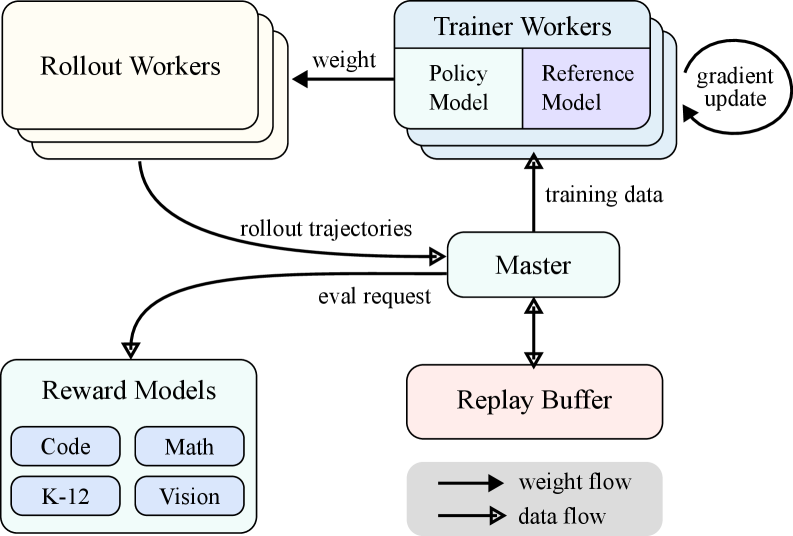
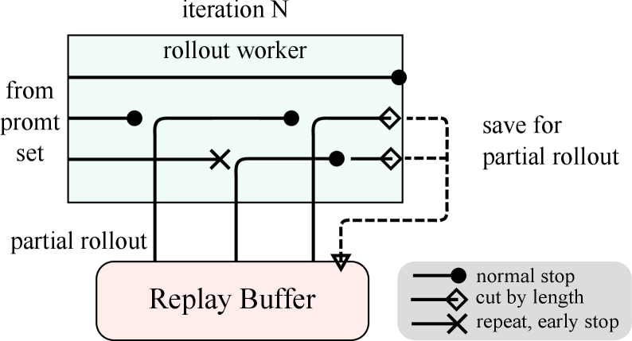
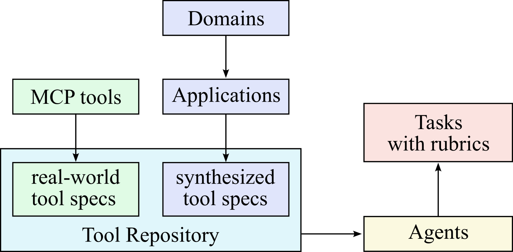
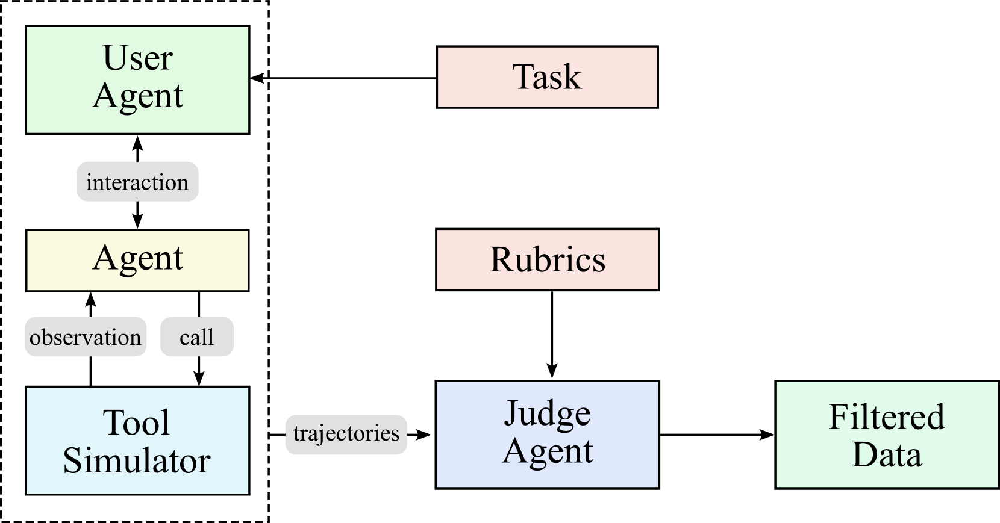

# 2.2 Kimi — 从长上下文推理 Scaling 到多模态 Agent Swarm

!!! abstract "本节摘要"
    Kimi 系列清晰展现了后训练从单轮长推理走向复杂多模态智能体的三步跨越：**K1.5** 将在线 RL 上下文扩展至 128K，提出 Partial Rollout、CoT RM 与 `long2short` 长度压缩；**K2** 在 1.04T MoE 上引入保证零 Loss Spike 的 **MuonClip** 优化器，构建基于 3K+ 真实 MCP 工具与世界模拟器的 Agentic 合成与自评 Rubric 体系；**K2.5** 进一步训练多模态并行编排器（**PARL / Agent Swarm**），并发现了早期低比例视觉融合与“视觉 RL 反向增益纯文本推理”的跨模态迁移规律。

!!! abstract "核心报告来源"
    - **Kimi k1.5**: *Kimi k1.5: Scaling Reinforcement Learning with LLMs*, [arXiv:2501.12599](https://arxiv.org/abs/2501.12599) (2025.01)
    - **Kimi K2**: *Kimi K2: Open Agentic Intelligence*, [arXiv:2507.20534](https://arxiv.org/abs/2507.20534) (2025.07)
    - **Kimi K2.5**: *Kimi K2.5 Technical Report*, [arXiv:2602.02276](https://arxiv.org/abs/2602.02276) (2026.02)

---

## Kimi k1.5 — 长上下文推理 Scaling 与 Long2Short

### 核心动机与算法选择（Online Policy Mirror Descent）

与 DeepSeek-R1 同月发布的 Kimi k1.5 提出了高度一致的核心论断：**把强化学习的上下文窗口拉长（Scaling Context Length），本身就是解锁测试时推理扩展的关键维度**，无需依赖复杂的 MCTS 树搜索、价值网络或过程奖励模型（PRM）。

在优化器选择上，k1.5 没有沿用 PPO 或 GRPO，而是从带相对熵（KL）正则的 **Online Policy Mirror Descent（在线策略镜像下降）** 出发推导出无 Critic 的策略梯度更新：

- **显式弃用 Value 网络**：团队指出，长思维链中许多看似“走弯路报错再撤回”的中间步骤对探索至关重要，用不准确的局部 Value 函数强行做步级信用分配反而会掐灭有益的回溯尝试；
- **组均值基线 + 平方正则项**：对同一问题采样多条回答，用二元结果奖励 $r \in \{0, 1\}$ 减去同问题组平均奖励作为优势，同时配合对数概率比惩罚约束步长，并在每轮大迭代重置优化器状态。

!!! success "关键发现 1：Chain-of-Thought Reward Model（先思考再判分的 RM）"
    对于无法用简单字符串比对判分的复杂科学或开放推理题，k1.5 训练了 **CoT RM**——要求判分模型在给出 0/1 评判前先生成一段逐步核查的推理过程。对比测试显示：**CoT RM 的判别准确率高达 98.5%，而直接吐标量分数的传统 RM 准确率仅为 84.4%**。

### 128K 长上下文 RL 系统与 Partial Rollout

<figure markdown="span">
  { width="72%" }
  <figcaption>Kimi k1.5 RL 训练系统架构：Rollout Workers 采样、领域验证/RM 评分、Master 统一调度、Trainer Workers（Policy + Reference）更新参数，借助 Replay Buffer 实现跨轮次 Partial Rollout（图源：arXiv:2501.12599 Figure 3a）</figcaption>
</figure>

k1.5 采用渐进式窗口课程（**4K → 32K → 128K**）做 RL 训练。为了防止少数长达数万 token 的慢轨迹拖垮整批 GPU 利用率（木桶效应），团队设计了核心系统机制 **Partial Rollout（分段续写采样）**：

- 为每轮采样设定固定的最大 token 预算；
- 若某条长轨迹在本轮预算耗尽时仍未写完，不将其丢弃或强判错误，而是把当前已生成的前缀存入 **Replay Buffer**，在下一轮迭代中由新策略接着往后续写完成。

<figure markdown="span">
  { width="68%" }
  <figcaption>Partial Rollout 轨迹状态示意：区分正常终止（圆点）、触及单轮长度上限待续写（菱形）与陷入死循环复读提前熔断（叉号）（图源：arXiv:2501.12599 Figure 3b）</figcaption>
</figure>

同时配合两级题目采样调度與混合部署基础设施：

- **课程采样 + 优先采样（Curriculum & Prioritized Sampling）**：先从简单题起步稳定格式，随后实时跟踪模型在每道题上的平均成功率 $s$，按正比于 $(1 - s)$ 的权重抽题，把算力聚焦在尚未攻克的能力边界上；
- **训推共置与极速沙箱**：Megatron（训练）与 vLLM（推理）以 Kubernetes Sidecar 共置在同一批 GPU 上（推理切训练 ~10 秒，训练切推理 <1 分钟）；代码评测容器用轻量级 `crun` 替代 Docker，启动耗时从 0.12s 压至 0.04s，吞吐从 27 容器/秒提升至 120 容器/秒。

!!! success "关键发现 2：Long2Short（将长链推理能力压缩回短思维模型）"
    长思维模型虽然强，但日常简单问答耗费上万 token 太慢太贵。k1.5 系统对比了 4 种将 `long-CoT` 能力迁移给 `short-CoT` 模型的方案：

    | 压缩迁移方法 | 具体操作 | 压缩效率与准确率综合表现 |
    |--------------|----------|--------------------------|
    | **Model Merging（权重合并）** | 直接对长 CoT 模型与短 CoT 模型的参数权重做加权平均 | 中等（零训练成本，但长度控制不够精细） |
    | **Shortest Rejection Sampling** | 对同题采样 $n=8$ 次，挑出**正确回答中最短的那一条**做 SFT | 中等 |
    | **DPO 长度偏好学习** | 以最短正确解为正例 $y_w$，长度超过其 $1.5\times$ 的长解为负例 $y_l$ | 中高 |
    | **Long2Short RL（长度惩罚在线 RL）** | 在组内正确的前提下，对短于平均长度的回答给额外正奖励、过长回答给负惩罚，并收紧最大生成上限 | **最优**（`k1.5-short` 仅耗平均 **3,272 tokens** 即在 AIME 2024 达 **60.8%**） |

---

## Kimi K2 — 万亿 MoE、MuonClip 与大规模 Agentic 合成

K2 将主战场从单轮数学编程推向**开放工具生态下的多步智能体（Agentic Intelligence）**。模型采用 **1.04T 总参数 / 32.6B 激活参数** 的稀疏 MoE 架构（共 384 个专家，每 token 激活 8 个），注意力沿用 MLA 并将注意力头数从 DeepSeek-V3 的 128 精简为 64（在 128K 长上下文推理时节省高达 **83% 注意力 FLOPs**，而预训练损失差异仅 0.5%–1.2%）。

### MuonClip 优化器：根治大规模 MoE 注意力 Logits 爆炸

??? info "📖 初学者补充：什么是 Muon 优化器，为什么会引发注意力爆炸，QK-Clip 怎么修的？"
    1. **Muon 优化器为什么比 AdamW 更省数据？**
        传统 AdamW 按元素缩放梯度，参数更新矩阵往往集中在少数几个大奇异值主方向上（低效秩）。**Muon** 优化器对动量矩阵施加 Newton-Schulz 正交化迭代（记作 `msign`），把更新矩阵的所有奇异值拉平为近似相等（“满秩均匀推进”），在同等 token 预算下能学到更丰富的特征。
    2. **为什么放到万亿 MoE 上会炸？**
        自注意力分数由双线性乘积 $Q K^\top = (X W_Q)(X W_K)^\top$ 决定。Muon 的满秩强更新在 MoE 稀疏路由叠加下，容易让查询投影权重 $W_Q$ 和键投影权重 $W_K$ 的最大奇异向量对齐并累加增长，导致某几个注意力头的内积分数突破上百甚至上千（Attention Logits Explosion），Softmax 瞬间饱和溢出引发训练崩溃。
    3. **QK-Clip 的无损“后更新裁剪”**：
        K2 不去阉割 Muon 优化器本身的更新公式，而是在**每一步参数更新完成后**，逐个检查每个注意力头 $h$ 的最大注意力 logit 尺度 $S_{\max}^h$。一旦某头超过安全阈值 $\tau = 100$，立即按缩放因子 $\gamma_h = \min(1, \tau / S_{\max}^h)$ 对该头的 $W_Q^h, W_K^h$ 做等比例缩小（如各乘 $\sqrt{\gamma_h}$，仅对非共享 RoPE/头部分量缩放而不破坏当前步输出结构）。最奇妙的是它具备**自去激活（Self-deactivating）**性质：训练前约 70K 步帮助模型平稳度过剧烈期后，各头谱范数自然回落到 $\tau$ 以下，QK-Clip 自动不再触发，助 K2 在 **15.5T tokens 全程实现零 Loss Spike**！

### 三阶段大规模 Agentic 数据合成流水线

真实世界的软件与 API 工具调用很难靠人工手写轨迹，直接连真实线上接口又慢、贵且有副作用。K2 构建了经典的**“工具库扩增 → 任务与量表生成 → 世界模拟器交互与评判过滤”**三阶段流水线：

<figure markdown="span">
  { width="75%" }
  <figcaption>Kimi K2 Agentic 数据合成阶段一：从真实 MCP（Model Context Protocol）工具库（3,000+ 真实工具）与垂直领域出发，演化合成出 20,000+ 覆盖广泛场景的工具规范，并配套生成具有不同人设的 Agent 与带评分量表（Rubrics）的复杂任务（图源：arXiv:2507.20534 Figure 8a）</figcaption>
</figure>

<figure markdown="span">
  { width="75%" }
  <figcaption>Kimi K2 Agentic 数据合成阶段二：User Agent 与被测 Agent 多轮对话，Tool Simulator 充当有状态的“世界模型”执行工具调用并注入可控异常，最后由 Judge Agent 对照 Rubrics 严格筛选高分轨迹（图源：arXiv:2507.20534 Figure 8b）</figcaption>
</figure>

### Self-Critique Rubric Rewards（闭环自评量表奖励）

对于没有唯一标准答案的主观与复杂 Agent 任务，K2 让策略模型自身兼任 Critic，对照三层结构化 **Rubric（评分细则）**做成对自我批评打分：

1. **Core Rubrics（核心质量细则）**：事实有据、逻辑清晰、指令切题；
2. **Prescriptive Rubrics（反讨好防作弊细则）**：明确禁止开头阿谀奉承（“您问得太棒了！”）、禁止空洞免责套话与显式自我辩解，直接封堵常见形式化刷分套路；
3. **Human-Annotated Rubrics（场景定制细则）**：针对特定专业指令挂载的人工核查项。

更关键的是**闭环 Critic 进化**：在训练进程中，利用客观可验证任务（RLVR）上的最新 on-policy 采样持续更新该自评分支，把**可验证领域的硬核判别力持续蒸馏迁移到主观评分能力中**。配合约束解码（强制工具调用严格符合 TypeScript / JSON Schema）与 30 秒内完成 1T 参数同步的共置引擎，K2（非思考模式）在 SWE-bench Verified 取得 **65.8%**、LiveCodeBench v6 取得 **53.7%**。

---

## Kimi K2.5 — 原生多模态与并行 Agent Swarm（PARL）

K2.5 在 K2 的 1.04T MoE 基座上接入原生三维视觉编码器 **MoonViT-3D**，并将上下文窗口扩展至 **256K（262,144 tokens）**。

??? info "📖 初学者补充：MoonViT-3D 与多模态“早期融合 vs 晚期融合”是什么意思？"
    - **视觉编码器如何喂给 LLM**：图像或视频帧被切成小方块（Patch），经视觉 Transformer 编码成与词向量同维度的视觉 token，与文本 token 拼接成一条统一序列送入大语言模型主干。**MoonViT-3D** 同时在“高 × 宽 × 时间帧”三维块上做时空注意力，因此不仅能看单图，还能原生捕捉长视频中的连续动作变化。
    - **早期融合（Early Fusion）vs 晚期融合（Late Fusion）**：此处指在**预训练时间轴**上何时混入视觉数据——传统方案担心过早混入图像会冲淡纯文本能力，常在文本预训练快结束时才以高比例（如 50%:50%）突击注入图文数据（晚期重比例融合）；K2.5 则探索了从预训练极早期就按温和低比例（如 **10% 视觉 : 90% 文本**）全程伴随训练。

### 三个颠覆常规直觉的多模态后训练发现

1. **早期低比例融合全面胜出**：早期注入 + `10:90` 视觉文本配比，在所有多模态和纯文本基准上均优于晚期突击 + `50:50` 配比；
2. **Zero-Vision SFT（零人工视觉轨迹 SFT）**：SFT 阶段完全不喂人工拼凑的图文问答轨迹（图像裁剪、缩放等操作直接通过生成 IPython 代码在沙箱内编程完成）。实验甚至发现**强行塞入人工设计的视觉 SFT 轨迹反而拉低了后续泛化上限**——因为高质量早期联合预训练已打通跨模态表征，纯文本推理与代码能力可零样本自然泛化至视觉；
3. **视觉 RL 反向提升纯文本推理（跨模态双向增益）**：在多模态空间图表、视觉定位与计数任务上运行可验证 RL 后，模型在**纯文本基准**上的得分不降反升：

| 纯文本评测基准 | 视觉 RL 训练前 | 视觉 RL 训练后 | 净增益 |
|----------------|---------------|---------------|--------|
| **MMLU-Pro** | 84.7% | **86.4%** | **+1.7%** |
| **GPQA-Diamond** | 84.3% | **86.4%** | **+2.1%** |
| **LongBench v2** | 56.7% | **58.9%** | **+2.2%** |

### Agent Swarm 与 PARL（并行多智能体编排强化学习）

面对广度信息搜集等长链任务，单 Agent 串行调用几十次搜索延迟极高且上下文很快塞满。K2.5 提出了 **“可训练主编排器（Trainable Orchestrator）+ 冻结子智能体（Frozen Sub-agents）”** 的并行蜂群架构：

- **信用分配解耦**：子智能体固定采用中间阶段收敛的策略快照，其执行结果对主编排器而言等同于“外部环境观测”，RL 只集中更新负责拆解子任务、动态派生子代理并汇总结果的 Orchestrator，规避了多智能体同时更新时的信用模糊与不收敛；
- **PARL 三项奖励与退火机制**：

$$
r_{\text{PARL}}(x, y) = \lambda_1 \cdot r_{\text{parallel}} + \lambda_2 \cdot r_{\text{finish}} + r_{\text{perf}}(x, y)
$$

其中 $r_{\text{parallel}}$ 鼓励开启并行分支（防止偷懒退化回单线程串行），$r_{\text{finish}}$ 要求派出的子任务确实有效完结（防止为了刷并行分而胡乱派生空壳子代理），$r_{\text{perf}}$ 为最终任务质量分。训练前中期靠前两项引导学会并行分工，后期将 $\lambda_1, \lambda_2 \to 0$ 退火归零，使策略完全服务于终局任务表现，在广度搜索场景将端到端延迟降低了最高 **4.5×**。此外配合 **Toggle** 交替预算受限训练，使输出 token 开销节省 25%–30% 而精度几乎无损。

---

## Kimi 系列演进对比

| 维度 | Kimi k1.5 (2025.01) | Kimi K2 (2025.07) | Kimi K2.5 (2026.02) |
|------|---------------------|-------------------|---------------------|
| **模型骨干与窗口** | 长链推理模型 / 128K | 1.04T MoE (32.6B 激活, MLA-64) / 128K | 同 K2 + **MoonViT-3D** / **256K** |
| **核心优化器 / RL** | Online Policy Mirror Descent（无 Critic） | MuonClip 预训练 + K1.5 式 RL + 预算控制 | 同左 + **PARL 并行编排 + Toggle 省流** |
| **奖励体系** | 二元规则奖励 + **CoT RM (98.5%)** | RLVR + **三层闭环 Self-Critique Rubric** | RLVR + 生成式 RM + 跨模态视觉奖励 |
| **代表性方法遗产** | Partial Rollout、Long2Short RL | MuonClip (`QK-Clip`)、MCP 世界模拟器合成 | Zero-Vision SFT、视觉→文本正向迁移、Agent Swarm |
| **权重开源状态** | 闭源 | **开源** | **开源** |
