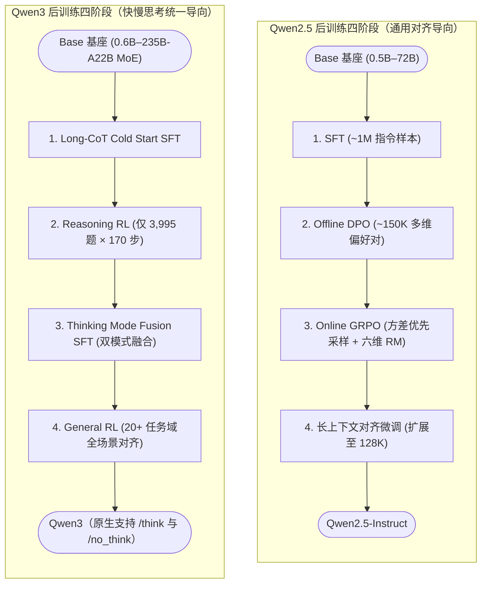

# 2.3 Qwen — 渐进式流水线精炼、模式融合与 MoE 算法演进

!!! abstract "本节摘要"
    Qwen 系列展现了系统工程化的后训练迭代方法论：**Qwen2.5** 建立六维度奖励模型与基于奖励方差的查询筛选；**Qwen3** 仅用 **3,995 条高信息量题目 + 170 步 RL** 实现 AIME +15 分跃升，并首创单模型 **Thinking / Non-Thinking 双模式融合**与高性价比强弱蒸馏；**Qwen3.5** 进一步探索 3:1 线性注意力（GatedDeltaNet）与标准注意力的混合 MoE 架构。在底层 RL 算法上，Qwen 团队先后提出 **GSPO** 与 **SAPO**，系统解决了大规模 MoE 模型在后训练中的路由失稳与硬裁剪崩溃难题。

!!! abstract "核心报告与论文来源"
    - **Qwen2.5**: *Qwen2.5 Technical Report*, [arXiv:2412.15115](https://arxiv.org/abs/2412.15115) (2024.12)
    - **Qwen3**: *Qwen3 Technical Report*, [arXiv:2505.09388](https://arxiv.org/abs/2505.09388) (2025.05)
    - **GSPO**: *Group Sequence Policy Optimization*, [arXiv:2507.18071](https://arxiv.org/abs/2507.18071) (2025.07)
    - **SAPO**: *Soft Adaptive Policy Optimization*, [arXiv:2511.20347](https://arxiv.org/abs/2511.20347) (2025.11)
    - **Qwen3.5**: 官方技术博客发布（2026.02，侧重混合架构披露）

---

## Qwen2.5 vs Qwen3 后训练流水线演进对比

---

## Qwen2.5 — 六维细粒度奖励与方差优先查询采样

Qwen2.5 的后训练确立了两项被后续版本持续沿用的基础设计：

### 1. 六维度解耦评估准则（Multi-Dimensional Reward Criteria）

单一标量总分往往会把“事实准确但啰嗦”与“精炼但夹带轻微幻觉”混成同一个中等分数。Qwen2.5 从六个正交维度组织偏好与奖励评估：

| 评估维度 | 核查核心指标 | 对构造 DPO / RL 数据的具体价值 |
|----------|-------------|-------------------------------|
| **Truthfulness（真实性）** | 事实准确、忠于给定上下文、不编造未提供信息 | 精准抑制开放问答与摘要幻觉 |
| **Helpfulness（有用性）** | 完整解决用户指令与隐含子需求 | 核心指令遵循保障 |
| **Conciseness（简洁性）** | 信息密度高、不堆砌车轱辘套话 | 专门构造“同等信息量但更精炼”的偏好对，克制长度膨胀偏差 |
| **Relevance（相关性）** | 紧扣主题不跑偏 | 防止多轮对话发散 |
| **Harmlessness（无害性）** | 识别并得体拒绝违法、危险请求 | 安全底线对齐 |
| **Debiasing（去偏见）** | 避免刻板印象与群体偏见 | 社会价值对齐 |

### 2. 方差优先查询选择（Variance-Based Prioritized Sampling）

在进入在线 GRPO 之前，先用当前策略对候选题目预采样若干条输出并评估得分方差：**重点保留得分方差大（即模型时对时错、处于能力临界区）的题目**，而对已经稳拿满分或完全一筹莫展的低方差题目大幅降权。这一“主动挑选最大信息量样本”的思路在 Qwen3 中被推向了极致。

---

## Qwen3 — 极简高信息量 RL、双模式融合与强弱蒸馏

Qwen3 同时开源了稠密系列与旗舰 MoE 模型（`Qwen3-235B-A22B`，总参 235B / 激活 22B），重点攻克了两个核心工程命题：**如何用最少量的在线 RL 撬动显著推理跃升？** 以及 **如何让一个模型自由切换“深度慢思考”与“极速直答”？**

### 阶段 2 的惊人样本效率：3,995 道题 + 170 步 = AIME +15 分

Qwen3 在第二阶段 Reasoning RL 中没有搞题海战术，而是执行了严苛的三道数据漏斗（未在 Cold-Start SFT 中出现过、具备客观可验证真值、在预采样中处于 `Pass@N` 可学边界且剔除无需推理即可蒙对的选择题），最终仅精选出 **3,995 条** 高质量数学、代码与 STEM 查询：

| 指标 | Qwen3 Reasoning RL 实测数据 |
|------|----------------------------|
| **训练 Query 总量** | **3,995 条** |
| **GRPO 更新总步数** | **仅 170 步** |
| **旗舰模型 AIME 2024 增益** | **约 +15 分**（最终 Qwen3-235B-A22B 思考模式达 **81.5**） |

!!! success "核心启示"
    在线推理 RL 的瓶颈不在“百万级题目数量”，而在**每道题能否在组采样中持续产生高对比度的正负梯度信号**。只要题目精准卡在当前模型的认知边界上，不到四千道题就足以激活整套深度推理习惯。

### 阶段 3：Thinking Mode Fusion（快慢思考单模型融合）

以前业界往往需要分开部署两个模型（如 `GPT-4o` 负责日常快答，`o1/R1` 负责慢思考）。Qwen3 在阶段 2 训完强推理模型后，通过阶段 3 的 SFT 将两种交互范式无缝融进同一套权重：

- **统一聊天模板设计**：引入显式控制开关——用户输入带 `/think`（默认）时，模型在 `<think>...\n</think>` 内展开完整推导；输入带 `/no_think` 时，模型保留空的标签结构 `<think>\n\n</think>` 后直接输出精炼答案（保持内部格式分布一致，避免切换时表征断裂）；
- **同源双模数据合成**：让阶段 2 的强推理模型对同一批指令同时产出思考版与直答版高质量轨迹，混合通用数据微调，再经阶段 4（覆盖指令遵循、格式控制、Agent 工具调用等 20+ 细分子任务的混合奖励 General RL）加固；
- **自然涌现 Thinking Budget（思考预算）控制**：融合训练后，人们还可以通过在推理时截断 `<think>` 最大 token 数并追加停止提示词，让模型在任意指定思考长度预算（如 2K / 8K / 32K）下平滑折中延迟与准确率。

### Strong-to-Weak Distillation（面向中小尺寸模型的蒸馏配方）

针对轻量级模型（0.6B～14B 及 30B-A3B），Qwen3 系统对比了“在小基座上直接跑四阶段 RL”与“从 235B 旗舰双模教师做 **Off-policy + On-policy 强弱蒸馏**（匹配教师 logits 分布）”：

| 训练路径（以轻量基座为例） | 综合数学与代码表现 | 所需 GPU 训练小时成本 |
|---------------------------|-------------------|----------------------|
| 小模型从零直接跑完整 RL | 显著较低 | **10× GPU Hours** |
| **Strong-to-Weak 蒸馏（Off-policy SFT + On-policy Logit KL 蒸馏）** | **全面大幅超越直接 RL** | **仅需 ~1× GPU Hours（节省 90% 算力）** |

---

## Qwen3.5 — 线性注意力与标准注意力的混合 MoE 探索

2026 年初发布的 Qwen3.5 进一步向超长上下文高吞吐架构演进（上下文原生扩展至 **262K tokens**，支持 201 种语言与原生多模态理解），其最大变革在于采用了 **3:1 混合注意力 + 高稀疏度 MoE**：

- **层间 3:1 交替结构**：总计 60 层，每 4 层为一个循环块——前 3 层采用复杂度为 $O(n)$ 的线性注意力变体 **GatedDeltaNet (GDN)**，第 4 层保留复杂度为 $O(n^2)$ 的精确门控标准注意力（Gated Attention）；
- **高细粒度稀疏 MoE**：每层配备多达 512 个专家，每 token 仅激活 10 个路由专家（外加共享专家）。

??? info "📖 初学者补充：什么是 GatedDeltaNet（门控 Delta 线性注意力），为什么要 3:1 混搭？"
    - **标准 Softmax 注意力的长文本瓶颈**：处理 $n=262\text{K}$ 个 token 时，每个新 token 都要和前面所有历史 token 的 KV 缓存逐一算内积，推理 KV 显存随长度线性暴涨，预填充计算量按 $O(n^2)$ 平方暴涨。
    - **线性注意力的固定状态压缩**：线性注意力去掉外层非线性的 Softmax，利用矩阵乘法结合律，不再保存越来越长的历史 KV 列表，而是维护一个**尺寸恒定不变的记忆矩阵 $S_t \in \mathbb{R}^{d_k \times d_v}$**（类似高容量矩阵版 RNN）。每来一个新词，计算量和显存都恒定为 $O(1)$，整句总复杂度降至 $O(n)$。
    - **Delta Rule（增量擦写规则）与 Gating（遗忘门）**：早期线性注意力只往状态矩阵里不断累加 $k_t v_t^\top$，久了记忆糊成一团。**Delta Rule** 每次先检索当前键 $k_t$ 在旧记忆里存的值，只把“新值与旧预测的差值（Delta）”精准写入对应子空间；外加一个**遗忘门控（Gate）**在话题切换时快速清空整块旧记忆。
    - **为什么还要留 25% 的标准注意力？** 固定大小的矩阵 $S_t$ 终究是有损压缩，遇到“从 20 万字文档里精确复制一串 16 位订单号”（大海捞针精确拷贝）时不如全量 KV 缓存精准。**3 层 GDN（省掉 75% 的 KV 缓存与平方计算）+ 1 层全量注意力（兜底精确跨距检索）** 实现了推理吞吐与长文精度的黄金折中。

---

## Qwen 团队对 MoE 后训练算法的底层推进：GSPO 与 SAPO

随着 Qwen3 / Qwen3-VL 全面转向百亿至数千亿参数的稀疏 MoE 架构，Qwen 团队接连发表了两篇直接改写社区 MoE RL 配方的基础算法论文（完整数学推导已分别在 **[1.9 GSPO](../ch1/1.9-gspo.md)** 与 **[1.10 SAPO](../ch1/1.10-sapo.md)** 中详述）：

1. **GSPO（序列级几何平均重要性采样）**：诊断出 GRPO 的逐 token 比率 $r_{i,t} = \frac{\pi_\theta}{\pi_{\theta_{\text{old}}}}$ 在 MoE 每次参数更新改变约 10% 专家路由时会沦为高方差噪声源；通过将优化与裁剪粒度统一提升至序列几何均值 $s_i(\theta) = \left(\frac{\pi_\theta(y_i\mid x)}{\pi_{\theta_{\text{old}}}(y_i\mid x)}\right)^{1/|y_i|}$，原生消除了对繁重 Routing Replay 的依赖，支撑了 Qwen3-Instruct / Coder / Thinking 的大规模扩展；
2. **SAPO（平滑自适应软门控）**：进一步针对硬裁剪在阈值边界的梯度突变，用处处连续可微的 $\frac{4}{\tau}\sigma(\tau(r-1))$ 软门控（配合 $\tau_{\text{pos}}=1.0, \tau_{\text{neg}}=1.05$ 非对称温度）替代硬截断——既在平稳步长下保持了类似 GSPO 的序列级协调性，又能在个别 token 异常时做单点软隔离而不误伤整条长序列，已在 **Qwen3-VL** 多模态模型生产训练中全面验证。
