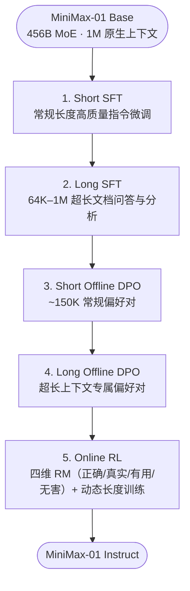

# 2.4 MiniMax — 从百万级长上下文分离对齐到 CISPO 与 Forge 框架

!!! abstract "本节摘要"
    MiniMax 系列鲜明体现了**问题驱动的系统与算法协同创新**：**MiniMax-01** 依托 Lightning Attention 原生支持 1M–4M 超长上下文，并通过“短长分离”五阶段流水线化解长短偏好冲突；**MiniMax-M1** 定位了 GRPO 硬裁剪扼杀稀有反思词的失效机理，提出 Token 级裁剪权重算法 **CISPO**（2× 步数效率提升），以约 53.5 万美元算力租用成本在 456B 混合注意力基座上训出 AIME 2024 达 86.0% 的 80K 长思考模型；**MiniMax-M2 / M2.5** 则转向高激活比 230B/10B 架构，构建支持 **Prefix Tree Merging（40× 多轮加速）** 的原生 Agent RL 框架 **Forge**。

!!! abstract "核心报告与资料来源"
    - **MiniMax-01**: *MiniMax-01: Scaling Foundation Models with Lightning Attention*, [arXiv:2501.08313](https://arxiv.org/abs/2501.08313) (2025.01)
    - **MiniMax-M1**: *MiniMax-M1: Scaling Test-Time Compute Efficiently with Lightning Attention*, [arXiv:2506.13585](https://arxiv.org/abs/2506.13585) (2025.06)
    - **MiniMax-M2 / M2.5 / M2.7**: MiniMax 官方技术博客与 Forge 架构披露 (2025.10 – 2026.03)

---

## MiniMax-01 — 百万上下文基座与“短长分离”五阶段后训练

MiniMax-01 采用 **456B 总参数 / 45.9B 激活参数** 的 MoE 架构，核心底座创新是 **7:1 混合线性注意力（Lightning Attention）**：每 8 层中有 7 层使用分块 I/O 感知的 $O(n)$ 线性注意力，仅留 1 层使用标准 Softmax 注意力，从而在极低 KV 缓存开销下原生支持 **1M tokens 训练上下文（推理外推至 4M tokens）**。

当团队在 1M 上下文模型上做后训练时，发现不能像常规模型那样把几百字的日常对话和几十万字的长文档混在一个池子里训练，由此设计了精细的**五阶段“短长分离”流水线**：

!!! warning "为什么要严格做“短长分离（Short-Long Separation）”？"
    直接混合短文本与百万字长文本做 SFT/DPO 会引发两重严重冲突：

    1. **梯度频率与尺度失衡**：同样跑一个序列总 token 预算，短样本包含成百上千条独立指令，而 1M 长样本只有寥寥一两条；混合更新时短样本梯度彻底主导参数方向，导致模型长程检索能力退化；
    2. **对齐偏好方向矛盾**：短对话里用户往往偏爱“言简意赅、直奔主题”，而百万字财报或代码库分析里用户需要“详尽穷举、不漏细节”。将两者拆成前后独立阶段，每阶段内部长度与评价标准高度一致，才能兼顾短对话灵巧度与长文深度。

---

## MiniMax-M1 — 混合注意力长链推理与 CISPO

MiniMax-M1 基于 MiniMax-01 继续投入 **7.5T tokens** 数学、代码与推理密集语料做继续预训练（CPT），随后注入少量 CoT 冷启动格式，进入大规模测试时计算扩展（RL Scaling，支持高达 **80K tokens 思考生成长度**，在 100K 生成长度下推理 FLOPs 仅约为纯稠密注意力 DeepSeek-R1 的 25%）。

### 问题诊断与 CISPO 算法贡献

正如 **[1.8 CISPO](../ch1/1.8-cispo.md)** 所详述的，M1 团队在每批 rollout 执行 16 轮 mini-batch 更新时发现：GRPO / DAPO 的硬目标裁剪会在第 1 轮就把 `"Wait"`、`"However"` 等低初始概率的关键反思词裁掉（梯度置零）。

为此提出的 **CISPO（Clipped IS-weight Policy Optimization）** 保持 **Token 级** 计算，改为在停止梯度算子内对逐 token 重要性采样比率封顶：

$$
\mathcal{J}_{\text{CISPO}}(\theta) = \mathbb{E} \left[ \frac{1}{\sum_{i=1}^{G}|o_i|} \sum_{i=1}^{G} \sum_{t=1}^{|o_i|} \mathrm{sg}\!\Big(\mathrm{clip}\big(r_{i,t}(\theta),\, 1-\varepsilon_{\text{low}}^{\text{IS}},\, 1+\varepsilon_{\text{high}}^{\text{IS}}\big)\Big) \cdot \hat{A}_{i,t} \cdot \log \pi_\theta(o_{i,t} \mid q, o_{i,<t}) \right]
$$

在实践中取消下界限制、仅调节上界 $\varepsilon_{\text{high}}^{\text{IS}}$，确保所有有效 token 在全部更新轮次中持续贡献梯度。在 Qwen2.5-32B 受控对比实验中，CISPO **仅用 50% 的训练步数即追平 DAPO 性能（实现 2× 步数收敛加速）**。结合 Lightning Attention 的长序列高吞吐优势，456B 规模的 M1 仅使用 **512 张 H800 GPU 训练 3 周（折算算力租赁成本约 $534,700）** 即完成完整 RL 训练，`MiniMax-M1-80k` 在 AIME 2024 取得 **86.0%**。

### 极具实战价值的三大底层工程排障经验

M1 报告毫无保留地披露了大规模混合架构 RL 中踩过的三个致命坑——这些细节在学术小实验里几乎隐形，在千卡生产中却直接决定训练生死：

!!! danger "工程陷阱 1：训练算子与推理算子的数值精度错配"
    在混合 Lightning Attention 架构上，团队起初发现 RL 跑起来后奖励长期停滞不涨。排查发现推理引擎内核与训练引擎内核存在细微的浮点计算差异，导致同一序列在两端的 token 概率相关性偏低、重要性比率失真。统一对齐两端关键内核精度后，奖励才恢复健康攀升。

!!! danger "工程陷阱 2：VeRL 默认 AdamW 超参数直接导致不收敛"
    沿用开源 RL 框架常见的默认优化器超参 **$\beta_2 = 0.999,\; \varepsilon = 10^{-8}$** 时，M1 训练完全失败；必须改为 **$\beta_2 = 0.95,\; \varepsilon = 10^{-15}$** 才能稳定收敛！
    - **原因**：RL 阶段的策略梯度随采样批次剧烈波动且稀疏，$\beta_2=0.999$ 对历史二阶矩记忆过长（滞后约千步），无法适应快速变化的梯度尺度；同时许多层的梯度数值极小，高达 $10^{-8}$ 的分母常数 $\varepsilon$ 会彻底淹没真实二阶矩信息，使自适应步长失效。

!!! danger "工程陷阱 3：LM Head 输出层必须使用 FP32 精度 + 长尾负样本失衡治理"
    1. **FP32 输出头**：在大词表上计算 $\log \pi_\theta(o_t \mid s_t)$ 时，BF16 尾数位太少，对低概率探索词的对数概率量化舍入误差极大，必须将最后一层 `lm_head` 投影与 Softmax 保持为 **FP32**。
    2. **后期尾部乱码崩溃治理**：在扩展生成窗口后期，错误负样本的长度膨胀速度远快于正确正样本，导致序列后半段堆积过大的负向梯度，诱发尾部乱码（Perplexity 飙升）。团队通过三招化解：① 检测连续高概率复读模式提前终止生成；② 混合 Sample-Level 与 Token-Level 归一化平衡正负样本权重；③ 调小梯度裁剪阈值与 $\varepsilon_{\text{high}}^{\text{IS}}$。

---

## MiniMax-M2 / M2.5 — 高稀疏激活比与 Forge 原生 Agent RL 框架

进入 M2 代际后，MiniMax 将模型底座切换为激活效率更高的 **230B 总参数 / 仅 10B 激活参数** MoE（单 token 激活参数较 M1 降低约 78%，专为高频多轮编码与工具交互降本提速），并在 M2.5 中推出了面向 **100K+ 真实可执行环境**（浏览器、终端、代码仓库、真实 API）的原生训练系统 **Forge**：

**Forge 框架的三大工程支柱：**

1. **Windowed FIFO（固定窗口先进先出调度）**：真实 Agent 任务有的 3 步结束，有的卡在编译测试上跑 200 步。若同步等待整批跑完再更新，GPU 绝大部分时间都在空转等慢任务。Windowed FIFO 维护固定并发容量的活跃滑窗，先完成的轨迹按窗口节奏流转入库，避免个别超长尾任务阻塞全局流水线。
2. **Prefix Tree Merging（多轮共享前缀树合并 — 40× 训练加速）**：

??? info "📖 初学者补充：Prefix Tree Merging 为什么能带来高达 40 倍的多轮训练加速？"
    在单轮数学题里，一条轨迹只有一轮 `<问题, 回答>`。但在一个 30 轮工具交互的 Agent 轨迹里，如果按常规做法把每一轮动作拆成一条训练样本：

    - 第 1 轮训练：输入 `[Turn 1]`
    - 第 2 轮训练：输入 `[Turn 1, Turn 2]`
    - ……
    - 第 30 轮训练：输入 `[Turn 1, Turn 2, ..., Turn 30]`

    你会发现前面几轮的历史上下文被重复前向和反向计算了 30 遍（计算量从 $O(L)$ 恶化为 $O(K \cdot L)$）！更进一步，同一道题采样出的多条分支轨迹在分叉前的公共历史也是完全相同的。**Prefix Tree Merging** 将同一条多轮轨迹及同源分支轨迹组织成一棵词元 **Trie（前缀树）**，配合定制注意力掩码，让所有共享前缀只做一次前向/反向传播，从而在长多轮 Agent 训练中实现了最高约 **40× 的吞吐提升**。

3. **多维复合奖励**：结合终局成败、中间过程校验、任务完成耗时惩罚（鼓励高效少绕弯路）与折扣未来回报（Reward-to-Go），使 M2.5 以约十分之一的推理成本逼平顶级闭源编码 Agent 表现。随后的 **M2.7** 进一步探索了将模型自身接入内部 30%–50% 的 RL 实验分析与代码迭代工作流，开启模型辅助自身后训练迭代的闭环尝试。

---

## MiniMax 系列演进总览

| 维度 | MiniMax-01 (2025.01) | MiniMax-M1 (2025.06) | MiniMax-M2 / M2.5 (2025.10–2026.02) |
|------|----------------------|----------------------|--------------------------------------|
| **骨干规模** | 456B / 45.9B MoE (Lightning Attn) | 同 01（+7.5T 推理 CPT，80K 思考） | **230B / 10B 高稀疏比 MoE** |
| **核心场景** | 1M–4M 超长文本理解与通用对话 | 长链数学推理与测试时计算扩展 | **大规模多轮编码与真实环境 Agent** |
| **后训练算法** | 短长分离五阶段（SFT + DPO + RL） | **CISPO（Token 级裁剪 IS 权重）** | **CISPO + Forge 异步前缀树框架** |
| **代表性工程贡献** | 短长偏好解耦五阶段流水线 | CISPO、Adam $\beta_2/\varepsilon$ 与 FP32 Head 排障 | Windowed FIFO、Prefix Tree Merging (40×) |
