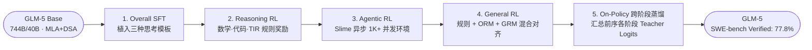

# 2.5 GLM-5 — 异步 Agentic RL 系统、训推确定性与跨阶段蒸馏

!!! abstract "本节摘要"
    GLM-5 是目前已公开技术报告中 **Agentic RL 工程与排障细节最详实** 的代表作：在 744B（40B 激活）MLA + DSA 基座之上，构建了“SFT → Reasoning RL → Agentic RL → General RL → On-Policy Cross-Stage Distillation”五阶段流水线；首创面向多步工具规划的 **Interleaved & Preserved Thinking**；在系统层通过 **TITO Gateway** 杜绝重分词静默偏移、通过**确定性 `torch.topk` + 冻结 Indexer** 根治稀疏注意力 RL 熵崩塌、依托异步 **Slime** 框架支撑千级并发长程交互，最终用跨阶段蒸馏消除多轮训练遗忘，在 SWE-bench Verified 上取得 **77.8%**。

!!! abstract "核心报告来源"
    - **GLM-5**: *GLM-5: from Vibe Coding to Agentic Engineering*, [arXiv:2602.15763](https://arxiv.org/abs/2602.15763) (2026.02)

---

## 基座架构与全链路训练全景

GLM-5 采用 **744B 总参数 / 40B 激活参数** 的稀疏 MoE 架构（256 个专家），注意力层同时集成了 **MLA（多头潜在注意力）** 与 **DSA（DeepSeek Sparse Attention，动态检索 top-$k=2048$ 关键历史 KV）**。

基础训练合计消耗 **28.5T tokens**：先在 4K 窗口完成 18T 通用语料 + 9T 代码与推理语料预训练；随后在 Mid-Training 中沿 `4K → 32K (1T) → 128K (500B) → 200K (50B)` 渐进扩展上下文并混入仓库级 Issue/PR/Diff 序列，最后经 20B tokens 完成稠密注意力向 DSA 稀疏注意力的无损适配。

<figure markdown="span">
  { width="95%" }
  <figcaption>GLM-5 从 Base 构建（左）到五阶段 Post-Training（右）的完整流水线：SFT、Reasoning RL、Agentic RL、General RL 各阶段最优检查点的 logits 共同作为教师，汇入末尾的 On-Policy Cross-Stage Distillation（图源：arXiv:2602.15763）</figcaption>
</figure>

---

## 三种精细化 Thinking 模式设计

<figure markdown="span">
  { width="95%" }
  <figcaption>GLM-5 多轮工具交互中的思考组织结构：每次生成 Tool Call 或最终回复前均插入 Reasoning 块，并在多轮上下文中完整保留历史推理链（图源：arXiv:2602.15763）</figcaption>
</figure>

传统推理模型只在用户提问后思考一次就输出全文；但在长达几十步的软件工程修复中，模型每看一眼报错日志都需要重新判断下一步动作。GLM-5 在 SFT 阶段就植入了三种思考机制：

| 思考模式 | 运作机制 | 解决的核心场景痛点 |
|----------|----------|-------------------|
| **Interleaved Thinking（交错式思考）** | 在**每一次发起工具调用前**以及最终作答前，都先生成 `<think>` 内部推理块，构成完整的 `Thought → Action → Observation` 闭环 | 让智能体在每一步敲命令、改代码前先分析上一步的工具返回结果并规划参数 |
| **Preserved Thinking（跨轮保留思考）** | 在复杂编码与长任务的多轮推进中，**不丢弃前几轮已经生成的 `<think>` 历史**，将其保留在后续输入上下文中 | 避免模型在每一轮被迫从零重新推导全局架构假设，保持长程计划连贯性 |
| **Turn-level Control（轮级按需开关）** | 支持在单次会话的每一轮独立开关是否启用思考模式 | 简单指令秒回，复杂排障深思，灵活兼顾延迟与深度 |

---

## 两个决定成败的底层工程教训

GLM-5 报告之所以备受推崇，是因为它清晰剖析了两个“代码不报错、预训练完全正常，但一进 RL 就暗中毁掉模型”的系统级训推不一致故障：

### 教训 ①：TITO Gateway — 根除 Re-tokenization（重分词）静默偏移

- **常规管线的隐蔽漏洞**：在多步工具调用循环中，推理引擎（如 SGLang/vLLM）把生成的 token 解码成字符串去调外部工具，拼好工具返回的 JSON 文本后，在送入训练引擎（Megatron）算梯度时**重新调用了一次 Tokenizer 把整段对话文本转回 token IDs**。由于特殊控制符、多字节 Unicode 字符、空白符合并或数字切分在合并前后边界可能发生细微变化，重分词得到的 token ID 序列会有哪怕 `0.1%` 与采样时真实生成的 token ID 对不上！
- **静默后果**：一旦中间错位一个 token，后续所有动作的对数概率 $\log \pi_\theta(o_t \mid o_{<t})$ 都在错位的上下文上计算——程序不会报任何 NaN 错误，但策略梯度持续掺入微小的方向偏差，训练几千步后收敛上限显著低于预期。
- **TITO（Token-In-Token-Out）解法**：网关层全程以**原始 Token ID 数组**作为唯一真相源流转——模型生成的动作直接保留原始 token IDs，仅对新增的外部环境观测单独编码追加，训练端**彻底禁止对全序列重新分词**。

### 教训 ②：DSA 稀疏注意力中的非确定性 CUDA `top-k` 崩溃

- **故障现象**：团队在开启 DSA 稀疏注意力跑大规模 RL 时发现，模型仅仅训练**寥寥几步就会出现性能断崖式暴跌，伴随生成熵急剧下滑（Sharp Drop in Entropy）**。
- **根因链条**：
    1. DSA 的 Lightning Indexer 需要为每个查询位置从历史上下文中挑出得分最高的 $k = 2048$ 个 KV 条目做稀疏注意力；因为打分公式含 `ReLU` 求和，大量非相关位置的得分并列为精确的 `0.0`（存在庞大的并列边界集）；
    2. 推理框架中的高性能定制 CUDA / TileLang `top-k` 算子使用并行原子竞争（`atomicAdd` / `atomicCAS`）处理并列元素，线程到达顺序随机，导致**完全相同的输入跑两次前向会选出不同的 2048 个 KV 索引集合**！
    3. 预训练中这种微小随机性会被海量样本平均掉；但在 RL 中，**同一个序列在 Rollout 采样时选了一套 KV，到训练引擎重算 $\log \pi_\theta$ 时又选了另一套 KV**——训推分布严重失配，算出的重要性采样比率与策略梯度方向失真，几步之内就把策略熵压垮崩溃。
- **为什么不能像 MoE 那样做 Replay？** MoE 每个 token 只需存 8 个专家编号；而 DSA 每个 token 位置要存 $k=2048$ 个索引，全序列跨层存储与跨节点传输的带宽开销完全不可接受。
- **GLM-5 的根治方案（双管齐下）**：① 在算子源头换用速度略慢但**严格确定性（并列时固定下标优先）的 `torch.topk`**，确保两端选出的 KV 集合逐位一致；② 在 RL 全程**默认冻结 DSA Indexer 参数**，防止检索路由本身在强化学习波动中漂移。

---

## 异步 Agentic RL 框架 Slime 与跨阶段防遗忘蒸馏

### 1. Slime 异步调度与 IcePop 异策略防护

为了支撑上千个并发沙箱同时执行长短悬殊的仓库修复与网页浏览任务，GLM-5 采用训练与推理解耦的异步框架 **Slime**：Rollout 集群不等慢任务跑完便源源不断推送已完成轨迹；训练侧定期同步权重并重置优化器动量，同时引入 **IcePop** 校验同一旧权重在训练引擎与推理引擎上的概率比 $\rho_{i,t} = \frac{\pi_{\theta_{\text{old}}}^{\text{train}}}{\pi_{\theta_{\text{old}}}^{\text{infer}}}$（超出 $[1/\beta, \beta]$ 容忍带的失配 token 直接掩码置零），配合双边异策略裁剪与版本新鲜度过滤（详见 [2.10 节](2.10-agentic-training.md)），确保高吞吐异步训练稳健收敛。

### 2. On-Policy Cross-Stage Distillation（阶段 5：跨阶段在线蒸馏）

顺序跑完 SFT → Reasoning RL → Agentic RL → General RL 后，后面阶段不可避免地会冲淡前面阶段的专项峰值能力（例如通用对齐后竞赛数学或代码修复率小幅回落）。

GLM-5 在第五阶段设计了极巧妙的 **On-Policy 跨阶段蒸馏**：

- 将前序各个阶段训出的最优专精 Checkpoint（Reasoning 最佳版、Agentic 最佳版、General 最佳版）统统冻结作为各自对应数据域上的 **Teacher**；
- 让当前统一 **Student** 模型自己 **On-policy 采样**生成轨迹（每个 prompt 只需 `group_size = 1` 条采样，无需组内互比）；
- 直接用对应领域教师与学生在每个词元上的对数概率差构造密集 Token 级优势：

$$
\hat{A}_t = \mathrm{sg}\!\Big[\log \pi_{\text{teacher}}(o_t \mid x, o_{<t}) - \log \pi_{\text{student}}(o_t \mid x, o_{<t})\Big]
$$

将 $\hat{A}_t$ 代入策略优化更新 Student。由于采样来自学生自身分布（不易破坏已有模式），而监督信号来自各阶段巅峰教师的逐 token 密集对数概率（比 0/1 终局奖励信息量高得多），一举在单一模型上完整找回并融合了全阶段峰值能力，实现 **SWE-bench Verified 77.8%** 与 **BrowseComp 75.9%** 的开源标杆成绩（报告同时验证了在 7 款国产算力芯片集群上的适配运行）。
