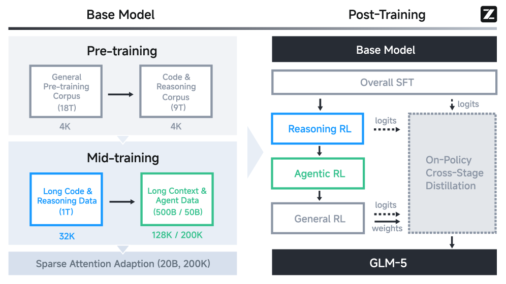
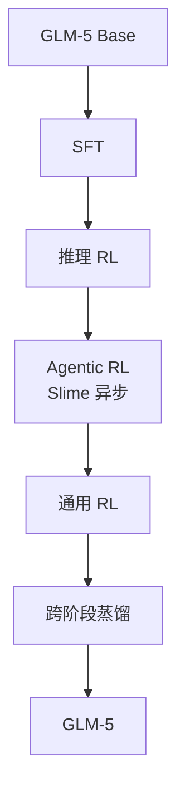
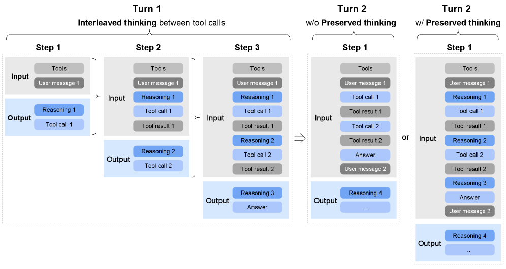

# 2.5 GLM-5

报告：[arXiv:2602.15763](https://arxiv.org/html/2602.15763v2)。这是目前把 Agentic RL 的失败案例写得最具体的公开报告之一。

GLM-5 是 744B MoE、约 40B 激活，256 个专家，注意力是 MLA 加 DeepSeek Sparse Attention。预训练语料合计 28.5T token。

<figure markdown="span">
  { width="95%" }
  <figcaption>预训练约 18T 通用语料和 9T 代码与推理，中间训练依次是 1T（32K）、500B 长上下文加 50B Agent 数据，再做 20B 的稀疏注意力适配。后训练是 SFT、推理 RL、Agentic RL、通用 RL，右侧用各阶段 logits 做 on-policy 跨阶段蒸馏。图源 GLM-5 论文。</figcaption>
</figure>

## 三种思考

<figure markdown="span">
  { width="95%" }
  <figcaption>每次工具调用前都先写推理，工具结果回来后再推理。思考可以留在后续轮次的上下文里。图源 GLM-5 论文。</figcaption>
</figure>

| 模式 | 行为 |
| --- | --- |
| Interleaved | 每次回复和每次工具调用之前都思考 |
| Preserved | 多轮之间保留已有思考，而不是每轮从头推 |
| Turn-level | 每一轮单独决定要不要思考 |

Qwen3 的思考主要包住最终回答。Agent 任务需要在每一次调用前决定工具和参数，所以思考插在动作前面。

## 采样 token 和训练 token 必须是同一串

推理引擎返回文本、训练引擎再分词时，特殊符号、多字节字符和 JSON 的边界可能差一两个 token。策略梯度用的对数概率就会对错位置。比例即使只有千分之一，也不会立刻变成 NaN，而是让优势慢慢偏掉。

TITO（token in, token out）让推理引擎直接交出 token id，训练端不再把工具返回的文本重分词。它消除的是分词边界不一致。数值精度、MoE 路由和稀疏注意力的 top-k 仍要单独处理。

## 稀疏注意力的 top-k 必须确定

DSA 的 indexer 为每个 query 选出 \(k=2048\) 个 key。CUDA 和 TileLang 的 top-k 在并列分数上是不确定的，同一次输入两次前向可能选出不同的下标。预训练里这点差异会被大量 token 平均掉。RL 要在采样和计算对数概率时面对同一条序列，两次注意力模式不同，梯度方向就错了。

报告的现象是：非确定性 top-k 下，RL 几步之内性能下降，同时 **熵急剧下降**。修复是两件一起做：训练引擎改用确定性的 `torch.topk`；RL 阶段冻住 indexer，避免「看哪些位置」本身还在变。\(k=2048\) 的下标如果每层每个 token 都存下来做 replay，存储和通信都不可接受，所以他们没有做 indexer replay。

## 异步系统和跨阶段蒸馏

Slime 同时跑一千条以上的多步工具轨迹，不等最慢的轨迹结束就开始训练。IcePop 用来抑制训练引擎和推理引擎概率差得过远的 token，细节放在 [2.10](2.10-agentic-training.md)，因为那里才写得上公式。

五个阶段顺序优化，后面的阶段会冲掉前面的能力。最后的 on-policy 蒸馏把前面各阶段的检查点当作教师。学生在这些数据上自己采样，优势是逐 token 的对数概率差：

$$
\hat A_t = \mathrm{sg}\big[\log \pi_{\mathrm{teacher}}(o_t \mid \cdots) - \log \pi_{\mathrm{student}}(o_t \mid \cdots)\big]
$$

教师概率高、学生概率低时优势为正。组大小为 1，因为比较对象是教师，而不是同题的其他采样。这不是一个未定义的标量 teacher_score。蒸馏减轻遗忘，不保证每个前序指标都回到原阶段的峰值。

报告给出的成绩是 SWE-bench Verified 77.8，BrowseComp 75.9。文中还记录了在七种国产芯片上的适配，那部分不改变上面的算法。
