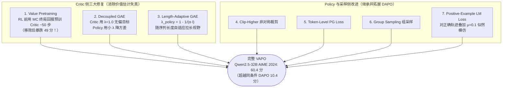

# 2.6 Seed — 从 DAPO 逐组件修复到 VAPO Actor-Critic 大规模复兴

!!! abstract "本节摘要"
    字节跳动 Seed 团队在后训练领域展现出极其扎实的**“逐组件受控消融”**研究风格：**DAPO** 逐步定位朴素 GRPO 在 32B 基座上卡在 AIME 30 分的症结，以五步改进推升至 50 分并完整开源；**VAPO** 进一步证明此前被广泛放弃的 Actor-Critic 路线在修好 Critic 冷启动与长度自适应 GAE 后可达 **60.4 分**；**Seed1.5-Thinking**（200B 总参 / 20B 激活 MoE）则在更大工业规模上验证了 VAPO 对 DAPO 的一致性领先（150B MoE 消融 `79% vs 73%`，正式版 AIME 2024 达 **86.7%**），并揭示了“RL 前做拒绝采样微调（RFT）反而压低最终上限”的关键规律。

!!! abstract "核心论文与报告来源"
    - **DAPO**: *DAPO: An Open-Source LLM Reinforcement Learning System at Scale*, [arXiv:2503.14476](https://arxiv.org/abs/2503.14476) (2025.03)
    - **VAPO**: *VAPO: Efficient and Reliable Reinforcement Learning for LLM Reasoning with Verifiable Rewards*, [arXiv:2504.05118](https://arxiv.org/abs/2504.05118) (2025.04)
    - **Seed1.5-Thinking**: *Seed1.5-Thinking: Advancing Superb Reasoning Models with Reinforcement Learning*, [arXiv:2504.13914](https://arxiv.org/abs/2504.13914) (2025.04)
    - **Seed-Coder**: *Seed-Coder: Let the Code Model Curate Data for Itself*, [arXiv:2506.03524](https://arxiv.org/abs/2506.03524) (2025.06)

---

## DAPO — 拆解复现鸿沟：如何把朴素 GRPO 从 30 分修到 50 分？

DeepSeek-R1 报告公开了在 Qwen2.5-32B-Base 上做零起点 RL 可达 AIME 2024 **47 分**，但外部社区直接照搬标准 GRPO 公式复现时普遍只能训到 **30 分左右**，随后便陷入熵坍塌或长度失控。

Seed 与清华 AIR 团队没有急于推翻算法重来，而是逐个排查训练动力学指标（生成熵、平均长度、截断率、有效梯度比例），用清晰的累加消融还原了完整的 **+20 分复现拼图**（算法公式详见 **[1.6 DAPO](../ch1/1.6-dapo.md)**）：

| 累加阶段（基于 Qwen2.5-32B Base） | AIME 2024 (`avg@32`) | 阶段增量 | 解决的具体工程病灶 |
|-----------------------------------|----------------------|----------|-------------------|
| **Naive GRPO（朴素起点）** | **30** | — | 熵迅速坍塌、超长截断污染奖励、大量全对/全错组空转 |
| `+ Overlong Filtering`（屏蔽截断样本） | 36 | **+6** | 防止未写完被截断的合理长推理被误判为 $-1$ 噪声 |
| `+ Clip-Higher`（$\varepsilon_{\text{high}}=0.28$） | 38 | **+2** | 给低概率反思探索词留出增长空间，阻止过早熵坍塌 |
| `+ Soft Overlong Punishment`（4K 缓冲带） | 41 | **+3** | 平滑惩罚临近 20K 上限的拖沓输出，引导按时收尾 |
| `+ Token-level PG Loss`（按总词元平均） | 42 | **+1** | 消除长链有效 token 梯度稀释，重罚超长乱码复读 |
| **`+ Dynamic Sampling`（完整 DAPO）** | **50** | **+8** | 实时剔除全对/全错零优势组，仅用 R1-Zero-32B **50% 步数**即超越其 47 分 |

此外，团队还将竞赛题原始分式/根式答案统一改写为易解析的整数形式（开源为 **DAPO-Math-17K**），从源头排除了符号解析器误判带来的奖励噪声。

---

## VAPO — 为 Actor-Critic 平反：7 组件协同实现 60.4 分

在用 DAPO 把无 Critic 路线推到 50 分后，Seed 团队进一步追问：**长思维链内部不同步骤的贡献天差地别，带 Critic 的 PPO 之所以只得 5 分，究竟是范式过时，还是 Critic 训练方式错了？**

答案通过 **VAPO**（详见 **[1.7 VAPO](../ch1/1.7-vapo.md)**）的七组件架构给出了铁证：

这一对比首次在同一基座、同一数据集上严格证明：**当显存预算允许驻留 Critic 且正确完成价值预训练与长度自适应 GAE 时，逐 token 精细归因的 Actor-Critic 上限显著高于整句平摊优势的 Value-Free 方法**。

---

## Seed1.5-Thinking — 200B MoE 规模验证、流式系统与 RFT 教训

为了检验上述算法结论能否从 32B 稠密模型推广到百亿激活规模的混合专家模型，团队在 **Seed1.5-Thinking**（**200B 总参数 / 20B 激活参数 MoE**）及内部 MoE 基座上开展了大规模验证与系统建设。

### 1. 跨架构与跨规模的算法排序一致性（报告 Table 3）

在受控步数的预训练基座直接 RL 消融中，无论在稠密模型还是百亿级 MoE 模型上，VAPO 均一致稳定地领先 DAPO：

| 基座模型架构 | DAPO (`AIME avg@32`) | VAPO (`AIME avg@32`) | VAPO 净优势 |
|--------------|----------------------|----------------------|-------------|
| **Qwen-32B-Dense** | 50% | **60%** | **+10%** |
| **Seed-150B-MoE**（受控消融步数） | 73% | **79%** | **+6%** |

融合 STEM、代码、逻辑推理（显著增益 ARC-AGI）与非推理创意写作四类数据，并配合 **Online Data Distribution Adaptation（在线数据分布自适应调整，缓解多域难度与奖励干扰）** 训练后，正式版 **Seed1.5-Thinking** 在仅 20B 激活参数下取得 **AIME 2024 `avg@32` 86.7%**、**GPQA-Diamond 77.3%**、**Codeforces `pass@8` 55.0%**，并在人类盲测主观非推理任务上对 DeepSeek-R1 取得 **+8.0% 净胜率**。

### 2. 反直觉负面发现：RL 前做拒绝采样微调（RFT）有害上限

许多早期实践习惯在正式 RL 之前，先用模型自己采样并筛出的正确轨迹做一轮 **Rejection Fine-Tuning (RFT)** 来抬高起点。Seed1.5-Thinking 对此做了严格的对照实验：

| RL 初始化起点 | 训练前期收敛速度 | 最终收敛 `AIME avg@32` |
|---------------|-----------------|------------------------|
| **标准基线（不经 RFT 直接进入 RL）** | 正常爬升 | **58%** |
| **先做一轮 RFT 再启动 RL** | 前期涨得更快、但迅速饱和 | **54%（上限反而降低 4 分）** |

!!! warning "机理解析"
    过多同分布正确样本的 SFT（或过多非 CoT SFT）会让策略概率分布过早坍缩到模型当前已经熟悉的狭小套路里，严重折损了后续在线 RL 跳出局部最优、探索高阶新解法的能力。**“少量高质量 CoT 冷启动 → 直接进入大规模在线 RL”** 是更优路径。

### 3. Streaming Rollout System (SRS) 异步流式基础设施

针对长 CoT 生成严重的长尾木桶效应，Seed1.5-Thinking 在基于 Ray + HybridFlow 的训推共置集群上设计了 **SRS 流式采样系统**：引入完成率参数 $\alpha \in [0, 1]$，当一批样本中有 $\alpha$ 比例已在最新策略下完成（On-policy）时即触发训练，剩余 $(1-\alpha)$ 未完成的长尾样本交由独立流式计算单元基于带版本快照异步续写，并在交互阶段启用误差补偿 **FP8 量化推理**，使端到端迭代吞吐较同步框架提升 **3×**。

后续发布的 **Seed-Coder**（8B 代码模型）进一步验证了模型驱动数据清洗与长链代码 RL 的有效性；2026 年初发布的 **Seed2.0** 系列则在产品端将 AIME 2025 推向新高（暂未披露独立后训练论文）。

---

## Seed 系列演进脉络汇总

| 阶段工作 | 核心定位 | RL 范式 | 代表性定量结果 | 对社区的核心方法论贡献 |
|----------|----------|---------|----------------|-----------------------|
| **DAPO (2025.03)** | Value-Free 算法诊断与开源基线 | 无 Critic 组相对策略梯度 | Qwen-32B AIME24: **30 → 50** | 五步累加消融拼图、Dynamic Sampling (+8)、开源 verl + 17K 整数数学集 |
| **VAPO (2025.04)** | 长链 Actor-Critic 修复与复兴 | 预训练 Critic + 自适应 GAE | Qwen-32B AIME24: **5 → 60.4** | 揭示 Value Pretraining（占 49 分差距）与长度自适应 GAE 是长链 Critic 成败关键 |
| **Seed1.5-Thinking (2025.04)** | 200B/20B MoE 旗舰推理产品验证 | VAPO / DAPO + 在线分布适配 | AIME24: **86.7** · GPQA: **77.3** | 验证 MoE 规模下 VAPO > DAPO (`79% vs 73%`)、证实前置 RFT 损害上限、SRS 3× 流式加速 |
