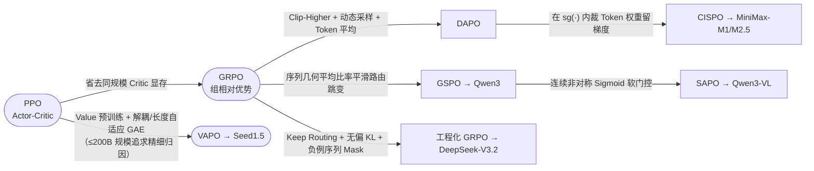

# 2.8 跨模型训练经验总结

!!! abstract "本节摘要"
    本节将 DeepSeek、Kimi、Qwen、MiniMax、GLM-5、Seed 六大代表系列的后训练流水线、策略优化算法与奖励体系放在同一坐标系下横向对照，提炼出**十条经过多方独立验证的共性工程经验**与**六大前沿演进趋势**。

---

## 主流模型后训练流水线横向总表

| 模型系列 | 阶段数 | 后训练流水线核心阶段顺序 | 核心在线 RL 算法 | 是否用 Critic |
|----------|--------|-------------------------|-----------------|--------------|
| **DeepSeek-R1** | 4 | Cold SFT → Reasoning RL → Rej. Sampling SFT（回 Base 重训）→ All-Scenario RL | **GRPO** | 否 |
| **DeepSeek-V3.2** | 2 (+分支) | 8 域 Specialist Distillation SFT → 单阶段 Unified Mixed GRPO（另设 Speciale 长链分支） | **GRPO**（无偏 KL + 序列 Mask + Keep Routing/Mask） | 否 |
| **Kimi k1.5** | 2–3 | Long-CoT SFT → 128K 渐进上下文 RL（+ Long2Short RL 压缩） | **Online Policy Mirror Descent** | 否 |
| **Kimi K2 / K2.5** | 2–3 | 工具/代码 SFT（K2.5 零视觉 SFT）→ Agentic RL（RLVR + 闭环自评 Rubric；K2.5 含 PARL + Toggle） | **Policy Mirror Descent 扩展** | 否 |
| **Qwen2.5** | 4 | SFT (~1M) → Offline DPO (~150K) → Online GRPO（方差优先）→ 长上下文微调 | **GRPO** | 否 |
| **Qwen3 / 3-VL** | 4 | Long-CoT Cold SFT → Reasoning RL (3,995 题) → Mode Fusion SFT → General RL | **GRPO → GSPO / SAPO** | 否 |
| **MiniMax-01** | 5 | Short SFT → Long SFT → Short DPO → Long DPO → Online RL（短长严格解耦） | **GRPO 变体** | 否 |
| **MiniMax-M1 / M2.5** | 3 | 推理 CPT → CoT SFT → 大规模 RL（M2.5 依托 Forge 异步前缀树系统） | **CISPO（Token 级裁剪 IS 权重）** | 否 |
| **GLM-5** | 5 | Overall SFT → Reasoning RL → Agentic RL (Slime) → General RL → **On-Policy 跨阶段蒸馏** | **GRPO + IcePop + 双边裁剪** | 否 |
| **Seed1.5-Thinking** | 2 | 精简 CoT Cold SFT → 大规模多域混合在线 RL（SRS 流式采样 + 在线分布适配） | **VAPO（Actor-Critic）/ DAPO** | **是（VAPO）** |

---

## 算法演进与分流全景

从横向对比可以提炼出四条清晰的算法选择规律：

1. **超大稀疏 MoE（>400B 总参）一致规避全尺寸 Critic**：DeepSeek（671B）、Kimi（1.04T）、GLM-5（744B）、MiniMax（456B）无一例外选择了无 Critic 路线；而在 32B～200B 规模上，Seed 团队用 VAPO 证明只要把 Critic 预训练好，Actor-Critic 在同等步数下依然具备 6～10 分的归因精度优势；
2. **解决“硬裁剪伤梯度”殊途同归**：DAPO 放宽上界，CISPO 只裁权重系数不掐断 $\log\pi$ 梯度，SAPO 用平滑钟形导数彻底消除硬跳变；
3. **解决“MoE 路由翻转失稳”形成三大成熟武器**：算法层用 **GSPO**（序列几何平均）或 **SAPO**（平滑软门控），系统层用 **Keep Routing / R3 Rollout Replay**（强制锁定采样专家路径），优化器层用 **MuonClip**（抑制 Q/K 谱范数爆炸）；
4. **防多阶段遗忘分化出两种架构**：DeepSeek-V3.2 选择“事前分域专家蒸馏 + 单阶段 Mixed RL 合流”，GLM-5 则选择“分阶段专项 RL + 末尾 On-Policy 跨阶段蒸馏汇总”。

---

## 奖励体系设计对比

| 模型系列 | 客观任务奖励 | 开放与主观任务奖励 | 防 Reward Hacking 核心手段 |
|----------|-------------|-------------------|---------------------------|
| **DeepSeek-R1** | 数学等价匹配 + 代码单测 + 语言一致性 | 有用性 RM（仅看最终答案）+ 安全 RM | 偏好 RM **仅在最后 400/1700 步介入**；对 `<think>` 过程免检 |
| **DeepSeek-V3.2** | 规则结果奖励 + 长度与语言一致性 | 每条指令挂载专属 Rubric 的生成式 RM | 数学弱/零 KL，开放域强 KL（分域调节正则强度） |
| **Kimi k1.5 / K2** | 二元规则校验 + 沙箱执行 | k1.5 用 **CoT RM (98.5%)**；K2 用**三层自评 Rubric** | Prescriptive Rubrics 明令禁止奉承套话；用 RLVR 客观信号持续校准 Critic |
| **Qwen2.5 / Qwen3** | 数学代码规则验证 + 20+ 类指令校验器 | **六维度独立评分 RM** + 成对/生成式评判 | 解耦简洁度与有用性评分，避免靠堆砌长度骗高分 |
| **GLM-5** | 数学代码规则 + SWE/终端/搜索环境真值 | 规则 + 结果 RM + 生成式 RM + 人类范文锚点 | 引入高质量人工文本作风格锚点防“AI 腔”自循环；跨阶段 Teacher Logits 约束 |
| **OpenAI (公开安全论文)** | — | 规范感知评判 + **有用性 × 安全性乘法奖励** | 隐藏安全 CoT 防表演作弊；乘法结构使 `safety=0` 时总分直接清零 |

---

## 十条可复现的共性后训练工程经验

!!! success "经验 1：Cold-Start SFT 宜精不宜多，切忌在 RL 前做重度 RFT"
    DeepSeek-R1 冷启动仅用数千条精修样本；Seed1.5-Thinking 受控实验直接证实，在 RL 前用大量自采样正确样本做微调（RFT）虽然前期涨分快，但收窄了分布多样性，使最终 AIME `avg@32` 从 58% 跌至 54%。冷启动的使命是**立规矩（格式与可读性），而不是替 RL 把路走死**。

!!! success "经验 2：在线 RL 的第一生产力是“能力边界上的高方差 Query”，而非题海数量"
    Qwen3 仅靠精选 **3,995 道题跑 170 步** 就拿到 AIME +15 分；DAPO 在已集齐其余四项改进后，仅靠 **Dynamic Sampling** 实时剔除全对/全错题就再涨 **+8 分**（42 → 50）。全对和全错的题目组优势为零，唯有模型当前成功率在 20%–70% 之间的临界题才能持续泵出高信噪比梯度。

!!! success "经验 3：中小尺寸模型走“强弱蒸馏 + 轻量 RL”性价比远超从头直接 RL"
    R1-Distill-Qwen-32B 纯 SFT 蒸馏在 AIME 上高出同尺寸万步直接 RL **+25.6 分**（72.6 vs 47.0）；Qwen3 从 235B 向小模型做 Off/On-policy 蒸馏仅需从头 RL **1/10 的 GPU 算力**且性能全面反超。大参数基座负责重度 RL 探索未知路径，小模型负责高效继承压缩。

!!! success "经验 4：神经网络偏好 RM 必须“限时、限视野、严防套话”"
    连续可微的神经网络打分器只要暴露步数足够长，必然被策略梯度找出漏洞。成熟防护包括：限制介入步数（R1 末尾 400 步）、隔离内部思维链（R1 与 OpenAI 均只评最终回复）、以及用显式反奉承条款（K2 Prescriptive Rubrics）封堵表面讨好。

!!! success "经验 5：MoE 架构上跑 RL 必须显式治理路由跳变失稳"
    不能把 Dense 模型调通的朴素 GRPO 直接搬上稀疏 MoE。务必在算法层启用序列级比率（GSPO）或平滑软门控（SAPO），或在系统层开启采样路由重放（Keep Routing / R3 Replay）。

!!! success "经验 6：超长上下文对齐必须实施“短长分离”或渐进长度课程"
    MiniMax-01 的五阶段短长解耦与 Kimi k1.5 的 `4K → 32K → 128K` 窗口课程共同说明：将海量短对话与稀疏长文档混在同一批次更新，必然导致短文本梯度淹没长程能力、且“简洁 vs 详尽”偏好相互打架。

!!! success "经验 7：训推比特级与分布级一致性往往比改损失函数更决定生死"
    GLM-5 的 TITO（消除 0.1% 重分词错位）、确定性 `torch.topk`（消除稀疏注意力并列竞争导致几步内熵崩塌），DeepSeek-V3.2 的 Keep Sampling Mask，以及 MiniMax-M1 的 FP32 输出头与 Adam $\beta_2=0.95, \varepsilon=10^{-15}$ 修正——任何破坏“训练重算概率 = 采样真实行为概率”的隐蔽裂缝，都会在大规模 RL 中被急剧放大。

!!! success "经验 8：Actor-Critic 远未过时，选型取决于活跃参数规模与显存账本"
    VAPO 在 32B Dense（60 vs 50）与 150B MoE（79 vs 73）上的严谨消融表明，只要做好 Value Pretraining 与长度自适应 GAE，Critic 的逐词元归因依然更强；500B+ 巨型 MoE 选 Value-Free 是出于工程显存约束的理性权衡，而非算法原理优劣。

!!! success "经验 9：多阶段顺序训练的遗忘可以通过 On-Policy Logit 蒸馏优雅弥合"
    GLM-5 第五阶段证明，保留各专项阶段最佳检查点作为 Teacher，让当前模型自采样并最小化逐 token 对数概率差，能够在不破坏已学分布的前提下无损聚合推理、Agent 与通用对话的各项峰值指标。

!!! success "经验 10：快慢思考切换与交错思考必须在后训练阶段原生内化"
    无论是 Qwen3 的 `/think`、`/no_think` 双模 SFT 融合，K1.5 的 Long2Short RL 压缩，还是 GLM-5 面向多步工具调用的 Interleaved Thinking，都应当作为显式数据与训练阶段内置进模型行为空间，而非留到线上靠提示词硬凑。

---

## 六大前沿演进趋势展望

| 演进维度 | 代表性工业信号 | 下一阶段走向判断 |
|----------|---------------|-----------------|
| **1. 主战场从单轮做题转向多轮 Agentic RL** | K2/K2.5、GLM-5、MiniMax-M2.5、V3.2 均将大规模真实/模拟工具环境列为核心阶段 | 核心瓶颈从“裁剪公式微调”转向十万级可验证沙箱合成、异步流式调度与跨轮信用分配 |
| **2. 后训练算力占比向预训练同量级逼近** | DeepSeek 后训练预算从 V3 的 `0.18%` 跃升至 V3.2 的 `>10%`，且明确 RL Scaling 未饱和 | 后训练不再是廉价附属品，算力与长尾环境交互预算成为新的旗舰分水岭 |
| **3. 分治专家 RL + 在线蒸馏成为旗舰标配** | V3.2 的 8 域 Specialist Distillation 与 GLM-5 的 Cross-Stage Distillation 异曲同工 | “专项 RL 探顶 → On-Policy 密集 Logit 蒸馏汇合”正在取代脆弱的单链路串联微调 |
| **4. 连续软门控逐步替代硬边界截断** | CISPO 保留越界梯度，SAPO 进一步用处处可微软门控统一 Token 与 Sequence 行为 | 硬阶跃裁剪将逐步让位于温度自适应的平滑信任域机制 |
| **5. 原生多模态与文本推理双向互促** | K2.5 证明早期 `10:90` 图文预训练 + 视觉 RL 可反向拉高 MMLU-Pro 与 GPQA 纯文本推理 | 视觉、代码执行与文本推理将合流为统一的跨模态 RL 流水线 |
| **6. 新型高效注意力与 RL 训练协同演进** | V3.2/GLM-5 的 DSA 稀疏注意力、Qwen3.5 的 GDN、MiniMax 的 Lightning Attention | 线性/稀疏注意力大幅压低长链 Rollout 成本，但也倒逼算子确定性与精度对齐升级 |
