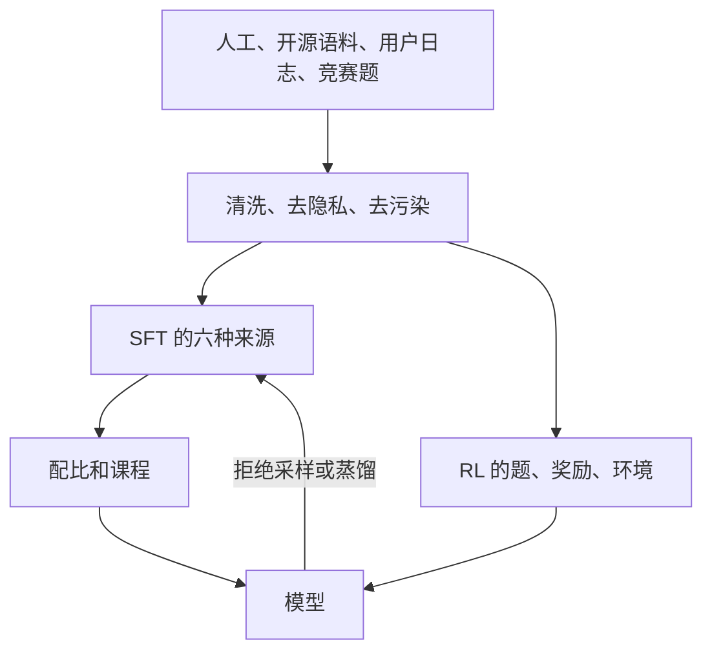

# 2.9 数据工程

SFT 需要「题目，回答」配对。RL 需要题目、能执行的环境和一个核验器，标准长回答可以由策略自己采样。两条线最后会互相回灌。

## SFT 的六种来源

| 方法 | 规模 | 代表 | 上限在哪 |
| --- | --- | --- | --- |
| 人工冷启动 | 数千条 | R1，Qwen3 | 贵，只负责格式 |
| 强模型蒸馏 | 十万到百万 | R1 的 80.4 万，V3 的约 150 万 | 超不过教师 |
| 拒绝采样 | 十万到百万 | R1 第三阶段约 80 万 | 超不过核验器 |
| 指令改写 | 数万 | Evol-Instruct，OSS-Instruct | 会漂离真实用户 |
| Agent 轨迹合成 | 千级种子到万级任务 | K2，SWE-smith | 模拟轨迹有偏 |
| 自博弈 | 可以一直生成 | STaR，LSP | 偏差会累积，仍要核验 |

冷启动宜少。R1 是数千条长思维链，一部分来自 R1-Zero 再人工改。格式标签，例如 `<think>` 或 `/think`，在这里写进模型。Seed 的实验说明，在 RL 前把模型自己的正确样本再监督一遍，会收窄后面的探索。

蒸馏对小模型最划算。R1-Distill-Qwen-32B 的 AIME 2024 是 72.6，同尺寸从头 RL 是 47.0。V3.2 把教师从一只 R1 换成多个领域专家，各自 RL 之后再合并。大模型仍然要自己探索教师没生成过的解法。

拒绝采样是：对一道题采样多次，留下核验通过的回答，当成下一次 SFT 数据。数学看答案，代码看测试，开放问答只能靠另一个模型评判，天花板依次降低。K1.5 在做对的样本里再选最短的，用来把长思维链压短。R1 的这一阶段从 V3-Base 重新训练，而不是接着 RL 检查点训。

指令合成里，Self-Instruct 让模型写指令和回答。Evol-Instruct 用多轮改写增加约束。只靠模型空想，容易反复生成同类题目。OSS-Instruct 先从真实代码库抽一个片段，再让模型围绕它出题，并用能否编译来过滤。SelfCodeAlign 进一步从片段里抽出概念，生成测试，在沙箱里丢掉跑不通的。

Agent 数据要合成的是任务、环境和轨迹，不只是一段文本。K2 从三千多个真实 MCP 工具扩到合成工具，用模拟器执行，再按量表过滤。SWE-smith 向真实仓库注入缺陷，得到约 5 万个修复任务。工业报告更信任沙箱里真实执行出来的轨迹，纯文本模拟的轨迹只能作补充。

自博弈里，STaR 做题、留下做对的、再监督微调，然后重复。它只能强化已经会做的题。LSP 把同一个模型分成出题者和求解者，交替变难。SGALM 在一个模型里同时训练生成和判别。后两种仍然需要某种核验，否则错误会当成新的训练目标。

## RL 要的是题、奖励和环境

Qwen3 的推理 RL 是 3995 道题、170 步、AIME 大约加 15 分。题的来源包括竞赛、公开数据集、合成和真实用户日志。用户日志最接近部署分布，也最需要去隐私。

筛选看的是多次采样的**平均成功率**，不是 pass@k。pass@k 是 k 次里至少对一次，平均成功率低的题仍然可以有很高的 pass@k。Qwen2.5 保留 8 次采样里对 2 到 5 次的题。全对没有正优势可学的新东西，全错没有成功样本。DAPO 在训练中把全对和全错的题立刻换掉。K1.5 按 \(1-\text{当前成功率}\) 提高难题的采样概率，并把上下文从 4K 课程式加到 128K。

奖励的上限就是 RL 的上限。

| 类型 | 适用 | 主要风险 |
| --- | --- | --- |
| 规则 | 数学、测试、格式 | 核验脚本被钻 |
| 奖励模型 | 开放偏好 | 用久了被讨好 |
| 量表自评 | 主观和 Agent 任务 | 需要可验证信号来校正评判器 |

R1 试过过程奖励：步骤边界在代码和 Agent 里不清楚，中间对错标不准，打分器会被策略利用，而且每次策略更新后都要重训。过程奖励更适合推理时重排，不适合作为那次大规模 RL 的主奖励。

环境方面，K2 用工具模拟器，GLM-5 的 Slime 并发一千条以上轨迹，MiniMax Forge 使用十万级真实环境，V3.2 公开了约 1827 个环境、4417 个任务。代码题的测试也要合成。K1.5 的漏斗是：竞赛题生成约 50 组测试，用多份标答交叉验证，大约 1000 道题最后留下 323 道。

## 混合和闭环

R1 第二段 SFT 大约是 60 万推理对 20 万通用。MiniMax 把短数据和长数据分成五个阶段。Qwen3 对同一批题同时生成思考和不思考两种回答。K1.5 的上下文长度逐段加长。DoReMi 用小模型搜索数据配比，再把权重用到大模型上；最优比例会随规模变化。

各家实际都在循环：少量冷启动，推理 RL，把做对的样本拒绝采样或蒸馏回 SFT，再进入通用或 Agent RL。GLM-5 在循环末尾加了跨阶段蒸馏，用来捡回前面阶段的能力。

| 阶段 | 常见数量级 |
| --- | --- |
| 冷启动 | 数千到数万 |
| 含拒绝采样的 SFT | 十万到百万 |
| RL 的题 | 数千到数万，且落在可学区间 |
| RL 步数 | 一百多步到数千步 |
| Agent 环境 | 数千到十万以上 |
