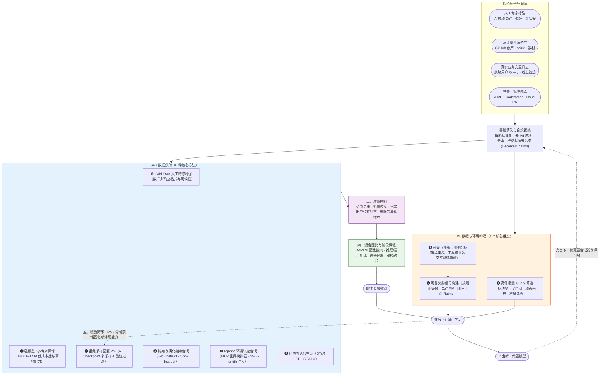
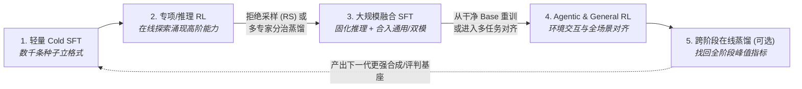

# 2.9 数据工程专题 — 后训练数据获取与闭环方法全景

!!! abstract "本节摘要"
    算法公式是完全公开的，而**高质量后训练数据与可验证环境的构造飞轮**才是各家模型真正的竞争壁垒。本专题围绕“SFT 与 RL 的训练数据分别从哪里来、怎么筛、怎么配比并形成迭代闭环”展开：涵盖 **SFT 六大数据获取范式**、**RL 三维数据与环境工程**、**六道质量控制关卡**、**数据混合与课程策略**以及 **SFT↔RL 螺旋进化闭环**。

---

## 后训练数据工程全景图

---

## 一、SFT 数据获取：6 种核心范式

### 横向对比速查表

| # | 获取方法 | 数据形态 | 典型量级 | 代表工业实践 | 核心优势 | 天花板与主要风险 |
|---|----------|----------|----------|--------------|----------|-----------------|
| ❶ | **Cold-Start 人工精修** | `(query, 规范长 CoT + 总结)` | 数千～万余条 | DeepSeek-R1 冷启动、Qwen3 Cold SFT | 质量与可读性最高，精确定义标签与思维模板 | 人工成本极高；数量过多反而限制后续 RL 探索 |
| ❷ | **强模型 / 多专家蒸馏** | `(query, teacher_trajectory)` | 十万～百万级 | R1 蒸馏 804K、V3 双轨 1.5M、V3.2 8 域专家蒸馏、Qwen3 强弱蒸馏 | 中小模型提分最快、仅需直接 RL ~10% 算力 | 受限于教师模型自身的能力边界 |
| ❸ | **拒绝采样 (Rejection Sampling)** | `(query, 经验证正确的自采样解)` | 十万～百万级 | R1 阶段 3 (~800K)、k1.5 Shortest RS | 将在线 RL 涌现的新能力沉淀为稳定 SFT 资产 | 质量上限严格受制于验证器/评判器的准确度 |
| ❹ | **锚点与演化指令合成** | `(合成指令, 合成解答)` | 数万～数十万 | WizardLM Evol-Instruct、Magicoder OSS-Instruct | 从少量种子快速扩展复杂度与技能组合 | 纯空想易陷入模式坍缩或偏离真实用户提问分布 |
| ❺ | **Agentic 交互轨迹合成** | `(工具集 + 任务, 多步交互轨迹)` | 千级种子 → 数万轨迹 | Kimi K2 (3K→20K 工具)、SWE-smith (50K 仓库修复) | 破解真实多步工具调用标注匮乏瓶颈 | 纯 LLM 模拟环境可能存在幻觉偏差，需沙箱兜底 |
| ❻ | **自博弈迭代 (Self-Play)** | `(自出题, 自解答 + 验证)` | 理论可无限迭代 | STaR、LSP、SGALM、GASP | 摆脱对外部人工题库的静态依赖 | 缺乏外部真值锚定时容易发生分布漂移或串通退化 |

### ❶ Cold-Start 人工与半自动精修种子

- **核心定位**：教基座“按什么格式把思考过程和最终结论分开写清楚”，而不是靠这几千条数据把所有题型背会。
- **实操铁律**：
    1. **控制规模，留足探索熵**：R1 仅用数千条（从 R1-Zero 输出中捞出可读片段加上人工润色与结构化总结）；Seed1.5 已证明在 RL 前灌入过多同分布正确样本做微调会压缩探索空间、拉低最终上限；
    2. **预埋交互协议**：Qwen3 的 `/think`、`/no_think` 模板，以及 GLM-5 每次调工具前的 `Interleaved Thinking` 协议，均在此阶段定型。

### ❷ 强模型蒸馏与 Specialist Distillation（多专家分治蒸馏）

- **单教师蒸馏**：用前沿大推理模型（如 671B R1 或 235B Qwen3）生成的轨迹直接训练中小尺寸模型，是目前 32B 及以下模型性价比最高的路线（还可以进一步结合匹配教师词表 Logits 的 On-policy KL 蒸馏）；
- **多专家分治蒸馏（V3.2 新范式）**：单一通用教师很难在数学、竞赛代码、前端工程、深度搜索等所有维度同时做到极致。DeepSeek-V3.2 先针对 **8 个细分领域**各自独立跑满高预算专项 RL 训出 8 位“单科状元”，再分别生成双模式轨迹汇合蒸馏给同一个基座，显著突破了单教师蒸馏的木桶短板。

### ❸ 拒绝采样回灌（Rejection Sampling, RS）

- **标准流水线**：拿当前阶段 RL 训出的强模型，对每道题高温采样 $k$ 条候选轨迹 → 用规则验证器（数学匹配、代码单测）或生成式评判模型筛出正确且行文优质的输出 → 汇总成新一代 SFT 数据集。
- **两个高价值技巧**：
    - **回到干净 Base 重训**：DeepSeek-R1 在阶段 2 推理 RL 结束后，收集约 600K 拒绝采样推理样本 + 200K 通用样本，**回到最初的 V3-Base 重新做 SFT**，彻底洗掉长程纯推理 RL 可能带来的局部语癖与通用退化；
    - **Shortest RS（最短正确解筛选）**：Kimi k1.5 在同题多条正确轨迹中专门挑选 token 最短的一条，有效剔除无效车轱辘话、服务于长短思维压缩。

### ❹ 指令演化与真实锚点合成

??? info "📖 深入拆解：为什么纯 LLM 造题会“模式坍缩”？OSS-Instruct 与 SelfCodeAlign 怎么破局？"
    如果你直接提示大模型“请帮我编 10,000 道 Python 编程题”，不出几百道就会陷入严重的**模式坍缩（Mode Collapse）**——翻来覆去全是斐波那契数列、二分查找、链表反转和简单的列表排序，根本覆盖不了真实工程里的异步网络、数据库事务或复杂并发。

    1. **OSS-Instruct（Magicoder, [arXiv:2312.02120](https://arxiv.org/abs/2312.02120)）——用真实开源代码片段做随机锚点**：
        - **Step 1**：从 GitHub 海量真实代码库（如 The Stack）中随机抽取一小段互不相同的真实函数或 API 调用代码片段（仅数行至十余行）；
        - **Step 2**：把这段真实代码喂给大模型，要求它**以这段代码涉及的真实业务场景或底层技术点为灵感**，反向构思一道自包含的编程任务并给出完整解答；
        - **效果**：真实世界千奇百怪的开源代码强行把生成分布拽出了模型的固有舒适区，使合成指令的多样性与真实度大幅跃升。
    2. **SelfCodeAlign（[arXiv:2410.24198](https://arxiv.org/abs/2410.24198)）——概念抽取 + 沙箱执行自验证闭环**：
        甚至不需要强闭源教师，只用开源模型自身走完四步：从真实代码抽取出核心编程概念组合 → 合成新题目 → 采样多份候选实现**并同时合成配套单元测试** → 扔进真实沙箱交叉运行，只保留通过单测的代码作为对齐样本。
    3. **Instruct-SkillMix（[arXiv:2408.14774](https://arxiv.org/abs/2408.14774)）**：先用强模型归纳出指令遵循所需的数十项基础原子技能，每次随机抽取 $k$ 项技能组合合成复杂指令——仅用 **4K 条** 高密度组合样本即达到传统数十万条合成集的对齐水平。

### ❺ Agentic 交互轨迹合成（Seed-then-Expand）

多步工具使用的数据合成核心不是编对话文本，而是**造工具、造带状态的沙箱环境、造可自动判分的任务**：

- **Kimi K2 世界模拟器路线**：以 3,000+ 真实 MCP 工具为种子扩增出 20,000+ 工具定义 → 组合生成复杂任务与评分 Rubric → 由 User Agent、被测 Agent 与维护内部状态的 Tool Simulator 多轮交互，经 Judge Agent 严筛入库；
- **SWE-smith 真实仓库逆向造 Bug 路线**（[arXiv:2504.21798](https://arxiv.org/abs/2504.21798)）：直接挑选原本所有单元测试全绿的真实 GitHub 仓库，利用程序变换或 LLM **主动把好代码改坏（注入真实感 Bug 使部分单测变红）**，逆向低成本批量造出 **50,000+** 具备百分百真实 Docker 执行验证环境的仓库修复任务！

### ❻ 自博弈（Self-Play）迭代生成

??? info "📖 深入拆解：STaR、LSP 与 SGALM 三代自博弈机制对比"
    - **STaR（Self-Taught Reasoner）**：模型在现有题库上尝试生成推理链 → 只留下最终答案撞对的推理链做 SFT → 用变强后的模型再去解之前没做出来的难题。局限在于仍需现成题库，且对完全超出当前采样覆盖范围的题束手无策。
    - **LSP（Language Self-Play, [arXiv:2509.07414](https://arxiv.org/abs/2509.07414)）**：将模型拆为两个博弈角色——**Challenger（出题人）**专门寻找当前 **Solver（解题人）**薄弱的能力边界生成新挑战，Solver 则努力攻克新题，通过博弈均衡约束实现无外部新数据注入的持续自我对弈进化。
    - **SGALM / GASP（非对称引导自博弈, [arXiv:2603.15957](https://arxiv.org/abs/2603.15957)）**：进一步引入生成器与判别器联合对抗，或由教师引导出题难度阶梯，防止自博弈双方串通退化出无意义乱码。

---

## 二、RL 数据与环境构建：3 个核心维度

与 SFT 完全不同，**在线 RL 不需要事先准备好的长篇标准推理过程，它需要的是：(1) 处在能力边界上的好问题（Query），(2) 打不穿的可靠奖励（Reward），以及 (3) 高并发可复现的执行环境（Environment）**。

### 维度 ❶：Query 获取与“可学区间”筛选

所有头部实验室在 RL 选题上达成了高度一致：**剔除全对题与全错题，只喂“跳一跳够得着”的中等偏难题**。

| 筛选策略 | 具体筛选判据 | 代表模型 | 实测收益与机制 |
|----------|-------------|----------|---------------|
| **可学区间静态预筛** | 对每题预采样 $N$ 次（如 8 次），仅保留正确次数落在 **2～5 次（平均成功率 25%–62.5%）** 的题目 | Qwen2.5-Math、Qwen3 | 剔除已稳拿满分的简单题（零梯度）与当前完全摸不着边的超纲题（无正例） |
| **在线 Dynamic Sampling** | 训练循环中实时监测每个 Group：若 $G$ 次采样全对或全错，当场丢弃并补采新题凑满有效 batch | **DAPO**、MiniMax-M1 | 模型能力每百步都在涨，静态题库很快变简单；在线动态过滤在 DAPO 中单项贡献 **+8 AIME 分** |
| **失败率优先采样 + 课程** | 先用高成功率题分桶热身，随后按权重 $\propto (1 - \text{平均成功率})$ 向低通过率难题倾斜，配合 `4K→32K→128K` 窗口递增 | Kimi k1.5 | 兼顾早期格式稳定与后期硬骨头攻坚 |

!!! warning "指标辨析提醒：选题看的是多次采样平均成功率（`avg@N`），注意区分 `Pass@N`"
    工程讨论中常有人口头把“采样 10 次看做对几次来估难度”简称为 `Pass@10` 筛选——务必注意：严格数学定义下 `Pass@10` 是“10 次里**至少对 1 次**”的二值覆盖率，而衡量题目难度的核心代理量是**10 次采样的经验成功率 $\hat{p} = \frac{c}{10}$**。例如某题 10 次对 1 次（$\hat{p}=10\%$）和 10 次对 9 次（$\hat{p}=90\%$），它们的 `Pass@10` 都是 100%，但前者是待攻坚难题，后者已是熟题！保留 $0 < c < N$（且重点聚集中间成功率区间）才是组内方差最大的高信息量样本。

??? info "📖 五大代表团队的 RL Query 遴选细节对照"
    - **Qwen3（精选 3,995 题）**：① 严格限制未在冷启动集中出现且规则可验证；② 用当前模型预采样筛选处于中等可学通过率区间的题目；③ Embedding 语义去重，并**专门剔除不写推理过程靠盲猜也能高概率蒙对的选择/判断题**，最终浓缩出不到四千道高纯度题目。
    - **Qwen2.5（~66K 查询池）**：预采样计算奖励方差，高方差查询获得更高采样优先级。
    - **Kimi k1.5**：除了难度分桶与优先采样外，同样执行了严格的**反盲猜过滤（Anti-Guessing）**——禁止模型使用 CoT 直接裸猜答案 8 次，若裸猜就能撞对则说明题目存在选项特征泄漏或过于平凡，直接剔除。
    - **DAPO（DAPO-Math-17K）**：爬虫与人工整理竞赛题后，借助 LLM 将复杂分式、根号或集合表达式统一改写为**唯一确定整数答案**（例如原题答案是 $\frac{a+\sqrt{b}}{c}$，改写题面求 $a+b+c$），把规则解析器的误判率降到零。

### 维度 ❷：奖励信号工程

**RL 的能力上限严格等于奖励信号的保真度上限**：

1. **确定性规则验证（RLVR，可靠性 ★★★★★）**：数学符号等价库（如 `Math-Verify`）、代码单元测试、JSON Schema / 长度 / 关键词格式校验器；
2. **先思考再打分的生成式 RM（CoT RM / GRM，可靠性 ★★★★☆）**：如 K1.5 的 CoT RM（准确率从 84.4% 跃升至 98.5%）与 V3.2 挂载题目专属 Rubric 的生成式评判；
3. **闭环自评量表（Self-Critique Rubric，可靠性 ★★★★☆）**：如 K2 通过明确的反讨好负面清单 + 用 RLVR 客观样本持续在线校准自评分支；
4. **传统标量偏好 RM（可靠性 ★★★☆☆）**：仅适合短周期通用文风与安全微调，须严格控制暴露步数（如 R1 末尾 400 步）以防钻空子。
5. *(注：为何不把神经网络过程奖励 PRM 作为大规模 RL 主信号？详见 [2.1 节 DeepSeek-R1 负面实验分析](2.1-deepseek.md)——步边界模糊、标注昂贵且极易被策略梯度 Hacking，更适合推理阶段做 Best-of-N 重排序)*。

### 维度 ❸：可执行环境与单元测试合成漏斗

对于代码与 Agentic RL，没有高可靠的测试用例就没有奖励信号。Kimi k1.5 披露的**竞赛代码测例自动合成漏斗**展示了工业级严苛程度：

1. 收集公开编程竞赛题面，调用专业测试数据生成库 **CYaRon** 为每道题自动编写随机与边界测试生成器，生成 **50 组高强度测试用例**；
2. 为每道题收集 **10 份独立人类 AC 标准解答**，用这 10 份标答去跑生成的 50 组测例做交叉投票：某组测例只有至少 **7/10** 的标答输出一致，才被认定为合法测例；
3. 整道题目只有在至少 **9/10** 的标答能全数通过筛选后的测例集时，才获准进入 RL 训练集——**1,000 道原始竞赛题经过该漏斗后仅剩 323 道（32.3% 留存率）**，彻底杜绝了脏测例误导强化学习！

---

## 三、数据质量控制六道关卡

在数据送入训练器之前，工业流水线普遍执行以下六步质检：

| 质检环节 | 解决的问题 | 代表性技术手段 |
|----------|------------|---------------|
| **1. 语义级去重** | 防止模型在重复题型上死记硬背导致局部过拟合 | MinHash + Dense Embedding 余弦相似度聚类去重 |
| **2. 难度区间校准** | 剔除过简无信息量样本与超纲噪声样本 | 预采样成功率分桶（保留 20%–70% 区间） |
| **3. 真实用户分布对齐** | 避免合成指令自嗨、偏离真实线上高频需求 | 如 **CodecLM**（[arXiv:2404.05875](https://arxiv.org/abs/2404.05875)）：提取真实查询的领域与技能元数据分布，指导定向合成与重加权 |
| **4. 反盲猜与反捷径过滤** | 剔除不经正确推理也能蒙对答案的伪正例 | 无 CoT 裸答命中剔除（k1.5）；代码题多组强边界单测防硬编码 `if-else` 骗分 |
| **5. 安全、毒性与 PII 脱敏** | 清除个人隐私信息与违法有害引导 | 专用分类器（如 FineWeb 管线）+ LLM 细粒度安全重写过滤 |
| **6. 基准严格去污染（Decontamination）** | 杜绝 AIME / MATH / SWE-bench 测试原题或改写题混入训练集造成虚假高分 | $n$-gram 重叠检测 + 向量语义近邻检索 + LLM 等价题判定三双重过滤 |

---

## 四、数据混合配比与阶段课程设计

拿到各领域清洗好的高质量数据后，**怎么混、按什么先后顺序喂**，直接决定模型会成为偏科生还是全能旗舰：

| 混合 / 课程策略 | 核心机制 | 代表工业实践 |
|----------------|----------|-------------|
| **自动化配比搜索** | 在小代理模型上拟合各域验证损失，用分布鲁棒优化或缩放律外推最优域间权重 | **DoReMi**（[arXiv:2305.10429](https://arxiv.org/abs/2305.10429)）及微调混合缩放律框架 |
| **推理 : 通用黄金配比** | 在重训 SFT 阶段按固定比例混合长 CoT 推理数据与日常通用指令数据 | DeepSeek-R1 阶段 3：**600K 推理 : 200K 通用（3 : 1）** |
| **短长上下文严格分离** | 将常规长度指令与 64K–1M 超长文档拆成前后独立阶段，绝不混批更新 | MiniMax-01 五阶段流水线（Short SFT → Long SFT → Short DPO → Long DPO → RL） |
| **同源双模混合（Mode Fusion）** | 对同一批查询同时构造 `<think>` 慢思考版与空标签直答版 SFT 样本混合微调 | Qwen3 阶段 3、DeepSeek-V3.2 Specialist 蒸馏阶段 |
| **上下文与难度递增课程** | 窗口长度与题目复杂度由浅入深分阶段抬升 | Kimi k1.5 (`4K → 32K → 128K`)、GLM-5 Mid-training (`4K → 32K → 128K → 200K`) |

??? info "📖 深入理解：DoReMi 是如何自动找到最优数据配比的？"
    人工网格搜索 8 个数据域的混合比例需要跑几十次昂贵的大模型训练。**DoReMi** 给出了极低成本的三步法：

    1. 先用均匀或经验比例训一个很小的**参考小模型**（如 280M 参数），记录它在每条样本上的基准损失；
    2. 再训一个同尺寸的**代理小模型**，采用 **Group DRO（组分布鲁棒优化）** 动态上调那些“比参考模型学得还差（超额损失大）”的数据域采样权重——注意这里看的不是绝对损失高低（否则高噪声乱码域权重最大），而是**相对基准还有多大进步空间**；
    3. 将代理小模型收敛后得到的域权重直接迁移用于百亿～千亿大模型训练，大幅缩短调参周期。

---

## 五、SFT ↔ RL 螺旋上升数据闭环与规模速查

纵观所有顶尖开源与闭源报告，后训练数据从来不是“一次性静态准备好就用到底”的，而是构成了一条 **SFT 为 RL 搭台 → RL 探索突破天花板 → 拒绝采样 / 专家蒸馏把新能力固化回 SFT → 开启下一轮更广域 RL** 的螺旋飞轮：

### 各阶段典型数据规模经验速查表

| 后训练环节 | 工业界常见规模量级 | 核心工程准则 |
|------------|-------------------|-------------|
| **Cold-Start SFT** | **数千 ～ 1 万余条** | 极精极净，只立格式与语言一致性，保留高探索熵 |
| **全量融合 SFT（含 RS / 蒸馏）** | **50 万 ～ 150 万条** | 推理与通用兼顾（如 3:1），推荐回到干净 Base 重训避免分布累积偏移 |
| **在线推理 RL 高效 Query 集** | **4,000 ～ 数万道题** | 质量与可学区间过滤远重于绝对数量，配合在线 Dynamic Sampling |
| **可验证 Agent 训练环境** | **1,000 ～ 100,000+ 环境/任务** | 真实容器沙箱（如 GitHub Issue 逆向注入）与有状态世界模拟器结合 |

---

## 核心参考文献索引

??? abstract "数据工程代表论文速查"
    | 主题分类 | 代表工作 | arXiv 编号 | 核心贡献点 |
    |----------|----------|-----------|-----------|
    | **指令自生成与演化** | Self-Instruct / Evol-Instruct | [2212.10560](https://arxiv.org/abs/2212.10560) / [2304.12244](https://arxiv.org/abs/2304.12244) | 种子指令自举扩增与多维度复杂度演化 |
    | **真实代码锚点合成** | Magicoder (OSS-Instruct) / SelfCodeAlign | [2312.02120](https://arxiv.org/abs/2312.02120) / [2410.24198](https://arxiv.org/abs/2410.24198) | 开源代码片段防模式坍缩 + 自生成单测沙箱校验 |
    | **高密度技能组合与分布对齐** | Instruct-SkillMix / CodecLM | [2408.14774](https://arxiv.org/abs/2408.14774) / [2404.05875](https://arxiv.org/abs/2404.05875) | 原子技能随机组合（4K 样本高效对齐）与目标用户分布匹配 |
    | **软件工程环境合成** | SWE-smith | [2504.21798](https://arxiv.org/abs/2504.21798) | 真实仓库自动注入缺陷构建 50K 可验证修复环境 |
    | **自博弈与配比优化** | LSP / GASP / DoReMi | [2509.07414](https://arxiv.org/abs/2509.07414) / [2603.15957](https://arxiv.org/abs/2603.15957) / [2305.10429](https://arxiv.org/abs/2305.10429) | 出题-解题自博弈进化与基于 Group DRO 的自动域配比搜索 |
