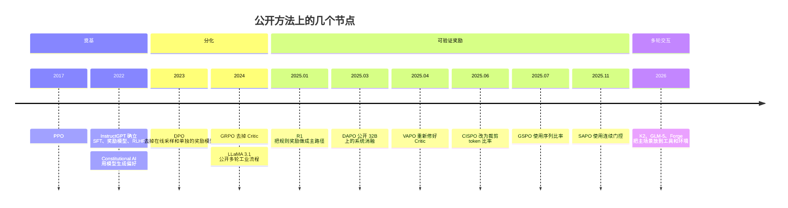

# 3.1 范式变迁

后训练的公开方法可以看成四代。分代是为了看目标变了什么，不是说上一代算法被弃用。DPO 和 PPO 今天仍在通用对齐里出现。

| 节点 | 之前的默认做法 | 之后多出来的做法 |
| --- | --- | --- |
| InstructGPT | 主要靠加大基座 | 1.3B 的 RLHF 可以在人类评估上超过 175B 基座 |
| DPO | 偏好对齐默认在线 RL | 离线偏好损失可以单独训练 |
| R1 | RL 多用于最后的对齐 | 规则奖励成为推理能力的主要训练信号 |
| DAPO 与 VAPO | 一组 GRPO 公式似乎就够 | 裁剪、采样和 Critic 冷启动会改掉几十分 |
| GSPO 与 SAPO | token 比率加硬裁剪 | 序列比率和连续门控用来稳住 MoE |
| Agent 报告 | 单轮生成 | 多轮工具、异步采样、训推一致 |

四代流水线可以压成：

1. 只有 SFT。代表是早期 Alpaca、Vicuna。模型模仿示范，没有比较好坏的信号。
2. SFT，训练奖励模型，再 PPO 或 DPO。代表是 InstructGPT、Claude、LLaMA 2。模型学会偏好，奖励模型会被钻，对多步推理的提升有限。
3. 少量冷启动，可验证奖励的推理 RL，再通用对齐。代表是 R1、Qwen3。推理行为从 RL 里变得更长、更会自我修正。没有标准答案的任务进不了这一段。
4. 在第 3 代后面加入工具和环境。代表是 K2、GLM-5、MiniMax 的 Forge。奖励更稀，终局分数更难分到某一次工具调用，采样和训练的计算路径必须一致。

推动换代的是标注成本、奖励被钻、竞赛推理和真实工具使用，以及少放一个同规模网络的显存压力。GRPO 比 PPO 少 Critic。DPO 连在线采样都省掉，代价是分布偏移。没有一种减少一直是免费的。
