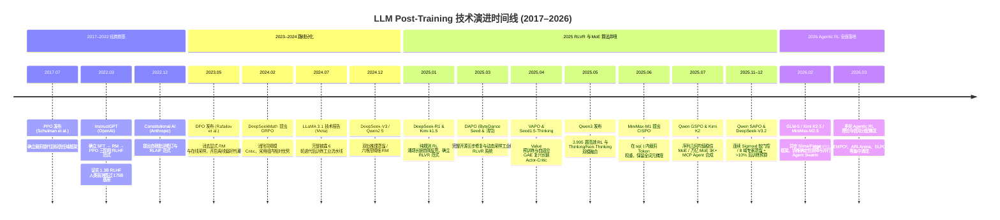

# 3.1 技术演进与范式变迁

!!! abstract "本节摘要"
    回顾大语言模型后训练从 2017 年 PPO 提出到 2026 年 Agentic RL 全面爆发的十年技术时间线，提炼六个改写行业默认配方的关键转折点，并剖析从 **SFT-Only → RLHF → RLVR → Agentic RL** 四代范式跃迁背后的核心驱动力。

!!! note "本章阅读说明"
    本章在前两章算法推导与工业报告拆解的基础上进行宏观归纳与前瞻分析：

    - **3.1 节**：梳理十年关键里程碑与四代后训练范式变迁；
    - **3.2 节**：系统归纳当前经过多方独立验证的**六大行业共识**与尚未根本解决的**五大核心技术挑战**；
    - **3.3 节**：围绕优化规律、规模取舍、数据护城河与自进化飞轮展开九条深度思考（标注为「💭 观点」的部分包含演绎推论，供探讨参考）。

---

## Post-Training 十年关键里程碑时间线



---

## 六个改写行业认知的关键转折点

| 转折节点 | 时间 | 认知转变（Before → After） |
|----------|------|---------------------------|
| **1. InstructGPT** | 2022.03 | 从“一味堆大基座参数”转向**“轻量对齐撬动百倍参数可用性”** |
| **2. DPO** | 2023.05 | 从“偏好对齐必须跑复杂的四模型在线 PPO”转向**“分类损失亦可直接优化隐式奖励”** |
| **3. DeepSeek-R1** | 2025.01 | 从“SFT 教能力、RL 只做最后礼貌修饰”彻底翻转为**“轻量 SFT 立格式、大规模在线 RL 涌现核心推理能力”** |
| **4. DAPO + VAPO** | 2025.03–04 | 从“套上 GRPO 公式就能复现”转向**“动态采样、超长缓冲与 Critic 预训练等工程细节决定几十分差距”** |
| **5. CISPO + GSPO + SAPO** | 2025.06–11 | 从“照搬 Atari 时代的逐 Token 对称硬裁剪”转向**“适配大词表稀疏 MoE 的保梯度、序列对齐与平滑软门控”** |
| **6. K2 / GLM-5 / Forge** | 2025.07–2026.02 | 从“单轮静态沙箱做数学代码题”跨越到**“十万级环境多轮异步交互、比特级训推一致与跨阶段在线蒸馏”** |

---

## 后训练四代范式演进全景

=== "第一代：SFT-Only 模仿微调 (2020–2022)"

    ```text
    Pre-trained Base ──► Supervised Fine-Tuning (SFT) ──► 部署对话模型
    ```

    - **代表工作**：FLAN、早期 Alpaca、Vicuna（蒸馏 GPT-4 对话输出）
    - **核心机制**：在人工或教师生成的问答示范上最大化下一个词元对数似然
    - **根本局限**：模型只学会了表面行文腔调；由于缺乏负反馈对比信号，它不知道“哪句话是编造的幻觉、哪一步推导算错了”，在复杂任务上上限极低。

=== "第二代：RLHF / DPO 人类偏好对齐 (2022–2024)"

    ```text
    Base ──► SFT ──► 人类/AI 偏好数据 ──► RM + PPO（或离线 DPO）──► 通用助手模型
    ```

    - **代表工作**：InstructGPT、ChatGPT、Claude 2/3、LLaMA 2/3
    - **核心机制**：用成对比较信号教会模型区分回答优劣，对齐有用性与无害性
    - **核心突破**：交互体验、指令遵循与安全性发生质变
    - **根本局限**：神经网络奖励模型（RM）对多步数理逻辑缺乏真实判别力，且训练步数一长必然触发严重的 **Reward Hacking**，难以支撑长程复杂推理扩展。

=== "第三代：RLVR 可验证长链推理强化学习 (2025)"

    ```text
    Base ──► 轻量 Cold-Start SFT ──► 大规模 Reasoning RL (GRPO/DAPO/VAPO/CISPO/GSPO) ──► 拒绝采样/蒸馏 + General RL
    ```

    - **代表工作**：DeepSeek-R1、Kimi k1.5、Qwen3、Seed1.5-Thinking、MiniMax-M1
    - **核心机制**：绕开脆弱的打分网络，直接用数学答案等价或代码单元测试的确定性结果驱动上万 token 长思维链自发进化
    - **核心突破**：模型涌现出自我检查、回溯纠错与动态分配测试时计算预算的能力，竞赛数学与编程逼近人类金牌水平
    - **根本局限**：局限于**单轮闭卷生成**与有标准答案的封闭题目，无法直接操作外部世界。

=== "第四代：多轮交互 Agentic RL 与多专家在线蒸馏 (2025 下半年–2026)"

    ```text
    Base (长窗口+仓库CPT) ──► SFT (交错思考) ──► Reasoning RL ──► 异步多环境 Agentic RL ──► General RL + 跨阶段蒸馏
    ```

    - **代表工作**：Kimi K2 / K2.5、GLM-5、DeepSeek-V3.2、MiniMax-M2.5 (Forge)
    - **核心机制**：模型在数百步的 `Thought → Tool Call → Environment Observation` 循环中与真实容器、终端、浏览器及子智能体交互，从环境成败与闭环 Rubric 中学习长程规划
    - **全新挑战**：轨迹长度高度异构导致同步等待空转、多步稀疏奖励下难以精确定位哪一步工具调用出错、以及跨引擎异策略与算子非确定性带来的系统级崩溃风险。

---

## 驱动四代范式跃迁的五股底层力量

| 核心驱动力 | 演进轨迹（从 → 到） | 标志性技术响应 |
|------------|---------------------|---------------|
| **1. 突破人工标注瓶颈** | 人工手写示范 → 人工成对排序 → AI 宪法自评 → 确定性规则与合成沙箱 | InstructGPT → Constitutional AI → DeepSeek-R1 → SWE-smith / K2 Simulator |
| **2. 对抗 Reward Hacking** | 单一标量 RM → 多维解耦 RM / CoT RM → 确定性验证器 + 反奉承量表 + 乘法安全奖励 | PPO+RM → Qwen2.5 六维 RM → RLVR + K2 Rubric + GPT-5 Safe-Completions |
| **3. 解锁测试时计算（Test-Time Scaling）** | 固定几百词直出答案 → 万词长思维链自纠错 → 快慢思考按需融合与并行蜂群 | ChatGPT → R1 / k1.5 → Qwen3 Mode Fusion / K2.5 Agent Swarm |
| **4. 适配超大规模稀疏 MoE 底座** | 4 模型常驻 PPO → 去 Critic GRPO → 序列级 GSPO / 软门控 SAPO / 路由锁定 | PPO → GRPO → GSPO / SAPO / V3.2 Keep Routing |
| **5. 从“纸上谈兵”走向真实工程闭环** | 单轮文本续写 → 多轮代码沙箱、终端运维与多跳搜索异步训练 | 同步框架 → Slime / Forge / SRS 异步流式前缀树系统 |
