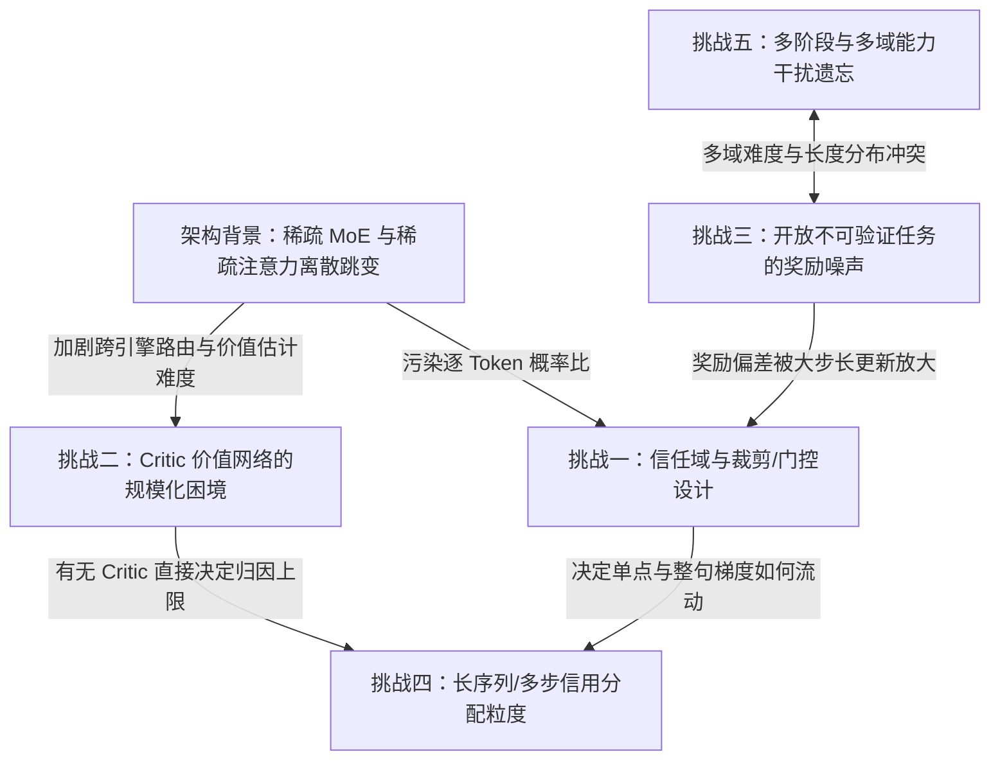

# 3.2 行业共识与核心挑战

!!! abstract "本节摘要"
    纵观第 1 章八种算法的数学演进与第 2 章六大模型系列的生产报告，后训练领域已经在六个核心维度上形成了经过多方独立验证的**强行业共识**；与此同时，围绕信任域自适应、Critic 规模化、开放任务防作弊、优化粒度权衡与多目标无损融合，仍横亘着**五大尚未彻底终结的技术挑战**。

---

## 六大行业共识（经多团队独立交叉验证）

### 共识一：“轻量 SFT 立规矩 + 重度在线 RL 出能力”成为标准范式

传统后训练长期奉行“SFT 决定能力上限，RL 只做安全与语气微调”。2025 年以来的所有头部实践彻底颠覆了这一分工——**SFT 只负责注入可读格式与最小行为模板，真正的复杂推理与长程规划能力必须靠在线 RL 探索释放**。

| 独立验证来源 | 关键实证记录 |
|--------------|-------------|
| **DeepSeek-R1 / V3.2** | R1 冷启动仅数千条样本即靠 GRPO 涌现反思能力；V3.2 将后训练 RL 预算从 V3 的 0.18% 暴增 50 倍以上至预训练的 **>10%** |
| **Qwen3** | 阶段 2 仅靠 **3,995 条精选查询 × 170 步在线 RL**，即在旗舰基座上撬动 **+15 分** AIME 跃升 |
| **Seed1.5-Thinking** | 受控实验证明：在 RL 前做拒绝采样微调（RFT）虽短期提分，但收窄了策略分布，导致最终 RL 收敛上限从 **58% 跌至 54%** |
| **LLaMA 4** | 将离线 DPO 降级为轻量收尾处理，核心推理与多轮能力交由大规模 Online RL 完成 |

### 共识二：PPO 遗留的“对称硬裁剪”是抑制推理涌现的结构性障碍

将 Atari 游戏时代的对称硬裁剪 `min(r·A, clip(r, 1-ε, 1+ε)·A)` 原封不动搬到大词表 LLM 上，会导致初始概率极低的关键推理转折词（`"Wait"`, `"However"`）稍一涨概率就触发越界，在后续更新步中梯度被硬生生置零。多家独立团队几乎在同一时间从不同切入点围剿了同一病灶：

| 团队 | 提出算法 | 问题切入点 | 核心破局机制 |
|------|----------|-----------|-------------|
| **ByteDance Seed** | **DAPO** | 对称上界 $1.2$ 压死低概率探索词引发熵坍塌 | 解耦上下界（**Clip-Higher**, $\varepsilon_{\text{high}}=0.28$），给正向探索松绑 |
| **MiniMax** | **CISPO** | 每批 16 轮更新中反思词第 1 轮即被硬裁剪出局 | 裁剪放入 $\mathrm{sg}(\hat{r})$ 当标量系数，**永不掐断有效词元的 $\nabla \log\pi$ 梯度** |
| **Alibaba Qwen** | **GSPO** | Token 级裁剪放大局部噪声并与序列奖励错配 | 升维至**序列几何平均比率** $s_i(\theta)$，全序列共享平滑权重 |
| **Alibaba Qwen** | **SAPO** | 硬裁剪在边界处发生阶跃跳变，后期易震荡崩溃 | 用处处可微的**非对称温度 Sigmoid 软门控**替代硬平台 |

### 共识三：稀疏 MoE 架构无法直接照搬稠密模型的 RL 配方

当今旗舰基座（DeepSeek 671B、Kimi 1.04T、GLM-5 744B、MiniMax 456B/230B、Qwen3 235B、Seed 200B）已全面转向高稀疏度 MoE。在 MoE 上，微小参数更新或训推算子差异就会让 `top-k` 离散专家路由发生约 10% 的翻转，使逐 token 概率比沦为高方差噪声。目前业界已沉淀出四套成熟武器：

1. **算法层序列平滑（GSPO）**：用整句几何均值摊平单点路由跳变；
2. **算法层连续软抑制（SAPO）**：用 $\mathrm{sech}^2$ 钟形导数自动衰减单点离群比率；
3. **系统层路由锁定（V3.2 Keep Routing / R3 Rollout Replay）**：采样时录下专家索引，训练时强制重放同一物理子网；
4. **优化器层谱裁剪（K2 MuonClip）**：通过后更新 `QK-Clip` 拦截 MoE 注意力头奇异值累加爆炸。

### 共识四：RL 题目的“可学边界信息量”远比题库绝对规模重要

全对组（$\hat{A}=0$）和全错组（$\hat{A}=0$）对策略梯度的有效贡献严格为零。无论是 Qwen2.5 的方差优先采样、Qwen3 的 3,995 题精选漏斗、K1.5 的 $(1-\text{成功率})$ 优先采样，还是 DAPO 单项贡献 **+8 分** 的在线 **Dynamic Sampling**，本质都是把宝贵的采样算力 100% 集中投放在模型当前成功率处于 **20%–70% 能力边界**的题目上——这是投入产出比最高的单项优化。

### 共识五：“超大模型重度 RL 探顶 + 中小模型蒸馏继承”的两层分工确立

强化学习与知识蒸馏扮演着互补角色：**RL 负责在大容量空间中发现新路径（突破教师天花板），蒸馏负责将已发现的高阶路径高密度压缩进小参数空间**。

- DeepSeek-R1 32B 纯 SFT 蒸馏领先同尺寸万步直接 RL **+25.6 分**，1.5B 蒸馏版在数学上反超 GPT-4o；
- Qwen3 从 235B 向轻量模型做 Off/On-policy 蒸馏仅耗费从头 RL **1/10 的 GPU 算力**且效果显著更优；
- DeepSeek-V3.2 更进一步，在大模型内部也采用**“8 个专精专家各自重度 RL → 蒸馏合并为统一基座 → 混合 RL”**的分治架构。

### 共识六：分布式训推系统的确定性与精度细节直接决定大规模 RL 成败

| 报告来源 | 隐蔽系统级陷阱 | 不处理的直接后果 | 标准修复方案 |
|----------|---------------|-----------------|-------------|
| **GLM-5** | DSA 稀疏注意力 CUDA `top-k` 并列原子竞争非确定性 | 采样与训练选出不同 KV 集合，**寥寥数步内性能暴跌、生成熵急剧崩塌** | 换用确定性 `torch.topk` + RL 阶段冻结 Indexer |
| **GLM-5** | 推理与训练两端对工具返回文本二次分词（0.1% 错位） | 不报错但对数概率错位，梯度静默偏移收敛至次优 | **TITO 网关**全程流转原始 Token IDs |
| **MiniMax-M1** | 沿用预训练/默认 AdamW $\beta_2=0.999, \varepsilon=10^{-8}$ | 二阶矩滞后且淹没微弱梯度，**RL 完全无法收敛** | 调整为 **$\beta_2=0.95,\; \varepsilon=10^{-15}$** |
| **MiniMax-M1** | 语言模型输出头 `lm_head` 采用 BF16 低精度 | 稀有探索词极小概率对数量化失真 | 输出层投影与 Softmax 强制使用 **FP32** |
| **DeepSeek-V3.2** | 训练端未保留采样时的 `top-p` / `top-k` 截断掩码 | 训推行动概率空间不一致引入梯度偏差 | **Keep Sampling Mask** 同步截断重归一化 |

---

## 五大尚未彻底终结的核心技术挑战

### 挑战一：信任域的自适应调节 — 超参数仍靠经验手调

虽然社区演进出了 `PPO 对称硬裁剪 → DAPO 非对称硬裁剪 → CISPO 裁权重系数 → GSPO 序列裁剪 → SAPO 连续软门控` 的清晰谱系：

| 算法 | 越界时（$r > 1+\varepsilon$ 且 $\hat{A}>0$）梯度 | 边界连续性 | 遗留的超参痛点 |
|------|------------------------------------------------|-----------|---------------|
| **PPO / GRPO / DAPO** | **$= 0$**（完全截断丢弃） | 阶跃不连续 | $\varepsilon_{\text{low}}, \varepsilon_{\text{high}}$ 对不同任务敏感 |
| **CISPO** | **$\neq 0$**（系数封顶为 $1+\varepsilon_{\text{high}}^{\text{IS}}$，$\log\pi$ 仍可微） | 权重导数在拐点折断 | 异步步数变大时截断引入的梯度偏置累积缺乏定量界 |
| **GSPO** | **$= 0$**（序列级截断，$\varepsilon \sim 10^{-4}$） | 序列边界不连续 | 单点极端离群值仍可能连累整条好序列被截 |
| **SAPO** | **$\neq 0$**（按 $\mathrm{sech}^2$ 平滑指数趋零） | **处处连续光滑** | 温度 $\tau_{\text{pos}}, \tau_{\text{neg}}$ 仍需人工固定，尚无随步长/长度自动调节的闭式法则 |

### 挑战二：Critic 价值网络的规模化两难困境

VAPO 在 32B Dense（`60.4 vs 50.0`）与 Seed-150B-MoE（`79% vs 73%`）上的严谨消融无可辩驳地证明：**只要做足 Value Pretraining、解耦 GAE 与长度自适应 GAE，逐 token 归因的 Critic 上限显著高于无 Critic 方法**。然而面对 671B～1T 级别的超大稀疏 MoE，再挂载一个同尺寸可训练 Critic 意味着增加 30%–50% 的显存、优化器状态与专家并行通信开销。**如何在超大 MoE 上以 <5% 的轻量级额外开销（如共享主干浅层分支、跨尺寸小 Critic 蒸馏或低秩价值头）拿回 VAPO 级别的细粒度归因收益**，仍是极具价值的开放课题。

### 挑战三：开放式与不可验证任务的奖励防钻空子（Anti-Hacking）

数学和代码之所以能狂飙突进，是因为编译器和真值等价判断是**不可被策略梯度反向求导钻空子的外部硬约束**。但创意写作、商业分析、复杂方案设计、心理陪伴等广阔任务不存在唯一真值。目前的多维 RM（Qwen2.5）、闭环反奉承 Rubric（Kimi K2）、隐藏内部 CoT（R1 / OpenAI）与乘法安全奖励（GPT-5）本质上都是**延缓和压缩 Hacking 窗口的防御工事**——只要评判器是一个静态或慢更新的神经网络，足够长步数的强化学习终究会找到它的盲区。

### 挑战四：超长多步交互下的信用分配粒度权衡

- **纯序列级信号（GRPO / GSPO）**：稳定、省显存、亲和 MoE，但把一条 50 步工具调用轨迹的最终成败一刀切平摊给每一步——做错后被自己救回来的弯路步骤也被一并表扬，最后一步功亏一篑前的 49 步好操作也被一并惩罚；
- **精细步级/词元级归因（VAPO / GiGPO / ELPO）**：归因精准，但要么需要同规模 Critic，要么依赖轨迹间的锚点状态重合或昂贵的二分搜索树采样。在长程 Agent 任务上实现**低开销、低方差的因果级步骤归因**依然任重道远。

### 挑战五：多目标与多阶段流水线的能力干扰与遗忘

当前旗舰模型动辄串联 4–5 个后训练阶段（冷启动、数学代码 RL、多轮 Agent RL、通用对话 RL、安全对齐）。不同领域的梯度尺度、理想输出长度与探索熵要求截然不同：

- DeepSeek-R1 采用“阶段 3 回到 Base 重训 SFT”洗掉偏移，但丢弃了阶段 2 RL 检查点已经学到的参数级精细表征；
- GLM-5 采用“阶段 5 On-Policy 跨阶段蒸馏”，DeepSeek-V3.2 采用“8 专家独立 RL 后合并蒸馏 + 单阶段混合 RL”——虽效果优异，但都需要维护多套全尺寸专家检查点并付出可观的额外算力。构建**单阶段免遗忘的多任务自适应帕累托优化框架**尚未完全解决。

---

## 五大核心挑战的耦合关系全景

